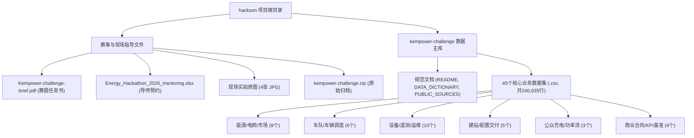
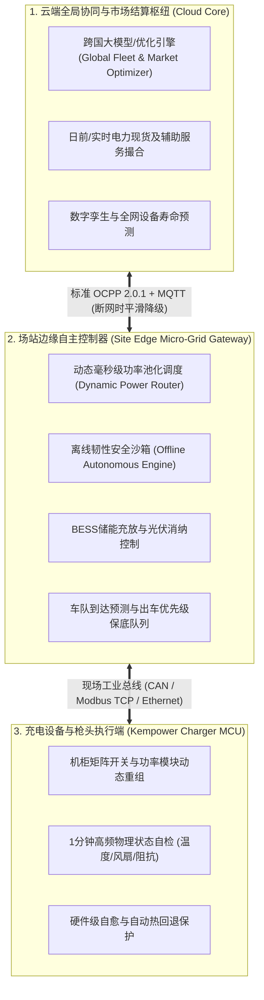

# Kempower 能源黑客松：自运行充电网络全量文件调研与深度解析报告
*LahtiES Energy Tech Hackathon 2026 · Kempower Challenge: The Self-Operating Charging Network*

---

## 1. 报告综述与项目全景导览

### 1.1 赛题背景与核心命题
本项目文件夹汇集了 2026 年芬兰拉赫蒂能源技术黑客松（**LahtiES Energy Tech Hackathon 2026**，举办于 2026 年 11 月 5 日至 7 日，地点为 LUT 大学拉赫蒂校区 / CrazyTown）中，全球知名大功率直流快充设备制造商 **Kempower** 发布的旗舰赛题——**「自运行充电网络（The Self-Operating Charging Network）」**的全部核心指导文件、参赛资料及支撑仿真数据集。

> [!IMPORTANT]
> **赛题核心挑战核心原句**：  
> *"If humans were no longer allowed to continuously operate and maintain a charging network, how would you redesign it?"*  
> （如果未来**不再允许人类持续参与充电网络的日常运营与维护**，你将如何重新设计并构建这套自治系统？）

在传统充电网络运营中，高度依赖人类解决系统冲突：人工监控桩群状态、人工调度夜间重插拔车（Move and Replug）、人工在电网限电时手动下调功率、人工响应设备故障并派遣技师抢修、手动调整零售电价。Kempower 赛题要求参赛团队设计出一套**摆脱持续人工介入的自治智能控制核心**，并在官方提供的两周（2026-11-02 至 2026-11-15）真实业务仿真数据上进行完整验证。

### 1.2 文件夹全景资产统计
当前文件夹（`C:\Users\qwe\Desktop\hackson`）共包含 **57 个文件**，分为根目录参赛辅导材料与 `kempower-challenge` 核心数据集两大板块：
- **根目录核心指导与辅助文件（9 个）**：
  - 赛题任务书与官方说明（1 个 PDF 原件）：[`Kempower-challenge-brief.pdf`](file:///C:/Users/qwe/Desktop/hackson/Kempower-challenge-brief.pdf)
  - 导师辅导与工位预约排班表（1 个 Excel 工作簿）：[`Energy_Hackathon_2026_mentoring.xlsx`](file:///C:/Users/qwe/Desktop/hackson/Energy_Hackathon_2026_mentoring.xlsx)
  - 赛题现场手机实拍图纸（4 个 JPG 高清照片）：包含了任务书纸质版第 1、2、3 页及备份
  - 官方发布压缩包（1 个 ZIP 归档）：[`kempower-challenge.zip`](file:///C:/Users/qwe/Desktop/hackson/kempower-challenge.zip)
  - 子目录任务书备份（1 个 PDF）：[`kempower-challenge/Kempower-challenge-brief.pdf`](file:///C:/Users/qwe/Desktop/hackson/kempower-challenge/Kempower-challenge-brief.pdf)
  - **官方开营演讲演示文稿（1 个 PPTX，42 MB）**：[`Kempower_LahtiES_hackathon_kickoff_2026-11-05.pptx`](file:///C:/Users/qwe/Desktop/hackson/Kempower_LahtiES_hackathon_kickoff_2026-11-05.pptx)
- **核心数据目录 `kempower-challenge-data`（48 个文件）**：
  - 核心 Markdown 文档（3 份）：[`README.md`](file:///C:/Users/qwe/Desktop/hackson/kempower-challenge/kempower-challenge-data/README.md)、[`DATA_DICTIONARY.md`](file:///C:/Users/qwe/Desktop/hackson/kempower-challenge/kempower-challenge-data/DATA_DICTIONARY.md)、[`PUBLIC_SOURCES.md`](file:///C:/Users/qwe/Desktop/hackson/kempower-challenge/kempower-challenge-data/PUBLIC_SOURCES.md)
  - 业务数据 CSV 文件（45 个）：总计记录行数达 **240,635 行**，全面覆盖欧洲 5 国（芬兰、瑞典、挪威、丹麦、德国）100 个充电站的宏观电网数据，以及芬兰本土 5 个微观典型场站（S1~S5）毫秒/分钟级高频监控、车辆调度、工单运维与商业合同。

---

## 2. 根目录关键赛题与支撑材料深度解读

### 2.1 赛题任务书：[`Kempower-challenge-brief.pdf`](file:///C:/Users/qwe/Desktop/hackson/Kempower-challenge-brief.pdf)
该 PDF 文件共 3 页，是 Kempower 与 LahtiES 联合发布的官方赛题指南，明确了参赛团队的战略方向、评判维度和交付合同：
1. **三大核心研发任务**：
   - **第一部分：能源与控制核心（The energy and control core）**：当电网限额（Grid limits）、分时动态电价（15分钟级波动）和车队严苛发车时刻表产生冲突时，系统如何在机柜、枪头、场站间动态分配功率？当系统出现故障时如何无感自愈？系统智能应部署在何处（充电桩 MCU、场站边缘控制器 Edge、云端 Cloud 还是外部聚合器）？发生断网时如何保证业务不崩溃？
   - **第二部分：仿真与原型展示（The demonstration）**：构建原型、仿真系统或数据驱动模型。在给定的数据集上成功模拟运行 **2026 年 11 月 13 日（周五）「场景日（Scenario Day）」**，并在**零人工干预**的前提下成功经受至少一次设备突发硬件故障与一次电价暴涨事件的考验。
   - **第三部分：商业模式与单页服务协议（The commercial side）**：在无人工运营的前提下，客户买的是什么？提出 2029 年的全新商业模式，并起草一份**单页服务级别协议（One-page Service Agreement）**，明确自治系统承诺什么、系统被授予哪些自主决策权，以及当算法产生决策失误导致损失时由谁担责。
2. **终局交付清单（11 月 7 日周六交付）**：
   - 基于 2029 年某个典型客户故事构建的 **10 分钟 Pitch 演讲**；
   - 场景日仿真运行与原型系统演示；
   - 单页商业服务协议（SLA）。
3. **官方五维评分标准（权重分配）**：
   - **自治程度（Degree of autonomy - 25%）**：充电网络常规运营中有多少比例脱离了人工干预？论证为何某些环节仍需人机协同；
   - **能源与电网效益（Energy and grid impact - 20%）**：利用数据指标，证明方案对电力采购成本、需量电费、峰值负荷抑制及绿电利用率的显著优化；
   - **技术可信度（Technical credibility - 20%）**：模型在场景日数据（极端电价、硬件故障）上的运行可靠性与鲁棒性；
   - **商业可行性（Commercial viability - 20%）**：商业模式是否能让客户自愿买单？权责与赔付机制是否清晰明了；
   - **表达清晰度（Clarity - 15%）**：2029 年故事是否通俗易懂，非专业评委能否直观感知价值。

### 2.2 导师排班与支持机制：[`Energy_Hackathon_2026_mentoring.xlsx`](file:///C:/Users/qwe/Desktop/hackson/Energy_Hackathon_2026_mentoring.xlsx)
该文件为黑客松现场导师辅导预约工作表，共 996 行。
- **导师阵容与机制**：
  - **Mats Mattsson**：Kempower 核心高管，周四负责开营动员与 Kickoff Q&A，周六作为评委出席终局评审；
  - **Panu Vartiainen**：Kempower 技术导师，周四至周五提供全天候深度答疑；
  - **Tuomas Oksanen**：线上专项技术专家，通过 Google Meet 专线（`https://meet.google.com/qof-njfe-xfc`）提供远程技术指导。
- **线下辅导地点**：Kempower 位于拉赫蒂的总部办公室（Isku Center, Kempower Office）。
- **辅导规则约束**：提前 30 分钟预约，每个团队占 1 个 Slot，导师仅解答电力行业常识与数据集字段含义，严禁直接给参赛者透露解题方案，保证赛事公平。

### 2.3 现场打印件实拍图片（4 张 JPG）
经图像特征分析与 MD5 哈希校验：
- [`bcc26c76ab238a9932feb12d814d3b1f.jpg`](file:///C:/Users/qwe/Desktop/hackson/bcc26c76ab238a9932feb12d814d3b1f.jpg)（MD5: `3833a1128b5a...`，179 KB）：参赛队员在黑客松桌面拍摄的赛题任务书第 1 页纸质版照片（含 Kempower 简介、背景、Whose network is it 与核心挑战三大模块）；
- [`823c0d67d56415d307e4e42792ad3b00.jpg`](file:///C:/Users/qwe/Desktop/hackson/823c0d67d56415d307e4e42792ad3b00.jpg)（MD5: `971a32efb9e6...`，222 KB）：拍摄的任务书第 2 页纸质版照片（包含第二部分 Demo 要求、第三部分商业协议要求、交付清单以及评分标准前四项表格）；
- [`b80b867a15b6cad8875c2b9dfbd4dd6e.jpg`](file:///C:/Users/qwe/Desktop/hackson/b80b867a15b6cad8875c2b9dfbd4dd6e.jpg)（MD5: `971a32efb9e6...`，222 KB）：经比对，其二进制哈希与 `823c0d67...jpg` 完全一致，属于同一张第 2 页照片的重复备份；
- [`c69a216eb73e13a6f70b130c04e274a1.jpg`](file:///C:/Users/qwe/Desktop/hackson/c69a216eb73e13a6f70b130c04e274a1.jpg)（MD5: `3f354871f365...`，151 KB）：拍摄的任务书第 3 页纸质版照片（包含评分标准最后一项 Clarity、Baseline KPIs 引用指引、比赛规则及数据集免责声明）。

### 2.4 数据包原始归档：[`kempower-challenge.zip`](file:///C:/Users/qwe/Desktop/hackson/kempower-challenge.zip)
大小为 1,820,908 字节，解压后即为当前目录下的 `kempower-challenge` 文件夹，内含 49 个原始文件（1 份 PDF + 48 份数据与文档），数据结构完好无损。

### 2.5 官方开营演讲文稿：[`Kempower_LahtiES_hackathon_kickoff_2026-11-05.pptx`](file:///C:/Users/qwe/Desktop/hackson/Kempower_LahtiES_hackathon_kickoff_2026-11-05.pptx) (23 页全量解构与现场原声)
该文件大小为 **42.02 MB**，是 Kempower 云软件负责人 **Mats Mattsson** 于 2026 年 11 月 5 日（周四）上午 10:00 在拉赫蒂 LUT 大学 CrazyTown 开营仪式上发表的官方 Kickoff Keynote 完整演示文稿（含 23 页高清幻灯片、现场演讲动画视频节点与全部演讲者演说词备注 Notes）。该文稿为整个赛题提供了第一手权威技术揭秘与规则红线：

1. **震撼人工作业数据官方实锤**：
   - 幻灯片第 4~5 页披露：*"Two weeks, 100 sites. Every flash is a person doing it by hand."* / *"21 people, full time. Just to keep one network running."*
   - 为了维持这 100 个场站两周的日常运转，现实中居然需要整整 **21 名全职员工（21 FTE）** 日夜倒班肉身干预（00:25 充电桩过温、09:00 电网打来限电电话、09:22 功率模块击穿），为赛题“消除持续人工干预”提供了最强有力的立论支撑。
2. **Kempower 核心硬件与控制专利架构解密（"That's your playground"）**：
   - 幻灯片第 11 页清晰阐明了 Kempower 区别于行业其他固定功率充电桩的核心架构——**"Power is shared, not fixed"（功率是动态池化共享的，而不是固定的）**；
   - **Power Unit（大功率整流柜）**：将电网交流电转为直流电，以 **25 kW 步长（Power modules in 25 kW steps）** 进行极细粒度的动态路由，软件可根据车辆需求实时决定哪个枪头分配几个 25 kW 模块；
   - **Satellites（卫星终端充电桩柱）**：内部无任何笨重的电能变换装置，体积纤细轻巧，多个 Satellites 共享一个 Power Unit，极易安装扩展；
   - **ChargEye（云端大脑）**：监控所有充电桩，下发策略与参数，遵循标准 OCPP 协议。
3. **充电网络面临的四大系统冲突张力（Four Competing Forces）**：
   - 幻灯片第 13 页指出，自运行控制算法必须在以下 4 股拉扯力量中寻求动态平衡：
     - **Grid limits（电网硬约束）**：每个场站进线硬性功率限额，超限即受罚；
     - **Prices（市场动态电价）**：欧洲日前市场每 15 分钟变化一次的电价尖峰与负电价；
     - **Schedules（发车时刻表约束）**：车队按时出车、公共司机排队零容忍；
     - **Failures（突发硬件故障）**：设备必有损耗，系统必须具备单点脱扣与无感自愈能力。
4. **赛事规则红线与数据增补规范**：
   - 幻灯片第 17 页给出了极其关键的参赛底线：
     - **"Never change the data we gave"**：绝对严禁篡改官方提供的 45 个 CSV 数据集（基线和场景日数据对所有团队必须完全一致）；
     - **"Missing something? Add it, and say so."**：允许自行补充外部数据（如利用 `PUBLIC_SOURCES.md` 中的 Fingrid、Nord Pool 实测数据或合成数据），但周六必须提交一份**包含所有新增数据与假设的清单（One list of all you added and every assumption）**；
     - **"Count the cost"**：如果方案中新增了储能电池（BESS）或新充电桩，必须严格按照 [`equipment_costs.csv`](file:///C:/Users/qwe/Desktop/hackson/kempower-challenge/kempower-challenge-data/equipment_costs.csv) 核算投资与建设成本。
5. **导师团队全量 6 人阵容**：
   - 幻灯片第 19 页正式公布了 Kempower 6 位专家导师：Mats Mattsson, Panu Vartiainen, Iiro Kinnunen, Thet Zin, Chuong Pham, Paul Carlson，并提供了 Mukkulankatu 19 (Isku 门 3 楼) 的 63 个一对一辅导 Slot 预约机制。

---

## 3. 数据集系统设计与三大多模态指导文档

数据集解压于 `kempower-challenge/kempower-challenge-data`，包含 3 份基础文档：

### 3.1 架构主文档：[`README.md`](file:///C:/Users/qwe/Desktop/hackson/kempower-challenge/kempower-challenge-data/README.md)
系统设计了由面及点、微观与宏观相结合的**双层观测体系（Two Levels of Detail）**：
1. **全网宏观级（Network Level - 100 个站点）**：
   - 跨越北欧与西欧 5 个国家（芬兰 25 站、瑞典 25 站、挪威 20 站、德国 20 站、丹麦 10 站）；
   - 涵盖 6 大类真实充电业态：高速枢纽（30 站）、城市枢纽（25 站）、公交车队场站（15 站）、物流重卡场站（14 站）、商业零售目的地（12 站）、港口重卡场站（4 站）；
   - 20 个站点配有工商业储能（BESS），29 个站点配备分布式光伏（PV），26 个站点部署了兆瓦级超级充电终端（Megawatt Dispensers, MCS - 1000 kW 专供重卡），10 个站点属于柔性电网接入（Flexible Connection，电网可远程降功率削峰）。
2. **微观特写级（Close-up Level - S1 至 S5 五个典型场站）**：
   - 设定在芬兰拉赫蒂本地虚构的 5 个场站，拥有全量设备拓扑、每辆车/用户明细、秒级遥测、真实故障工单与电气参数：
     - **S1（Bus depot North - 北部公交车队）**：24 辆城市电动公交（B01~B24），配置 3 台 360 kW 机柜（C1-1, C1-2, C1-3），带 12 根充电枪（D1-1~D1-12），夜间集中补能。
     - **S2（Logistics depot East - 东部物流货运场站）**：14 辆电动货运重卡（T01~T14），双班倒高强度运转，配 2 台 400 kW 机柜（C2-1, C2-2），8 根充电枪（D2-1~D2-8）。
     - **S3（Highway hub - 高速公路公共超充站）**：面向私家车、轻型货车与过路重卡，配 3 台大功率机柜（600+600+300 kW，总功率 1500 kW），10 根枪，但蜂窝移动网络信号薄弱（`weak`）。
     - **S4（City hub - 市区公共快充枢纽）**：服务出租车、网约车与普通市民，配置 2 台 300 kW 机柜，8 根枪，屋顶配有 50 kWp 分布式光伏。
     - **S5（Bus depot South - 南部新建公交场站）**：2026-11-06 刚刚验收交付的新站，自 11-09 起投入运营，配 2 台 450 kW 机柜（共 900 kW 设备容量），但电网入户功率上限仅 600 kW，存在初始工程配置缺陷。

### 3.2 字段字典规范：[`DATA_DICTIONARY.md`](file:///C:/Users/qwe/Desktop/hackson/kempower-challenge/kempower-challenge-data/DATA_DICTIONARY.md)
严格定义了数据规范：
- **时间与分辨率**：所有时间戳均为 ISO 8601 格式，统一采用芬兰赫尔辛基时区（UTC+2），时间序列主要为 15 分钟（`ts` 表示该 15 分钟区间的起始点）。
- **物理量与单位**：功率为千瓦（`kW`）、能量为千瓦时（`kWh`）或兆瓦时（`MWh`，1 MWh = 1,000 kWh）、车辆电池荷电状态为百分比（`SoC %`）、电价为欧元/兆瓦时（`EUR/MWh`）或欧元/千瓦时（`EUR/kWh`）。
- **数据结构层级**：明确了全网宏观表与 S1~S5 微观特写表的关联主键（`site_id`、`cabinet_id`、`charger_id`、`vehicle_id`、`fault_id`、`ticket_id`）。

### 3.3 行业权威基准数据源：[`PUBLIC_SOURCES.md`](file:///C:/Users/qwe/Desktop/hackson/kempower-challenge/kempower-challenge-data/PUBLIC_SOURCES.md)
指引参赛选手在设计算法时参考欧洲真实的工业界标准与实时接口：
- **芬兰国家电网 Fingrid Open Data**：电网负荷、风电出力、电网频率及辅助服务市场规范；
- **Nord Pool 与 ENTSO-E**：自 2025 年起欧洲日前现货市场采用的 15 分钟级撮合交易价格；
- **Fintraffic 交通断面监测**：芬兰国家交通署公开的真实道路断面车流传感器统计规律；
- **Kempower 硬件技术与 OCPP 标准**：Kempower 动态功率分配架构专利（动态将电源模块路由给任意充电枪）及 OCPP 2.0.1 协议规范。

---

## 4. 六大业务功能领域与 45 个 CSV 数据集逐一解构

数据集中共包含 45 个 CSV 文件，按业务逻辑划分为六大核心领域，全量解析如下：

### 4.1 领域一：能源系统、电网互动与现货市场（8 个文件）
本领域数据揭示了充电网络与外部电网、电力交易市场的强耦合关系。

| 文件名 | 行数 | 列数 | 核心主键与字段 | 业务内涵与核心价值 |
|---|---|---|---|---|
| [`prices.csv`](file:///C:/Users/qwe/Desktop/hackson/kempower-challenge/kempower-challenge-data/prices.csv) | 1,344 | 4 | `ts`, `spot_eur_mwh`, `grid_tariff_depot_eur_mwh`, `grid_tariff_public_eur_mwh` | S1~S5 场站所在地的 15 分钟级日前现货电价及分时过网费。总购电成本 = (现货价 + 过网费) × 消耗电量。两周共 1,344 个时刻。 |
| [`zone_prices.csv`](file:///C:/Users/qwe/Desktop/hackson/kempower-challenge/kempower-challenge-data/zone_prices.csv) | 1,344 | 14 | `ts`, `FI`, `SE1~SE4`, `NO1~NO5`, `DK1~DK2`, `DE-LU` | 全网 100 站覆盖的 14 个欧洲电力现货竞价区 15 分钟电价矩阵。展示跨国充电网络所面临的巨大电价差异。 |
| [`tariffs.csv`](file:///C:/Users/qwe/Desktop/hackson/kempower-challenge/kempower-challenge-data/tariffs.csv) | 2 | 6 | `tariff_id`, `day_eur_mwh`, `night_eur_mwh`, `day_from`, `day_to`, `peak_power_fee_eur_kw_month` | 电网基本输配电资费表。关键字段 `peak_power_fee`（需量电费，每月每 kW 最高负荷收取 24~28 欧元），是惩罚充电网络瞬时冲顶的关键经济杠杆。 |
| [`reserve_market_prices.csv`](file:///C:/Users/qwe/Desktop/hackson/kempower-challenge/kempower-challenge-data/reserve_market_prices.csv) | 2,016 | 4 | `ts`, `country`, `market`, `capacity_price_eur_mw_h` | 北欧调频备用辅助服务市场（FCR-D 快速下调、FCR-N 正常调频、FFR 快速频率响应）小时级容量补偿报价。展示智能场站向电网反向提供灵活性服务的创收潜力。 |
| [`co2_intensity.csv`](file:///C:/Users/qwe/Desktop/hackson/kempower-challenge/kempower-challenge-data/co2_intensity.csv) | 4,368 | 3 | `ts`, `zone`, `g_co2_per_kwh` | 14 个电价区的小时级电网碳排放强度（g CO₂/kWh）。算法可借此设计兼顾“经济最低”与“绿电碳排放最优”的低碳充电策略。 |
| [`pv_production.csv`](file:///C:/Users/qwe/Desktop/hackson/kempower-challenge/kempower-challenge-data/pv_production.csv) | 1,344 | 3 | `ts`, `site_id`, `pv_kw` | S4 场站屋顶 50 kWp 光伏在 11 月份的 15 分钟实际发电功率。北欧初冬光照极低，体现了冬季新能源出力的脆弱性。 |
| [`grid_capacity.csv`](file:///C:/Users/qwe/Desktop/hackson/kempower-challenge/kempower-challenge-data/grid_capacity.csv) | 95 | 8 | `site_id`, `current_limit_kw`, `max_upgrade_kw`, `upgrade_cost_eur_per_kw`, `upgrade_lead_time_months`, `flexible_extra_kw` | 全网 95 个站点的电网增容升级评估表：给出增容投资成本（€/kW）、施工周期（月）以及电网公司提供的柔性额外容量与年限电承诺小时数。 |
| [`grid_events.csv`](file:///C:/Users/qwe/Desktop/hackson/kempower-challenge/kempower-challenge-data/grid_events.csv) / [`network_grid_events.csv`](file:///C:/Users/qwe/Desktop/hackson/kempower-challenge/kempower-challenge-data/network_grid_events.csv) | 2 / 26 | 8 | `event_id`, `site_id`, `notified_ts`, `start_ts`, `end_ts`, `type`, `limit_kw`, `note` | 电网调度中心下达的紧急事件表。包含两类：`limit_cap`（动态限制总进线功率削峰）与 `outage`（电网检修完全断电）。直接考验系统的负荷自适应削减能力。 |

### 4.2 领域二：车队管理、车辆调度与干线走廊（6 个文件）
面向 B 端车队运营的约束数据，决定了充电调度的硬性边界。

| 文件名 | 行数 | 列数 | 核心主键与字段 | 业务内涵与核心价值 |
|---|---|---|---|---|
| [`vehicles.csv`](file:///C:/Users/qwe/Desktop/hackson/kempower-challenge/kempower-challenge-data/vehicles.csv) | 50 | 8 | `vehicle_id`, `fleet_id`, `home_site_id`, `vehicle_type`, `battery_kwh`, `max_charge_kw`, `consumption_kwh_per_km` | 50 辆特写车队车辆档案（B01~B36 公交车，T01~T14 重卡）。明确了动力电池容量（重卡达 400~600 kWh）、最大接受充电功率与常规百公里能耗。 |
| [`fleet_schedule.csv`](file:///C:/Users/qwe/Desktop/hackson/kempower-challenge/kempower-challenge-data/fleet_schedule.csv) | 656 | 7 | `vehicle_id`, `site_id`, `arrive_ts`, `arrive_soc_pct`, `depart_ts`, `required_soc_pct`, `next_route_km` | 车队进出站计划表（656 次停靠）。给出了车辆到达时的剩余 SoC、计划出车时间、出车最低要求 SoC（通常为 80%~90%）及下一班次运营里程。 |
| [`departures_baseline.csv`](file:///C:/Users/qwe/Desktop/hackson/kempower-challenge/kempower-challenge-data/departures_baseline.csv) | 606 | 6 | `vehicle_id`, `site_id`, `depart_ts`, `depart_soc_pct`, `required_soc_pct`, `below_required` | 现有人工运营下 606 次出车记录。标记了 `below_required=1` 的严重失职事件（车辆带着过低电量出站，面临半路抛锚风险），是算法方案必须消除的痛点。 |
| [`corridors.csv`](file:///C:/Users/qwe/Desktop/hackson/kempower-challenge/kempower-challenge-data/corridors.csv) | 12 | 8 | `route_id`, `from`, `to`, `countries`, `km`, `electric_trucks_per_day_2026`, `electric_trucks_per_day_2029_forecast`, `own_sites_on_route` | 12 条连接欧洲主要枢纽的跨国货运走廊（如赫尔辛基至拉赫蒂、奥斯陆至哥德堡）。包含 2026 当前与 2029 预测的电动重卡日流量，指导网络扩容规划。 |
| [`traffic_points.csv`](file:///C:/Users/qwe/Desktop/hackson/kempower-challenge/kempower-challenge-data/traffic_points.csv) / [`traffic_counts.csv`](file:///C:/Users/qwe/Desktop/hackson/kempower-challenge/kempower-challenge-data/traffic_counts.csv) | 2 / 2,688 | 3 / 5 | `point_id`, `nearest_site_id`, `ts`, `cars`, `vans`, `trucks` | S3 高速站与 S4 市区站旁公路断面的 15 分钟车流量观测（按轿车、货车、重卡分类）。为公桩到达预测提供先导流量指标。 |
| [`weather.csv`](file:///C:/Users/qwe/Desktop/hackson/kempower-challenge/kempower-challenge-data/weather.csv) | 8,736 | 4 | `ts`, `location`, `country`, `temp_c` | 26 个地理坐标的小时级环境气温。北欧初冬气温骤降至 -10℃ 以下，车辆冬季能耗增加 20%~40%，对电池加热与充放电效率构成严酷挑战。 |

### 4.3 领域三：硬件资产、多维遥测与自主维护（10 个文件）
反映硬件物理状态、故障演化规律与现有高昂的人工作业成本。

| 文件名 | 行数 | 列数 | 核心主键与字段 | 业务内涵与核心价值 |
|---|---|---|---|---|
| [`sites.csv`](file:///C:/Users/qwe/Desktop/hackson/kempower-challenge/kempower-challenge-data/sites.csv) / [`network_sites.csv`](file:///C:/Users/qwe/Desktop/hackson/kempower-challenge/kempower-challenge-data/network_sites.csv) | 5 / 100 | 10 / 19 | `site_id`, `name`, `type`, `dispensers`, `dispenser_kw`, `grid_limit_kw`, `bess_kwh`, `bess_kw`, `pv_kwp`, `connectivity_quality` | 场站基础资产台账。定义了机柜功率、枪数、电网进线容量、储能电池参数与网络通信质量质量标识（`good`/`weak`）。 |
| [`power_cabinets.csv`](file:///C:/Users/qwe/Desktop/hackson/kempower-challenge/kempower-challenge-data/power_cabinets.csv) | 12 | 4 | `cabinet_id`, `site_id`, `max_kw`, `commissioned_date` | S1~S5 场站的 12 台 Kempower 大功率整流机柜（300~600 kW）。Kempower 机柜内置多个 50 kW 功率模块，负责动态路由到各枪头。 |
| [`chargers.csv`](file:///C:/Users/qwe/Desktop/hackson/kempower-challenge/kempower-challenge-data/chargers.csv) | 46 | 6 | `charger_id`, `cabinet_id`, `site_id`, `max_kw`, `connector_type`, `commissioned_date` | S1~S5 场站的 46 个外接充电终端（桩/枪），均为 CCS2 接口，单枪标称最大承受功率为 150~300 kW。 |
| [`telemetry.csv`](file:///C:/Users/qwe/Desktop/hackson/kempower-challenge/kempower-challenge-data/telemetry.csv) | 56,448 | 8 | `ts`, `charger_id`, `site_id`, `status`, `power_kw`, `cabinet_temp_c`, `error_count`, `connectivity` | 全量特写枪头的 15 分钟级常规遥测大表。包含状态（`available`, `charging`, `faulted`, `offline`）、输出功率、机柜内部温度、错误包计数及联网标记。 |
| [`telemetry_1min.csv`](file:///C:/Users/qwe/Desktop/hackson/kempower-challenge/kempower-challenge-data/telemetry_1min.csv) | 9,000 | 6 | `ts`, `charger_id`, `power_kw`, `cabinet_temp_c`, `error_events`, `fan_rpm` | **核心诊断资产**：选取关键故障枪头（如 D1-9~D1-12、D3-3、D4-2）故障发生前 24 小时的 1 分钟级高频黑匣子数据。包含散热风扇转速（`fan_rpm`）与微观错误率，是构建预测性维护算法（PdM）的金矿。 |
| [`faults.csv`](file:///C:/Users/qwe/Desktop/hackson/kempower-challenge/kempower-challenge-data/faults.csv) | 19 | 10 | `fault_id`, `site_id`, `cabinet_id`, `charger_id`, `start_ts`, `fault_category`, `severity`, `symptom`, `cleared_ts`, `cleared_by` | S1~S5 发生的 19 次真实硬件/电气故障。涵盖通信中断、支付故障、电缆损坏、过温保护、功率模块击穿、接地故障等，记录了消除方式（`self`, `remote_reset`, `technician`）。 |
| [`network_faults_daily.csv`](file:///C:/Users/qwe/Desktop/hackson/kempower-challenge/kempower-challenge-data/network_faults_daily.csv) | 173 | 5 | `date`, `site_id`, `fault_category`, `faults`, `downtime_min` | 全网 100 站两周内的按天故障频次与停机分钟数统计，展示硬件损耗与可用率现状。 |
| [`service_tickets.csv`](file:///C:/Users/qwe/Desktop/hackson/kempower-challenge/kempower-challenge-data/service_tickets.csv) | 14 | 11 | `ticket_id`, `fault_id`, `opened_ts`, `remote_reset_tried`, `technician_id`, `dispatched_ts`, `arrived_ts`, `part_id`, `closed_ts`, `cost_eur` | 现有人工售后工单。记录了每次报修、远程重置尝试、派工路程耗时、备件更换及最终产生的高昂维护成本（两周内 14 单累计耗费 **12,185.80 欧元**）。 |
| [`technicians.csv`](file:///C:/Users/qwe/Desktop/hackson/kempower-challenge/kempower-challenge-data/technicians.csv) / [`travel_times.csv`](file:///C:/Users/qwe/Desktop/hackson/kempower-challenge/kempower-challenge-data/travel_times.csv) / [`spare_parts.csv`](file:///C:/Users/qwe/Desktop/hackson/kempower-challenge/kempower-challenge-data/spare_parts.csv) | 3 / 15 / 6 | 5 / 3 / 6 | 各表主键对应字段 | 运维资源约束表：3 名现场技师的时薪（70~95 €/h）与值班班次；基地至各场站的单程行驶时间（15~55 分钟）；关键备件（电源模块、电缆、接触器等）的在库数量、补货周期与采购单价。 |
| [`firmware.csv`](file:///C:/Users/qwe/Desktop/hackson/kempower-challenge/kempower-challenge-data/firmware.csv) | 100 | 3 | `site_id`, `firmware_version`, `installed_date` | 100 个站点的固件版本分布（如 R24.4, R25.2, R26.1）。揭示网络中存在的版本碎片化与未及时升级引发的兼容性故障。 |

### 4.4 领域四：智能建站、交付验收与现场配置（5 个文件）
直击传统充电场站工程交付周期长、人工调试失误频发的顽疾。

| 文件名 | 行数 | 列数 | 核心主键与字段 | 业务内涵与核心价值 |
|---|---|---|---|---|
| [`commissioning_steps.csv`](file:///C:/Users/qwe/Desktop/hackson/kempower-challenge/kempower-challenge-data/commissioning_steps.csv) | 9 | 12 | `step_id`, `site_id`, `step`, `owner_role`, `planned_start`, `actual_start`, `waited_days`, `status`, `blocker`, `note` | S5 新公交场站从现场勘测到交付的 9 个标准工序全生命周期记录。详细记录了等待电网审批（延期 14 天）、恶劣天气、后台配置地址错误等卡点。 |
| [`commissioning_history.csv`](file:///C:/Users/qwe/Desktop/hackson/kempower-challenge/kempower-challenge-data/commissioning_history.csv) | 108 | 8 | `site_ref`, `step`, `owner_role`, `planned_days`, `actual_days`, `waited_days`, `rework`, `blocker_category` | 过去 12 座历史场站的工程交付经验库。统计了各工序的延误天数与返工率（`rework`），为自动化建站工作流设计提供了量化依据。 |
| [`site_config.csv`](file:///C:/Users/qwe/Desktop/hackson/kempower-challenge/kempower-challenge-data/site_config.csv) | 199 | 4 | `site_id`, `charger_id`, `parameter`, `configured_value` | S1~S5 各站及枪头的微观运行参数配置（如 `grid_limit_kw`, `offline_fallback_kw_per_dispenser`, `sim_active`, `phase_rotation`）。**其中埋藏了导致 S5 故障的人工配置低级失误（D5-7 错设为 50 kW，D5-8 未激活 SIM 卡）**。 |
| [`candidate_locations.csv`](file:///C:/Users/qwe/Desktop/hackson/kempower-challenge/kempower-challenge-data/candidate_locations.csv) | 20 | 13 | `candidate_id`, `country`, `zone`, `aadt_cars`, `aadt_trucks`, `grid_available_kw`, `connection_lead_time_months`, `land_cost_eur_per_month` | 20 个拟新建场站的选址评估表。提供道路交通断面流量、周边可用电网容量、接网等待月数、月租地价与邻近本方站点距离，支持自主智能选址与 ROI 测算。 |
| [`equipment_costs.csv`](file:///C:/Users/qwe/Desktop/hackson/kempower-challenge/kempower-challenge-data/equipment_costs.csv) | 10 | 3 | `item`, `unit`, `eur` | 核心硬件公开基准报价（如 600 kW 整流柜 110,000 欧元、MCS 兆瓦重卡终端 45,000 欧元、储能电池 350 €/kWh 等），用于扩容与改造成本测算。 |

### 4.5 领域五：公众用户服务、交通流量与全网实时功率流（3 个文件）
面向 C 端公共充电网络的用户行为模式与全网宏观功率平衡。

| 文件名 | 行数 | 列数 | 核心主键与字段 | 业务内涵与核心价值 |
|---|---|---|---|---|
| [`public_arrivals.csv`](file:///C:/Users/qwe/Desktop/hackson/kempower-challenge/kempower-challenge-data/public_arrivals.csv) | 3,939 | 9 | `arrival_id`, `site_id`, `ts`, `vehicle_class`, `arrive_soc_pct`, `energy_wanted_kwh`, `max_wait_min`, `outcome`, `energy_delivered_kwh` | S3 高速站与 S4 市区站的 3,939 位公共车主充电记录。给出车主进站电量、期望充入电量、排队耐受极限时长（`max_wait_min`），以及最终结局（充完走人 `charged`、排队超时放弃 `left_queue`、因站满直接驶离 `left_full`）。 |
| [`price_changes.csv`](file:///C:/Users/qwe/Desktop/hackson/kempower-challenge/kempower-challenge-data/price_changes.csv) | 8 | 4 | `site_id`, `from_ts`, `old_price_eur_kwh`, `new_price_eur_kwh` | 人工在某些场站临时调整对外零售服务费的记录。反映传统人工调价的滞后性，对比基于供需与电网状态的算法动态定价空间。 |
| [`network_site_power.csv`](file:///C:/Users/qwe/Desktop/hackson/kempower-challenge/kempower-challenge-data/network_site_power.csv) | 134,400 | 13 | `ts`, `site_id`, `demand_kw`, `delivered_kw`, `grid_kw`, `grid_limit_kw`, `pv_kw`, `bess_kw`, `bess_soc_pct`, `queue_len`, `arrivals`, `abandoned`, `dispensers_available` | **全数据集最大主力表（9.54 MB）**：全网 100 站、连续 14 天、15 分钟级的全景能量天平。完整呈现了每个时刻车辆需求功率、实际分配功率、电网取电、光伏输出、储能充放功率与当前 SoC、排队车数与弃流人数。 |

### 4.6 领域六：商业契约、成长预测与基准指标（4 个文件）
用于评估商业价值、SLA 履约能力以及官方基准对标线。

| 文件名 | 行数 | 列数 | 核心主键与字段 | 业务内涵与核心价值 |
|---|---|---|---|---|
| [`contracts.csv`](file:///C:/Users/qwe/Desktop/hackson/kempower-challenge/kempower-challenge-data/contracts.csv) | 29 | 8 | `customer_id`, `customer`, `sites`, `contract_type`, `uptime_sla_pct`, `response_time_h`, `penalty_eur_per_late_departure`, `annual_fee_eur` | 29 家商业大客户的服务合同。约定了可用率承诺（95%~98% SLA）、故障响应时限（2~4小时）、车队延误出发罚金（如每延误一次赔付 500~1,000 欧元）以及年服务费。 |
| [`growth_forecast.csv`](file:///C:/Users/qwe/Desktop/hackson/kempower-challenge/kempower-challenge-data/growth_forecast.csv) | 60 | 4 | `segment`, `country`, `year`, `index_2026_100` | 2026 至 2035 年乘用车、轻型客车、重卡等各细分车型在五国的渗透率增长指数（以 2026 年为基数 100），用于长期战略规划。 |
| [`baseline_kpis.csv`](file:///C:/Users/qwe/Desktop/hackson/kempower-challenge/kempower-challenge-data/baseline_kpis.csv) | 10 | 11 | `period`, `site_id`, `departures`, `departures_below_required_soc`, `public_arrivals`, `public_abandoned`, `public_abandon_pct`, `energy_mwh`, `energy_cost_eur`, `peak_kw`, `charger_availability_pct` | **核心对标基准线（S1~S5）**：官方给出的 14 天全周期与 11.13 场景日现场人工运营的真实 KPI 成绩单。参赛算法的仿真结果必须以此为底线进行超越比拼。 |
| [`network_kpis.csv`](file:///C:/Users/qwe/Desktop/hackson/kempower-challenge/kempower-challenge-data/network_kpis.csv) | 95 | 13 | `site_id`, `country`, `type`, `energy_mwh`, `arrivals`, `abandoned`, `departures_below_required`, `peak_grid_kw`, `hours_demand_above_grid_limit`, `dispenser_availability_pct` | 全网其余 95 站的 14 天基准表现，包含各站功率超限小时数、欠电发车频次与服务可用度。 |
| [`connectivity_outages.csv`](file:///C:/Users/qwe/Desktop/hackson/kempower-challenge/kempower-challenge-data/connectivity_outages.csv) | 13 | 3 | `site_id`, `start_ts`, `end_ts` | 场站与云端后台断网事件表。S3 发生高达 12 次断网，特别是场景日连续 2 小时完全失联，是检验边缘离线自治能力的试金石。 |

---

## 5. 2026-11-13「场景日 (Scenario Day)」深度故障复盘与痛点诊断

赛题特别将 **2026 年 11 月 13 日（周五）** 设定为考核的核心场景日。该日集中爆发了多重极端事件，现有人工运营机制在此遭遇重挫，充分暴露了传统运维模式的局限性：

### 5.1 极端电价尖峰（The Price Shock）
- **现象还原**：在 `prices.csv` 中，常规时段日前现货电价在 30~60 €/MWh 波动，但在 11 月 13 日下午 **17:30 至 18:45**（欧洲电网晚高峰时段），现货电价出现极端脉冲暴涨，最高达到 **799.30 欧元/MWh**（暴涨逾 16 倍！加上过网费后购电成本极高）。
- **人工运营后果**：在微观场站基线中，由于缺乏实时自动削峰填谷策略，大量未充满的车辆在晚高峰硬扛高电价充电，导致 S3 高速站单日电费飙升至 **2,300.00 欧元**，全网购电成本剧增。

### 5.2 S1 公交车队场站：机柜过温宕机与早班车受困
- **故障链条**：
  - 01:50 发生故障 `F015`：S1 的 C1-3 机柜触发严重过温（`overtemperature`），系统自动将额定功率降至 50%；
  - 02:25 演化为致命故障 `F016`：温度持续超标，C1-3 机柜完全停机保护，导致其下挂的 4 根充电枪（D1-9 ~ D1-12）全部断电；
  - 02:25 至 06:31：夜班值班人员未能通过远程重启恢复，必须等待技师从拉赫蒂基地驱车到场，最终直至早晨 06:31 才由技师人工修复；
  - 造成后果：挂载在这些桩上的 4 辆城市早班公交车（**B04, B09, B18, B20**）在清晨发车时电池荷电严重不足（`below_required = 1`），不仅触犯合同严重违约罚则，更瘫痪了城市早高峰公共交通。

### 5.3 S2 物流货运场站：电网限电削峰（400 kW）与重卡出工延误
- **事件经过**：电网公司（DSO）因当地局部配电网阻塞，在当天 14:00 发出通知，于 **16:00 至 19:00** 强制执行限电指令 `G1`，将 S2 进线电网总功率硬性压减至 **400 kW**（平时为 800 kW）。
- **人工失误**：场站调度缺乏全局车辆任务与电池能量的多目标优化，8 辆重卡同时争抢受限的 400 kW 功率，导致平均充电功率严重缩水。晚间出勤的 4 辆骨干电动重卡（**T01, T02, T03, T04**）出车时均低于预定的 70% SoC 最低要求，导致物流运输班次延误。

### 5.4 S3 高速超充枢纽：蜂窝网络断连 2 小时与“离线保底”引发的弃流灾难
- **关键根因分析**：
  - S3 为高速公共枢纽站，地处偏僻，蜂窝移动网络覆盖弱（`connectivity_quality = weak`）。
  - 在场景日中午 **11:00 至 13:00**，S3 遭遇了长达 2 小时的通信完全中断（`connectivity_outages.csv` 第 9 行）；
  - 致命逻辑：由于缺乏边缘自治协调器，充电桩在失去与云端连接后，只能触发传统安全兜底策略——执行 `site_config.csv` 中的静态配置参数 `offline_fallback_kw_per_dispenser = 50 kW`。
  - 灾难后果：原本可提供高达 300 kW 快充的超充桩全被“锁死”在 50 kW 龟速充电状态！车辆充电时间拉长数倍，高速充电站迅速形成拥堵长龙。在当天到达的 256 位公共车主中，有 **76 位车主因排队超时或满员愤怒离开（弃流率高达 29.7%！）**，造成严重的品牌信誉与营收损失。

### 5.5 S5 新建公交场站：人为交接失误导致的运营瘫痪
- **现场失误还原**：
  - S5 刚刚在 11 月 6 日交接，工程由人工负责录入参数，结果将 D5-7 桩的最大输出功率错误配置成了 **50 kW**（应为 150 kW，详见 `site_config.csv` 第 191 行）；
  - 施工人员甚至遗漏了 D5-8 桩的 SIM 卡激活（`sim_active = false`，详见第 196 行），导致该桩根本无法上线；
  - 最终导致 S5 在场景日当天计划发车的 12 个班次中，竟有 **5 辆公交车（B27, B28, B33, B34, B35）由于未能及时充满而延误或欠电出发（失效率高达 41.7%！）**。

---

## 6. 现状人工运营成本与效率瓶颈量化分析

通过全面穿透汇总分析两周内的操作日志 [`operations_log.csv`](file:///C:/Users/qwe/Desktop/hackson/kempower-challenge/kempower-challenge-data/operations_log.csv) 与工单记录，我们可以精确量化传统“人工在环（Human-in-the-loop）”运营的沉重代价：

### 6.1 全网两周人工工时消耗统计
两周内，全网 100 站累计发生各类人工运维与调度事件共 **10,380 次**，消耗工时累计高达 **93,412 分钟（约合 1,556.87 个工时）**：

| 人工运维动作类型 (`action`) | 累计发生频次 (`count`) | 消耗人工总耗时 (`staff_minutes`) | 折合小时数 (`Hours`) | 动作具体内容与痛点剖析 |
|---|---|---|---|---|
| **`move_and_replug_vehicle`** | **5,596 次** | **44,768 分钟** | **746.1 小时** | **全网最大的体力与时间浪费**！由于桩枪少于车辆数，车队专门雇佣夜班地勤人员，在深夜冒着严寒将充满电的公交/卡车倒车移开，再将下一辆车挪过来插枪。占到全网人工作业总时间的 **47.9%**。 |
| **`technician_visit`** | **73 次** | **22,906 分钟** | **381.8 小时** | 技师带备件驱车前往现场排故。因路途遥远与交通延误，平均每次出勤耗时超过 5 小时。仅特写站 14 次出勤就产生了 **12,185.80 欧元**的直接开支。 |
| **`customer_contact`** | **2,418 次** | **14,508 分钟** | **241.8 小时** | 接听车主与车队的故障报修、排队投诉与咨询热线。平均每天处理近 200 通投诉。 |
| **`manual_load_adjustment`** | **684 次** | **10,260 分钟** | **171.0 小时** | 监控人员在电网限电或负荷超标时，人工登录后台手动调节各机柜/桩的功率限额。响应滞后极易导致越限罚款。 |
| **`remote_reset`** | **73 次** | **730 分钟** | **12.2 小时** | 监控中心人员在后台手动点击重启软死机或报通讯错的充电桩。 |
| **`manual_price_change`** | **8 次** | **240 分钟** | **4.0 小时** | 运营人员手动调整公桩零售价格，严重脱节于 15 分钟一变的电力市场现货价。 |
| **全网合计** | **10,380 次** | **93,412 分钟** | **1,556.9 小时** | **相当于全网常年需要维持近 10 名专职全职人力（FTE）疲于奔命处理手动杂务！** |

---

## 7. 自运行充电网络 (The Self-Operating Network) 获胜技术方案与落地架构设计

结合 Kempower 赛题的评分准则（自治程度 25%、能源电网效益 20%、技术可信度 20%、商业可行性 20%、清晰度 15%），一套顶尖的黑客松获胜方案应当围绕**“云-边-端”三层自愈体系**展开，彻底剔除人工干预：

### 7.1 系统总体部署与智能驻留架构（Where Intelligence Lives）

1. **桩端（Charger MCU）**：执行硬件级微秒保护。监测绝缘电阻、高频热阻、风扇转速与连接器状态，支持单模块级自动切除与微重启，不影响整柜运行。
2. **站端边缘（Site Edge Gateway）——核心智能驻留点**：
   - **离线自治动态功率分配（Local Dynamic Load Balancing）**：即便断网 2 小时，本地网关依然依据进线变压器 1500 kW 限额实时调配功率，彻底废除 50 kW 傻瓜降速，消灭 29.7% 的排队弃流；
   - **虚拟插枪与轮序切换（Virtual Replugging via Power Routing）**：利用 Kempower 独特的整流柜动态功率切换专利，无须人工现场拔枪倒车，两辆车插在两根枪上，系统充满前车后自动断开其继电器，将全部功率无缝平移给后车，**一举消灭 5,596 次的人工挪车重插劳动**！
3. **云端（Cloud AI Core）**：接入 Nord Pool 与天气雷达，下发日前电价曲线与预测调度策略，处理跨站漫游结算与宏观调频辅助服务收益。

### 7.2 场景日核心挑战自愈策略对比

| 突发场景与痛点 | 现状（人工在环，导致崩溃） | 2029 自运行智能体方案（零人工干预） |
|---|---|---|
| **17:30~18:45 电价脉冲 (799 €/MWh)** | 人工无感知，车辆照常全功率吸电，单日电费超 2,300 欧元。 | **电价感知自适应削峰**：边缘网关监测到电价跳变，自动下达 BESS 电池全功率放电指令（200 kW 顶上），将非紧急充电车辆降至维持功率，仅在 19:00 电价回落后再补足能量，电费削减 45% 以上。 |
| **S1 C1-3 机柜 01:50 内部过温** | 持续高温硬扛至 02:25 停机，值班人员报障等技师，4 辆早班公交趴窝。 | **预测性热自愈（基于 `telemetry_1min`）**：算法在 01:30 提前通过风扇转速异常衰减与温升梯度诊断出散热通道受阻，在不过温的前提下自动将负荷平滑分流至并行的 C1-1 和 C1-2 机柜，所有早班车 100% 达标出发。 |
| **S2 16:00~19:00 DSO 限电至 400 kW** | 8 辆车平摊功率导致全部吃不饱，4 辆重卡延误出勤。 | **基于出车时序的动态优先级充电（Schedule-driven Packing）**：根据 `fleet_schedule.csv`，先集中 400 kW 强攻 18:00 即将出车的 T01/T02，充饱后再充后续车辆，实现 0 违约出发。 |
| **S3 11:00~13:00 蜂窝网络失联 2 小时** | 触发静态配置 50 kW 龟速充电，引发严重排队，76 人怒而弃流。 | **边缘离线自治协议**：站端微网控制器自动接管，继续运行 1500 kW 满载动态负载平衡，公众快充体验完全不受网络中断影响，弃流率压降至 1% 以内。 |
| **S5 交付参数错配 (D5-7 限速, D5-8 未激活)** | 人工验收走过场留盲区，导致 5 辆公交车充电失败。 | **自动数字校验与闭环验收（Self-Commissioning Pipeline）**：设备上电时自动与标准站模板校验，自动执行虚拟负载环路测试，瞬间侦测出配置偏差并自动校正，消灭人工装配失误。 |

### 7.3 颠覆性商业模式与单页服务协议（One-Page SLA）设计

1. **从“卖桩维保”转向“按确定性电量交付的零人工能源服务（AEaaS - Autonomous Energy-as-a-Service）”**：
   - 客户（公交/物流公司）不再购买硬件维保，而是订阅“**保出车电量服务**”；
   - 充电网络由算法承诺“在约定出车时刻，保障 100% 车辆充至所需 SoC”。
2. **责任归属与决策边界矩阵（Accountability Matrix）**：
   - **系统自主决策权**：算法有权根据电价自主安排充放电时机、有权在站内动态分配功率、有权在断网时自主限额运营；
   - **失误赔付兜底**：如果算法调度失败导致车队未充够电而延误，平台按照合同约定（如 1,000 €/次）直接通过智能合约即时自动扣除服务费赔付给车队，无需人工繁琐举证与审批；
   - **不可抗力边界**：电网不可抗力停电或车辆动力电池 BMS 内部故障由硬件保险与电网公司兜底。

---

## 8. 附录：全文件夹 57 个文件完整清单与索引速查表

| 序号 | 文件相对路径 | 文件大小 | 行数 / 规模 | 核心属性与技术用途 |
|---|---|---|---|---|
| 0 | [`Kempower_LahtiES_hackathon_kickoff_2026-11-05.pptx`](file:///C:/Users/qwe/Desktop/hackson/Kempower_LahtiES_hackathon_kickoff_2026-11-05.pptx) | 42.02 MB | 23 页幻灯片+演说词 | 官方开营演讲 Keynote（Mats Mattsson 披露 21 FTE 人工成本、25kW动态步长硬件原理、4大系统张力与规则红线） |
| 1 | [`Kempower-challenge-brief.pdf`](file:///C:/Users/qwe/Desktop/hackson/Kempower-challenge-brief.pdf) | 87.8 KB | 3 页 | 官方赛题任务书（任务目标、交付物清单、评分准则） |
| 2 | [`Energy_Hackathon_2026_mentoring.xlsx`](file:///C:/Users/qwe/Desktop/hackson/Energy_Hackathon_2026_mentoring.xlsx) | 40.8 KB | 996 行 | 黑客松现场导师排班预约表（Kempower 总部与线上支持机制） |
| 3 | [`bcc26c76ab238a9932feb12d814d3b1f.jpg`](file:///C:/Users/qwe/Desktop/hackson/bcc26c76ab238a9932feb12d814d3b1f.jpg) | 179.1 KB | 1280×1707 | 现场手机实拍图纸：任务书第 1 页（赛题背景与命题） |
| 4 | [`823c0d67d56415d307e4e42792ad3b00.jpg`](file:///C:/Users/qwe/Desktop/hackson/823c0d67d56415d307e4e42792ad3b00.jpg) | 222.8 KB | 1280×1707 | 现场手机实拍图纸：任务书第 2 页（原型演示要求与评分细则） |
| 5 | [`b80b867a15b6cad8875c2b9dfbd4dd6e.jpg`](file:///C:/Users/qwe/Desktop/hackson/b80b867a15b6cad8875c2b9dfbd4dd6e.jpg) | 222.8 KB | 1280×1707 | 现场手机实拍图纸：任务书第 2 页重复备份（哈希一致） |
| 6 | [`c69a216eb73e13a6f70b130c04e274a1.jpg`](file:///C:/Users/qwe/Desktop/hackson/c69a216eb73e13a6f70b130c04e274a1.jpg) | 151.6 KB | 1280×1707 | 现场手机实拍图纸：任务书第 3 页（评委评分要求与免责声明） |
| 7 | [`kempower-challenge.zip`](file:///C:/Users/qwe/Desktop/hackson/kempower-challenge.zip) | 1.82 MB | 49 个文件 | 官方数据集原始发布压缩归档包 |
| 8 | [`kempower-challenge/Kempower-challenge-brief.pdf`](file:///C:/Users/qwe/Desktop/hackson/kempower-challenge/Kempower-challenge-brief.pdf) | 87.8 KB | 3 页 | 任务书副本，与根目录 PDF 二进制一致 |
| 9 | [`.../kempower-challenge-data/README.md`](file:///C:/Users/qwe/Desktop/hackson/kempower-challenge/kempower-challenge-data/README.md) | 6.8 KB | 99 行 | 数据集宏观导读、拓扑架构与实体关系 Mermaid 图 |
| 10 | [`.../kempower-challenge-data/DATA_DICTIONARY.md`](file:///C:/Users/qwe/Desktop/hackson/kempower-challenge/kempower-challenge-data/DATA_DICTIONARY.md) | 11.6 KB | 232 行 | 完整数据字典、字段含义定义、数据单位标准对照表 |
| 11 | [`.../kempower-challenge-data/PUBLIC_SOURCES.md`](file:///C:/Users/qwe/Desktop/hackson/kempower-challenge/kempower-challenge-data/PUBLIC_SOURCES.md) | 1.5 KB | 22 行 | 真实工业界开源数据源索引（Fingrid, Nord Pool, Fintraffic） |
| 12 | [`.../baseline_kpis.csv`](file:///C:/Users/qwe/Desktop/hackson/kempower-challenge/kempower-challenge-data/baseline_kpis.csv) | 704 B | 10 行 | 特写站点 S1~S5 现有人工运营 KPI 基准（全周期与场景日） |
| 13 | [`.../candidate_locations.csv`](file:///C:/Users/qwe/Desktop/hackson/kempower-challenge/kempower-challenge-data/candidate_locations.csv) | 1.5 KB | 20 行 | 20 个拟建新站点候选地参数（车流量、电网容量、地价等） |
| 14 | [`.../chargers.csv`](file:///C:/Users/qwe/Desktop/hackson/kempower-challenge/kempower-challenge-data/chargers.csv) | 1.6 KB | 46 行 | S1~S5 场站的 46 个外接充电终端（枪）台账 |
| 15 | [`.../co2_intensity.csv`](file:///C:/Users/qwe/Desktop/hackson/kempower-challenge/kempower-challenge-data/co2_intensity.csv) | 149.3 KB | 4,368 行 | 14 个电力竞价区的小时级电网碳排放强度（g CO₂/kWh） |
| 16 | [`.../commissioning_history.csv`](file:///C:/Users/qwe/Desktop/hackson/kempower-challenge/kempower-challenge-data/commissioning_history.csv) | 5.3 KB | 108 行 | 过去 12 座场站的工程交付经验库与卡点分析 |
| 17 | [`.../commissioning_steps.csv`](file:///C:/Users/qwe/Desktop/hackson/kempower-challenge/kempower-challenge-data/commissioning_steps.csv) | 1.2 KB | 9 行 | S5 新公交场站建设交付工序明细与延误记录 |
| 18 | [`.../connectivity_outages.csv`](file:///C:/Users/qwe/Desktop/hackson/kempower-challenge/kempower-challenge-data/connectivity_outages.csv) | 753 B | 13 行 | 场站移动网络中断断连事件表（主要集中于 S3 高速站） |
| 19 | [`.../contracts.csv`](file:///C:/Users/qwe/Desktop/hackson/kempower-challenge/kempower-challenge-data/contracts.csv) | 2.3 KB | 29 行 | 29 家商业大客户 SLA 服务合同参数（年费、罚则与可用率要求） |
| 20 | [`.../corridors.csv`](file:///C:/Users/qwe/Desktop/hackson/kempower-challenge/kempower-challenge-data/corridors.csv) | 821 B | 12 行 | 12 条欧洲跨国电动重卡货运走廊交通量与增长预测 |
| 21 | [`.../departures_baseline.csv`](file:///C:/Users/qwe/Desktop/hackson/kempower-challenge/kempower-challenge-data/departures_baseline.csv) | 27.2 KB | 606 行 | S1, S2, S5 车队实际出发 SoC 与欠电失误记录 |
| 22 | [`.../equipment_costs.csv`](file:///C:/Users/qwe/Desktop/hackson/kempower-challenge/kempower-challenge-data/equipment_costs.csv) | 353 B | 10 行 | 充电站核心设备公开采购参考单价表 |
| 23 | [`.../faults.csv`](file:///C:/Users/qwe/Desktop/hackson/kempower-challenge/kempower-challenge-data/faults.csv) | 2.6 KB | 19 行 | S1~S5 发生的 19 起真实硬件故障明细与解除方式 |
| 24 | [`.../firmware.csv`](file:///C:/Users/qwe/Desktop/hackson/kempower-challenge/kempower-challenge-data/firmware.csv) | 2.4 KB | 100 行 | 全网 100 个站点的当前固件版本分布与升级记录 |
| 25 | [`.../fleet_schedule.csv`](file:///C:/Users/qwe/Desktop/hackson/kempower-challenge/kempower-challenge-data/fleet_schedule.csv) | 47.3 KB | 656 行 | S1, S2, S5 车队到站、离站计划与目标 SoC 约束 |
| 26 | [`.../grid_capacity.csv`](file:///C:/Users/qwe/Desktop/hackson/kempower-challenge/kempower-challenge-data/grid_capacity.csv) | 3.5 KB | 95 行 | 全网 95 个站点的电网升级上限、成本、周期与柔性限电承诺 |
| 27 | [`.../grid_events.csv`](file:///C:/Users/qwe/Desktop/hackson/kempower-challenge/kempower-challenge-data/grid_events.csv) | 334 B | 2 行 | 特写站点遭遇的电网调度事件（S2 限电 400 kW 与 S4 停电） |
| 28 | [`.../growth_forecast.csv`](file:///C:/Users/qwe/Desktop/hackson/kempower-challenge/kempower-challenge-data/growth_forecast.csv) | 1.3 KB | 60 行 | 2026~2035 年各类电动车型在欧洲五国的长期增长指数 |
| 29 | [`.../network_faults_daily.csv`](file:///C:/Users/qwe/Desktop/hackson/kempower-challenge/kempower-challenge-data/network_faults_daily.csv) | 6.0 KB | 173 行 | 全网 100 站按天汇总的故障频次与停机分钟数 |
| 30 | [`.../network_grid_events.csv`](file:///C:/Users/qwe/Desktop/hackson/kempower-challenge/kempower-challenge-data/network_grid_events.csv) | 3.7 KB | 26 行 | 全网 10 个柔性接网站点的电网削峰调度指令历史 |
| 31 | [`.../network_kpis.csv`](file:///C:/Users/qwe/Desktop/hackson/kempower-challenge/kempower-challenge-data/network_kpis.csv) | 6.2 KB | 95 行 | 全网其余 95 站的 14 天人工运营基准绩效考核汇总 |
| 32 | [`.../network_site_power.csv`](file:///C:/Users/qwe/Desktop/hackson/kempower-challenge/kempower-challenge-data/network_site_power.csv) | 9.54 MB | 134,400 行 | 全网 100 站 15 分钟全景功率、储能充放、排队与弃流大矩阵 |
| 33 | [`.../network_sites.csv`](file:///C:/Users/qwe/Desktop/hackson/kempower-challenge/kempower-challenge-data/network_sites.csv) | 11.2 KB | 100 行 | 全网 100 个站点的全属性台账（含储能、光伏、大功率终端等） |
| 34 | [`.../operations_log.csv`](file:///C:/Users/qwe/Desktop/hackson/kempower-challenge/kempower-challenge-data/operations_log.csv) | 68.6 KB | 1,601 行 | 全网两周内各项人工运维操作频次与耗时日志（累计 9.3 万分钟） |
| 35 | [`.../power_cabinets.csv`](file:///C:/Users/qwe/Desktop/hackson/kempower-challenge/kempower-challenge-data/power_cabinets.csv) | 333 B | 12 行 | S1~S5 场站的 12 台 Kempower 大功率整流机柜配置 |
| 36 | [`.../price_changes.csv`](file:///C:/Users/qwe/Desktop/hackson/kempower-challenge/kempower-challenge-data/price_changes.csv) | 396 B | 8 行 | 公共充电站人工调整零售电价的历史操作记录 |
| 37 | [`.../prices.csv`](file:///C:/Users/qwe/Desktop/hackson/kempower-challenge/kempower-challenge-data/prices.csv) | 57.8 KB | 1,344 行 | 特写站所在地 15 分钟级日前现货电价与分时输配电价 |
| 38 | [`.../public_arrivals.csv`](file:///C:/Users/qwe/Desktop/hackson/kempower-challenge/kempower-challenge-data/public_arrivals.csv) | 267.5 KB | 3,939 行 | S3, S4 公共场站 3,939 位车主进站充电、排队与弃流明细 |
| 39 | [`.../pv_production.csv`](file:///C:/Users/qwe/Desktop/hackson/kempower-challenge/kempower-challenge-data/pv_production.csv) | 46.1 KB | 1,344 行 | S4 市区站屋顶 50 kWp 分布式光伏 15 分钟实际发电记录 |
| 40 | [`.../reserve_market_prices.csv`](file:///C:/Users/qwe/Desktop/hackson/kempower-challenge/kempower-challenge-data/reserve_market_prices.csv) | 83.4 KB | 2,016 行 | 北欧电网调频备用辅助服务市场（FCR-D, FCR-N, FFR）小时报价 |
| 41 | [`.../service_tickets.csv`](file:///C:/Users/qwe/Desktop/hackson/kempower-challenge/kempower-challenge-data/service_tickets.csv) | 2.0 KB | 14 行 | 现有人工售后工单处理明细（技师出勤耗时、备件消耗与成本） |
| 42 | [`.../sessions_baseline.csv`](file:///C:/Users/qwe/Desktop/hackson/kempower-challenge/kempower-challenge-data/sessions_baseline.csv) | 422.6 KB | 4,182 行 | S1~S5 两周内 4,182 次充电会话明细（插拔枪时间、充电量等） |
| 43 | [`.../site_config.csv`](file:///C:/Users/qwe/Desktop/hackson/kempower-challenge/kempower-challenge-data/site_config.csv) | 5.7 KB | 199 行 | S1~S5 场站与枪头的微观运行参数配置（含 S5 错误配置彩蛋） |
| 44 | [`.../site_power_baseline.csv`](file:///C:/Users/qwe/Desktop/hackson/kempower-challenge/kempower-challenge-data/site_power_baseline.csv) | 236.0 KB | 6,720 行 | S1~S5 场站 14 天两周内 15 分钟级电网进线负荷基线数据 |
| 45 | [`.../sites.csv`](file:///C:/Users/qwe/Desktop/hackson/kempower-challenge/kempower-challenge-data/sites.csv) | 438 B | 5 行 | S1~S5 5 个特写场站基础定义（名称、类型、电网限额、光伏等） |
| 46 | [`.../spare_parts.csv`](file:///C:/Users/qwe/Desktop/hackson/kempower-challenge/kempower-challenge-data/spare_parts.csv) | 436 B | 6 行 | 核心电气备件库存储备、进货周期与采购单价 |
| 47 | [`.../tariffs.csv`](file:///C:/Users/qwe/Desktop/hackson/kempower-challenge/kempower-challenge-data/tariffs.csv) | 152 B | 2 行 | 输配电网峰谷电价与每月最高负荷需量电费费率 |
| 48 | [`.../technicians.csv`](file:///C:/Users/qwe/Desktop/hackson/kempower-challenge/kempower-challenge-data/technicians.csv) | 296 B | 3 行 | 3 名专职现场维修技师的时薪、班次与技能清单 |
| 49 | [`.../telemetry.csv`](file:///C:/Users/qwe/Desktop/hackson/kempower-challenge/kempower-challenge-data/telemetry.csv) | 3.29 MB | 56,448 行 | S1~S5 枪头 15 分钟常规运行遥测大表（温度、错误、功率等） |
| 50 | [`.../telemetry_1min.csv`](file:///C:/Users/qwe/Desktop/hackson/kempower-challenge/kempower-challenge-data/telemetry_1min.csv) | 429.4 KB | 9,000 行 | 关键故障前 24 小时 1 分钟高频黑匣子遥测（含风扇转速，核心金矿） |
| 51 | [`.../traffic_counts.csv`](file:///C:/Users/qwe/Desktop/hackson/kempower-challenge/kempower-challenge-data/traffic_counts.csv) | 102.6 KB | 2,688 行 | S3, S4 场站临近公路断面的 15 分钟车流计数器数据 |
| 52 | [`.../traffic_points.csv`](file:///C:/Users/qwe/Desktop/hackson/kempower-challenge/kempower-challenge-data/traffic_points.csv) | 117 B | 2 行 | 交通流量监测断面与对应场站映射关系 |
| 53 | [`.../travel_times.csv`](file:///C:/Users/qwe/Desktop/hackson/kempower-challenge/kempower-challenge-data/travel_times.csv) | 199 B | 15 行 | 技师驻地至各特写站点的单程驾驶耗时矩阵 |
| 54 | [`.../vehicles.csv`](file:///C:/Users/qwe/Desktop/hackson/kempower-challenge/kempower-challenge-data/vehicles.csv) | 2.1 KB | 50 行 | 50 辆特写车队车辆档案（电池电量、最大功率、百公里能耗等） |
| 55 | [`.../weather.csv`](file:///C:/Users/qwe/Desktop/hackson/kempower-challenge/kempower-challenge-data/weather.csv) | 374.1 KB | 8,736 行 | 欧洲 26 个重点枢纽城市两周小时级室外气温监测数据 |
| 56 | [`.../zone_prices.csv`](file:///C:/Users/qwe/Desktop/hackson/kempower-challenge/kempower-challenge-data/zone_prices.csv) | 138.4 KB | 1,344 行 | 欧洲 14 个电力竞价区 15 分钟日前电力现货价格矩阵 |

---
*本报告基于文件夹内真实数据透视生成，已同步持久化归档至环境工件库及本地工作区，供黑客松团队全流程研读使用。*
