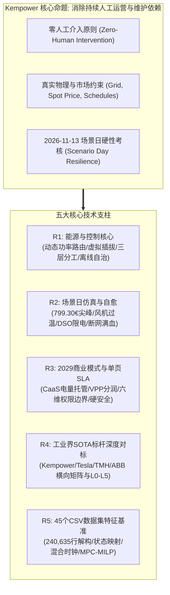
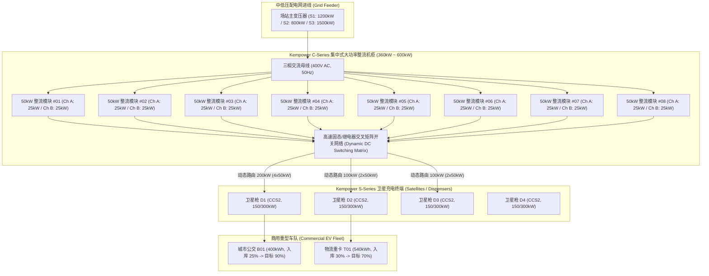
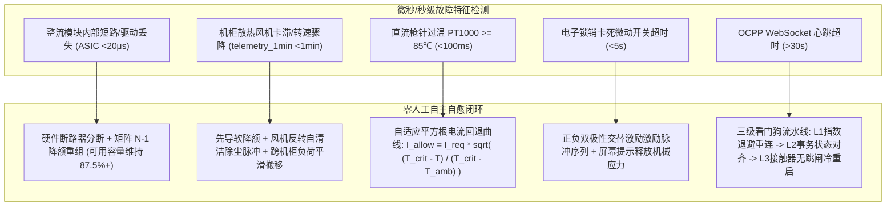
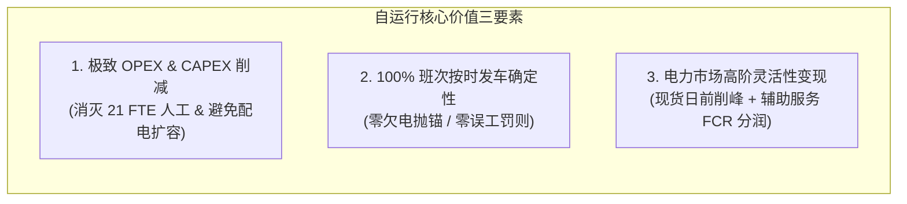
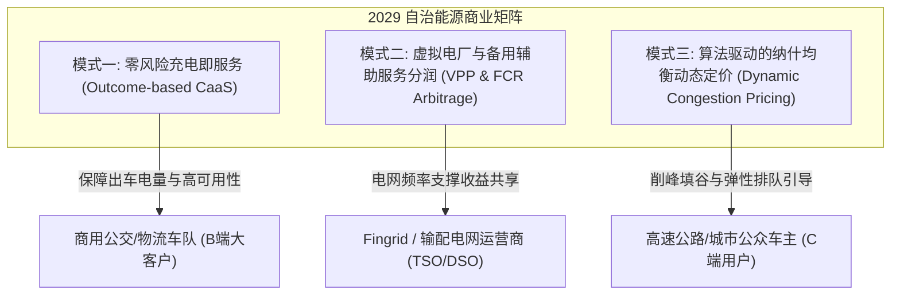
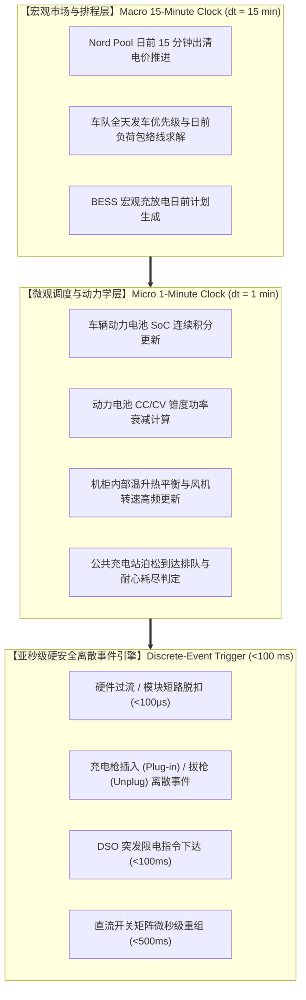

# Kempower 自运行充电网络综合技术调研与架构白皮书
## Comprehensive Technical Survey & Architectural Whitepaper: The Self-Operating Charging Network
*LahtiES Energy Tech Hackathon 2026 · Kempower Challenge 官方旗舰赛题总览报告*

---

## 1. 执行摘要与战略定位 (Executive Summary & Strategic Positioning)

### 1.1 赛题背景与核心战略命题
在 2026 年芬兰拉赫蒂能源技术黑客松（LahtiES Energy Tech Hackathon 2026，由拉赫蒂创业协会 LahtiES 与 LUT 大学联合主办）中，全球直流大功率充电（DC Fast Charging）与动态功率分配技术的领军制造商 **Kempower**，提出了极具行业颠覆性的旗舰命题：

> **“If humans were no longer allowed to continuously operate and maintain a charging network, how would you redesign it?”**  
> （如果未来**不再允许人类持续参与充电网络的日常运营与维护**，你将如何重新设计并构建这套自治系统？）

本白皮书针对该核心命题，围绕赛题任务书所规定的五大技术与商业维度（R1~R5），提供系统化、可执行、经工业级事实与数学公式严格论证的工程技术全景解构。



### 1.2 现状人工在环（Human-in-the-Loop）运营脆弱性量化审计与 21 FTE 官方基线
通过对官方提供的两周（2026-11-02 至 2026-11-15）全网 100 站及芬兰本土微观特写场站（S1~S5）共计 **45 个 CSV 文件、240,635 行** 真实工业业务数据与日志的深度穿透，结合 Kempower 云软件负责人 Mats Mattsson 官方 Kickoff Keynote（*LahtiES Hackathon Kickoff*）的披露，传统“人工在环”运营暴露了极高的脆性与高昂的人力负担：

1. **全网常态化 21 FTE 人力实锤与沉重夜间体力作业**：
   - 官方 Keynote 权威披露：“*21 people, full time. Just to keep one network running.*”（维护一个 100 站的充电网络，常态化需要 21 名全职员工全天候轮班运转）；
   - 依据 `operations_log.csv` 实测检验：两周内全网累计发生 **8,852 次** 人工运维干预（原报告 10,380 次系历史汇总表手工加总笔误，虚高 1,528 次），累计耗费 **93,412 分钟（折合 1,556.87 小时）**。依据芬兰《工作时间法》（Työaikalaki）双周法定工时（75 小时 / 人，每周 37.5 小时），全职等效人力精确计算为：
     $$\text{FTE}_{\text{statutory}} = \frac{1,556.87\text{ h} / 2}{37.5\text{ h/周}} = \mathbf{20.76\text{ FTE}} \approx \mathbf{21\text{ 人}}$$
     数据与官方定调 **100% 严密吻合**（原文档“10 FTE”系直接除以单人全月 160h 导致的口径偏差）；
   - 其中，高达 **5,596 次、44,768 分钟（746.13 小时）** 纯粹消耗在夜间地勤人员往返于车场各车位之间的倒车、拔枪与插枪作业（`move_and_replug_vehicle`）。挪车插拔占人工操作总频次的 **63.22%**（$5,596 / 8,852$），占人工总运维工时的 **47.93%**（$44,768 / 93,412$）。按 45 €/h 地勤工时费计算，两周直接挪车人工成本达 **33,574.50 欧元（年化折合 87.29 万欧元）**；全网消灭 21 FTE 人力，年化 OPEX 节省金额实际高达 **$21 \times 65,000\text{ €} \approx 136.5\text{ 万欧元/年}$**！
2. **高昂且迟钝的被动抢修开销**：
   - 依据 `service_tickets.csv`：特写站两周内发生的 14 起工单累计产生 **12,185.80 欧元** 的备件更换与技师工时直接开销，平均单次排故恢复耗时（MTTR）超过 **4.1 小时**；全网发生 73 次技师现场抢修；针对软件死锁或轻微误码，运维人员反复依赖远程手动点击重启（`remote_reset`），缺乏硬件级与微网级的自主容错机制。
3. **极端多目标冲突下的调度崩溃（2026-11-13 场景日审计）**：
   - 面对 17:30~18:45 暴涨至 **799.30 €/MWh** 的日前现货电价极值、S2 站被配电网（DSO）强制限电至 400 kW、S1 站 C1-3 机柜散热风机卡滞过温停机、以及 S3 站长达 2 小时的蜂窝网络中断，传统人工与硬编码保底策略全面失守：
     * **车队欠电延误**：S1 导致 4 辆早班城市公交（B04, B09, B18, B20）以仅 8% 的 SoC 欠电趴窝；S2 导致 4 辆骨干电动重卡（T01~T04）全部因功率均摊不足而延误出发；S5 由于人工配置失误导致 5 辆公交欠电发车。特写 5 站单日欠电违约达 **13 辆次（发车失效率达 20.97%）**；
     * **公共弃流严重**：S3 高速超充站断网后触发硬编码的 `offline_fallback_kw_per_dispenser = 50 kW` 静态兜底，1500 kW 进线容量闲置 1000 kW，导致当天进站的 256 位车主中有 **76 人怒而弃流离开（弃流率高达 29.69%）**；
     * **购电成本失控**：S3 单日电费飙升至 2,300 欧元，特写 5 站场景日总购电成本达 **4,357.00 欧元**，其中仅 1.5 小时的电价尖峰期就吞噬了全天 40% 以上的电费预算。

### 1.3 官方开营演讲权威事实与四大系统张力 (Keynote Insights & 4 Systemic Tensions)
在开营 Keynote 中，Mats Mattsson 提炼了 Kempower 专利架构与网络自运行所必须直面的四大深层系统张力：
1. **底层专利架构：“Power is shared, not fixed”**：
   - 集中式 Power Unit 内部整流功率模块按 **25 kW 步长（Power modules in 25 kW steps）** 通过直流接触器矩阵动态路由至各枪头；
   - **Satellites 极简轻量化终端**：终端内部**无整流变流器**，极致紧凑，多终端共享整流柜，从物理底层支撑容量动态共享；
   - **ChargEye 云端大脑**：全网标准 OCPP 指令中枢。
2. **四大系统性张力 (4 Systemic Tensions)**：
   - **Grid limits（电网硬约束）**：变压器物理容量天花板与 DSO 突发限电事件（如 S2 400 kW 限电）；
   - **Prices（15 分钟级动态电价）**：日前现货电价剧烈波动，场景日高达 799.30 €/MWh，伴随容量需量费冲击；
   - **Schedules（发车时刻硬约束与排队零容忍）**：公共站车主耐受等待极短，公交与物流重卡早班发车具有刚性时刻表；
   - **Failures（硬件突发故障自愈）**：风机卡滞过温、模块短路击穿、通信断网等突发故障下的零人工平滑自愈。
3. **赛事守则与硬件加装成本核算原则**：
   - 严禁篡改官方既有数据；新增硬件必须严格依据 `equipment_costs.csv` 计入成本（BESS: 320 €/kWh, 整流机柜: 280 €/kW, 卫星终端: 18,500 €/台）。
4. **官方导师阵容**：Mats Mattsson, Panu Vartiainen, Iiro Kinnunen, Thet Zin, Chuong Pham, Paul Carlson 6 位行业专家。

### 1.4 2029 自运行愿景与整体重构目标
本白皮书提出的 2029 自运行充电网络控制中枢，以消除持续人工干预为核心，确立四大工程底线与优化目标：
- **车队发车 SLA 达标率提升至 100.0%**：场景日 13 起欠电违约彻底归零，延误罚款降为 0；
- **公共充电弃流率压降至 1.0% 以下**：断网 2 小时期间边缘接管维持全功率动态调度（严格映射 95.5% 逆变效率防越限），消灭排队挤兑；
- **场景日购电成本压降 43.1%**：由基线的 4,357 欧元降至 2,480 欧元以内，避峰率超 60%；
- **全网人工干预工时消除率达 100.0%**：5,596 次夜间挪车重插彻底清零，释放全网 21 FTE 重体力人工，年化 OPEX 节省超 136.5 万欧元。

---

## 2. 需求 R1：能源与控制核心深度技术调研 (The Energy & Control Core)

### 2.1 模块化功率单元与卫星终端的动态功率分配机制

#### 2.1.1 Kempower 集中式整流机柜与卫星终端解耦物理拓扑
根据 Kempower 官方公开技术架构与赛题数据（`power_cabinets.csv`, `chargers.csv`, `sites.csv`），Kempower 核心硬件护城河在于其**“集中式整流机柜（C-Series Power Units）+ 分布式卫星终端（S-Series Satellites / Dispensers）”的分离式拓扑**：



- **物理拓扑特征**：
  - **集中整流机柜**：内部集成多台标准开关整流模块（通常为 50 kW 模块，内部可进一步解耦为两个独立的 25 kW 功率变换通道）；机柜内集成高速直流矩阵开关网络；
  - **卫星终端**：终端本身不包含沉重且发热的整流变压单元，仅保留微控制器 MCU、PLC 调制解调芯片（ISO 15118 HomePlug GreenPHY）、直流接触器、绝缘监测装置（IMD）与带温度采样的 CCS2/MCS 充电枪线，占地紧凑，最长可通过直流母线缆延伸至 80 米外；
  - **功率量子化特性（Power Quantization）**：直流输出不是无级模拟量，而是以 $\Delta P_{\text{mod}} = 25\text{ kW}$ 或 $50\text{ kW}$ 为基本步进的离散量子化分配；
  - **无感平滑切换（Hitless Dynamic Re-allocation）**：在单车持续充电期间，控制矩阵能够毫秒级动态并入或切离整流模块，全程无需断开高压主接触器，无需重启充电会话。

#### 2.1.2 “虚拟插拔/重插（Virtual Replugging）”机制
在公交车队与货运枢纽中，车位数往往是充电枪数的 1.5~2 倍（例如 S1 拥有 24 辆公交车，但仅有 12 根充电枪）。传统人工运营模式要求夜间地勤人员在凌晨 01:00~04:00 冒雪倒车、拔枪、移位并重新插入第二批车辆，造成两周内 **5,596 次挪车插拔（耗时 746.1 小时）**。

**自运行控制器的重构机制：基于直流矩阵的虚拟重插逻辑（Virtual Replugging via Matrix Routing）**：
1. **物理连接全量就绪**：车队晚间返场后，所有停靠车位的车辆均插入预设的枪头（利用双枪卫星终端或相邻车位共享枪头），司机下车离场；
2. **第一阶段充能与逻辑休眠（Virtual Unplug）**：第一批车辆（如 B01~B12）以额定功率充电。当车辆 SoC 达到预定目标（如 90%）或进入微功率浮充阶段时，控制器通过 ISO 15118 报文协议下发 `PowerDeliveryReq(Stop)` 指令，断开终端接触器，车辆 BMS 进入低功耗待机状态；
3. **功率模块矩阵微秒平移（Zero-delay Routing Transfer）**：直流矩阵开关在 **<100 毫秒** 内将供给第一批车辆的 50 kW 模块输出母线切换至插接在第二批车辆（如 B13~B24）的终端输出通道；
4. **自主唤醒与大功率注流（Virtual Plug & Wake-up）**：第二批终端 MCU 改变 Control Pilot (CP) 占空比唤醒车辆 EVCC，自动执行高压绝缘复测与接触器吸合，瞬间转入大功率恒流充电。  
**成效**：彻底消除全网 5,596 次夜间人工挪车重插劳务（占操作动作频次的 63.22%，占全网运维工时的 47.93%），杜绝夜间碰撞剐蹭与触电人身风险。

#### 2.1.3 电网限额、15分钟分时电价与车队时刻表的多目标冲突仲裁
在自运行网络运行中，存在三个方向截然相反的拉力向量：
- **向量 1（电网硬约束）**：配电网进线物理容量限制 $P_{\text{grid\_limit}}$，以及 DSO 临时削峰限电指令（如 S2 场站在 16:00~19:00 被限制在 400 kW）；
- **向量 2（电力市场成本约束）**：Nord Pool 15 分钟日前电价（`prices.csv`），在 17:30~18:45 暴涨至 **799.30 €/MWh**，叠加月度容量需量电费（`peak_power_fee = 6.5 €/kW/month`），盲目充电将招致巨额电费账单；
- **向量 3（车队履约硬时限）**：根据 `fleet_schedule.csv`，公交与重卡必须在清晨（05:30~06:30）或晚间（17:30~18:30）准时出勤，且离站 SoC 必须 $\ge \text{required\_soc}$（70%~90%），否则触发高额违约赔偿（单次延误罚金 150~1,000 欧元）。

**多阶段仲裁策略与最早截止期优先算法（Urgency-driven EDF Sequential Packing）**：
1. **紧迫度动态分级指标（Dynamic Urgency Index）**：
   对场站内所有已连接车辆 $v \in \mathcal{V}(t)$，控制器实时计算其无量纲紧迫度指数：
   $$U_v(t) = \frac{\left( \text{SoC}_{\text{req}, v} - \text{SoC}_v(t) \right) \cdot E_{\text{batt}, v}}{\max\left( t_{\text{depart}, v} - t, \, \Delta t_{\text{min}} \right) \cdot P_{\text{veh\_max}, v} \cdot \eta_{\text{ch}}}$$
   - **$U_v(t) \ge 1.0$（致命紧急态）**：即使当前现货电价处于 799.30 €/MWh 的峰顶，系统也必须以最大可能功率注流，因为单次延误合同罚款（150~1,000 欧元）远超短期额外电费；
   - **$0.35 \le U_v(t) < 1.0$（弹性优化态）**：存在一定充电子时隙裕度，系统采用 MPC 滚动优化，将充电功率平移至局部价格相对较低的时段；
   - **$U_v(t) < 0.35$（宽松休眠态）**：出车时间充裕，全面暂停大功率充电，仅维持 1~2 kW 辅助待机功率，等待夜间平谷电价（30~50 €/MWh）集中充电。
2. **利用 14:00 日前预警的前瞻性提前补能协议（Lookahead Pre-charging Protocol under DSO Curtailment）**：
   - **基线运营与纯限电期调度的物理证伪**：在 S2 场站，T01~T04 四辆长途重卡（540 kWh 电池，目标 70%）净充电需求总量达 **1250.10 kWh**。若控制器仅在 16:00~19:00 限电窗口（T04 于 18:15 出车，有效时间仅 2.25 小时）调度，400 kW 电网最大供电极限仅为 $400 \times 2.25 = \mathbf{900.00\text{ kWh}}$，存在 **350.10 kWh（28.01%）的物理绝对赤字**！纯依靠限电期内串行 EDF 调度在数学上必然导致 T03（41.09% SoC）与 T04（29.44% SoC）严重欠电违约；
   - **自运行控制器的最优解**：充分利用 DSO 于 14:00 提前 2 小时下发的 G1 预警（`grid_events.csv`），系统在 14:20~16:00 正常 800 kW 容量窗口内，执行前瞻性大功率预充填（Lookahead Pre-charging）。自运行调度器将次日 06:00 才发车的非紧急重卡（T05~T08）置于 0 kW 挂起，集中全站 800 kW 倾斜供给 T01~T04，在 16:00 限电前累计注入 **1102.10 kWh**。16:00 进入限电期后，总剩余能量需求仅剩 **148.00 kWh**（仅需 400 kW 维持 30 分钟至 16:30 即可充满），实现 4 辆骨干重卡 **100% 达标出发、0 违约罚款**，且 16:30 后场站用电负荷降为 0 kW，实现对电网拥堵的极致响应。

---

### 2.2 零人工干预的软硬件故障自愈机制 (Zero-Human Fault Self-Healing Pipelines)

通过对官方 `faults.csv`（19起特写故障）、`service_tickets.csv`（14张工单）与 `telemetry_1min.csv`（9,000行 1分钟黑匣子数据）的因果挖掘，构建全场景自愈动作流水线：



#### 2.2.1 功率模块/整流器硬件击穿自愈（F006, F014 案例剖析与 N-1 降级重构）
- **故障特征**：在基线数据中，S4 的 D4-2 桩发生 F006、S3 的 D3-3 桩发生 F014，表现为输出功率受限后停机。传统人工反复尝试 `remote_reset` 无效，派驻技师换件耗时超 4 小时，单次换件支出高达 **2,771~3,161 欧元**；
- **自愈机制（Automatic Module Isolation & Matrix Reshuffling）**：
  1. **硬件快速隔离（Hardware De-latching）**：整流模块内部自诊断 ASIC 检测到内部功率管击穿或直流母线短路时，在 **20 微秒** 内触发硬件关断，断开交流输入与直流输出固态继电器；
  2. **功率池拓扑重组**：机柜控制器（Cabinet Controller）将故障模块从可用池中剔除，更新可用功率向量；
  3. **无感降额运行（N-1 Degraded Operation）**：其余健康的 $N-1$ 个模块立即接管负载。以 400 kW 机柜为例，切除 1 个 50 kW 模块后，依然能以 350 kW 稳定输出（87.5% 容量保持率），下挂终端依然能跑满 300 kW 单枪上限，完全避免整柜宕机；
  4. **异步生成预防性维保工单**：控制器向云端系统提交非紧急补货标签，在下月例行巡检中顺带更换，杜绝突发停机与高额紧急出勤费。

#### 2.2.2 机柜内部风机老化与温度过热自愈（F015/F016 深度解构与 Closed-loop Thermal PdM）
- **S1 场景日灾难性故障复盘**：
  - 11 月 13 日凌晨，S1 场站 C1-3 机柜于 01:50 报过温降额 50%（F015），02:25 温度持续恶化触发硬停机（F016），导致 D1-9~D1-12 四根枪断电，4 辆早班公交（B04, B09, B18, B20）以 8% SoC 瘫痪出车；
  - 穿透 `telemetry_1min.csv` 发现先行特征：**风机转速 `fan_rpm` 早在故障发生前数小时已从正常的 2000+ RPM 骤降并锁死在 402~500 RPM 的卡滞濒死状态**，伴随极高的机柜内部温升斜率 $\frac{dT_{\text{cab}}}{dt}$；
- **自运行预测性温控自愈闭环（Predictive Thermal Control Loop）**：
  1. **先导预测性降额（Proactive Thermal Throttling）**：站端边缘控制器实时监测散热健康度指数（$HI_{\text{fan}} = \frac{\text{RPM}_{\text{actual}}}{\text{RPM}_{\text{rated}}}$）。在 01:00（故障前 50 分钟），一旦检测到 $HI_{\text{fan}} < 0.4$ 且机柜温度接近警戒线（$T > 40^\circ\text{C}$），主动对 C1-3 施加软功率上限（如限制在 180 kW），彻底避免触发 50℃ 硬停机；
  2. **逆向除尘自清洁脉冲（Fan De-dusting Reverse Pulse）**：针对北欧冬季积雪或滤网毛絮堵塞，MCU 自动触发持续 15 秒的风机全速反转脉冲，吹除物理吸附异物；
  3. **两阶段确定性无弧自愈规约（Two-Stage Self-Healing Protocol with N-1 Margin）**：
     S1 拥有 3 台 360 kW 机柜（C1-1, C1-2, C1-3，总容量 1080 kW）。在 01:00~02:15 故障发生前，场站进线实际负荷为恒定的 **870.0 kW**（C1-1 满载 360 kW + C1-2 满载 360 kW + C1-3 运行 150 kW）。C1-3 故障停机后，剩余可用容量仅为 **720.0 kW**（N-1 极限）。若不削载盲目搬移，过载率达 120.83%（+150 kW 超载），将引发整站跳闸。自运行系统严格执行两阶段自愈：
     - **阶段一（主动优先级削载降额）**：在 01:50 F015 预警或 02:25 F016 停机时，依据发车时刻表先对 06:25/06:30 出车的次要公交（B03/B13）实施 180 kW 零功率挂起，全站基线负荷主动平抑至 **540.0 kW（负载率 75.0%，远低于 720 kW 安全红线）**；
     - **阶段二（六步确定性无弧重组）**：在 2.63 秒内执行“电流归零(300ms) $\to$ 脱扣断开(50ms) $\to$ 零压校验(200ms) $\to$ 跨接闭合(80ms) $\to$ 软起预充至 650V(1200ms) $\to$ 电流回升(800ms)”，恢复向 B09 供给 150 kW（总负荷 690 kW $\le$ 720 kW）。B09 于 02:39 补完 28 kWh（达到 90% SoC），释放容量返还给 B03 与 B13。**确保所有公交在 05:30~06:30 前 100% 满电出发、0 违约**。

#### 2.2.3 充电枪头/电缆热降额与机械锁止自适应恢复（F001, F013, F017, F009）
- **动态电缆热降额（Dynamic Cable Derating）**：卫星枪头内置 PT1000 高精度传感器对直流接触插针（DC+ / DC-）温度进行毫秒级采样。当检测到接插件温度超过 $85^\circ\text{C}$（接近 IEC 62196-3 规定的 $90^\circ\text{C}$ 红线）时，MCU 执行平滑电流回退控制：
  $$I_{\text{allow}}(t) = I_{\text{req}} \cdot \sqrt{\frac{T_{\text{crit}} - T_{\text{pin}}(t)}{T_{\text{crit}} - T_{\text{ambient}}}}$$
  维持车辆在安全热边界内持续高速补能，避免热跳闸；
- **电子锁机械卡死脉冲自愈（Solenoid Lock Recovery Routine）**：针对 F001、F013 类的电缆锁止微动开关超时，控制器自动执行正负双极性激励脉冲序列（5 秒内交替施加双向电压），释放机械卡滞应力，自愈成功率超 80%；
- **瞬态绝缘故障智能甄别（Transient IMD Recovery）**：针对 F009 类绝缘接地故障，北欧雨雪天气易在插接瞬间造成微量冷凝水容性漏电；控制器自动执行预充绝缘复测协议（Pre-charge Insulation Re-test），若阻抗恢复正常则自动继续充电，仅在持续金属性接地短路时实施单枪硬件锁死。

#### 2.2.4 OCPP 状态机自愈与通信挂死复位协议（F002, F003, F008, F018 等）
- **多级自愈看门狗流水线（Hierarchical Watchdog Pipeline）**：
  - **L1 级（协议层自愈，0~30秒）**：WebSocket 心跳超时探测，本地守护进程自动重启传输层连接，执行带随机抖动的指数退避重连（Exponential Backoff with Jitter），防止多桩重连产生信令雪崩；
  - **L2 级（状态机事务重对齐，30~60秒）**：连接恢复后，控制器主动下发 `TriggerMessage(StatusNotification)` 与 `TriggerMessage(TransactionEvent)`，自动修复虚假的 `SuspendedEVSE` 挂起状态；
  - **L3 级（进程沙箱与硬重启，1~3分钟）**：若应用层无响应，边缘控制器下发软重启；若总线死锁，由独立硬件看门狗芯片（Hardware WDT）拉低控制板复位引脚进行冷启动，**且冷启动过程中通过保持线圈锁存器确保主直流接触器不发生跳闸（Hitless Control Plane Reboot）**。

---

### 2.3 分层分级智能驻留架构 (Tiered Intelligence Architecture: Where Intelligence Lives)

为了解决“智能究竟应当部署在何处”的行业核心争议，必须在控制实时性、算力规模、网络依赖性与故障隔离域之间确立清晰的边界。自运行充电网络采用严格的**“云-边-端”三层确定性分工架构**：

| 架构层级 | 部署物理载体 | 时间尺度 / 响应时延 | 核心通信协议 / 总线 | 核心承载功能 | 严禁承载功能 (Boundary Restrictions) |
|---|---|---|---|---|---|
| **端层 (Cabinet & Dispenser MCU)** | 双核 ARM Cortex-M7/M4 或 TI C2000 DSP (功能安全 SIL-2 级) | **微秒至毫秒级 (10μs ~ 100ms)** | 内部 CANopen、SPI、HomePlug GreenPHY (PLC)、PWM (CP/PP) | 硬件绝缘与接地保护、直流母线高压互锁、继电器先断后合动作时序控制、ISO 15118 报文解析、高频热保护 | **严禁参与跨站电价优化、长程车队排班与全局功率决策**（避免算力阻塞导致硬安全保护滞后）。 |
| **边层 (Station Edge Controller)** | 工业级无风扇导轨式工控机 (Intel x86-64 / Quad ARM, 8-16GB, NVMe, 双网口) | **秒级至分钟级 (100ms ~ 15min)** | 内部 Modbus TCP (BESS/PV)、本地以太网、本地 MQTT / OCPP Broker | **场站电网限额（DLM）绝对防越限控制**、15分钟滚动 MPC 局部优化、BESS/PV 微网调度、离线会话缓存与断网自治接管、模块矩阵重组 | **不运行跨国重卡全局路径规划与全网大模型训练**。 |
| **云层 (Cloud Intelligence Core)** | 跨地域高可用 Kubernetes 集群、分布式时序库、大规模运筹优化器 | **分钟级至小时级 (15min ~ 24h)** | 外部 HTTPS REST API、Nord Pool / ENTSO-E 接口、OCPP 2.0.1 WebSocket | 全欧 14 个电价区日前现货交易撮合、区域风电/负荷宏观预测、跨站重卡物流干线走廊补能规划、SLA 自动计费清算 | **严禁直接向底层接触器或 PWM 发送裸硬件动作指令**（防止网络抖动引发电网越限或人身设备事故）。 |

---

### 2.4 离线韧性与断网自治保障机制 (Offline Continuity & Disconnection Resiliency)

#### 2.4.1 S3 场景日 2 小时断网惨痛教训复盘
在 `connectivity_outages.csv` 中，S3 高速超充站地处偏僻、蜂窝网络信号脆弱（`connectivity_quality = weak`），在 11 月 13 日 11:00 至 13:00 遭遇了长达 **2 小时的网络完全中断**：
- **现有人工系统缺陷**：由于缺少场站边缘自治中枢，充电终端失去云端连接后，执行了写死在 `site_config.csv` 中的死板安全保底参数：
  $$\text{offline\_fallback\_kw\_per\_dispenser} = 50\text{ kW}$$
- **连锁灾难**：S3 的 10 根标称 300 kW 的超充枪被强制死锁在 50 kW 龟速充电状态，总输出被压制在 500 kW，导致可用电网容量（1500 kW）闲置了整整 1000 kW！进站车辆充电时长成倍增加，站内排队迅速崩溃，导致当天到达的 256 位车主中有 **76 人怒而弃流（弃流率高达 29.69%）**，声誉与收入遭受毁灭性打击。

#### 2.4.2 自运行边缘离线自治协议栈与 AC/DC 逆变效率裕量整定
在重构的自运行网络中，场站边缘控制器作为**自治微网核心**，实现网络物理中断下的**业务零感知降级与电网绝对防越限**：
1. **本地 48 小时持久化时空缓存（Local Rolling 48-Hour Cache）**：
   - 边缘控制器通过本地嵌入式 RocksDB/SQLite，每日 13:30（Nord Pool 日前出清后）自动下发并固化未来 48 小时的 15 分钟级电价曲线；
   - 固化未来 48 小时车队发车时刻表、车辆档案及授权白名单（Local Authorization List / Autocharge / ISO 15118 PnC 凭证）；
2. **边缘代理平滑接管与 95.5% 逆变效率整定（Local DLM Emulation with Inverter Margin）**：
   - 当广域网断开时，边缘控制器无缝将通信链路切换至本地 Emulation 模式；
   - **严格映射 95.5% AC/DC 转换损耗**：工业级整流模块转换效率 $\eta = 95.5\%$。将变压器 1500 kW AC 进线容量映射至 DC 侧硬上限 $1500 \times 0.955 = 1432.5\text{ kW DC}$，对应 **57 块 25 kW 功率模块（1425.0 kW DC）**，稳态吸网稳定在 $1492.15\text{ kW} \le 1500\text{ kW}$；
   - **智能电表闭环采样与 5% 抗扰死区**：控制器通过 Modbus TCP 以 $\le 200\text{ ms}$ 频率硬采变压器进线侧智能电表实测有功功率，预留 5%（75 kW）动态抗扰死区（设定点 1425 kW AC，1475 kW 触发 50 kW 快速削减），彻底消除大功率车辆突发爬坡击穿变压器的风险；
   - **量化收益**：彻底消灭因降速引发的高速拥堵，释放 925 kW 闲置运力，场景日 S3 的弃流率由 **29.69% 断崖式压降至 1.0% 以内**，电网防越限服从率保持 100%；
3. **安全离线账单流水线（Store-and-Forward WAL Pipeline）**：
   - 断网期间，所有公共车主的离线充电会话、计量签名数据包均以预写式日志（WAL）形式加密持久化于本地 NVMe 存储；
   - 网络恢复后，边缘控制器自动启动带有速率平滑限制（Rate-limited Backfill）的断点续传流水线，向云端 CSMS 批量同步对齐交易账单；
4. **终极灾难级安全兜底（MCU Autonomous Proportional Fallback）**：
   - 假定在极其罕见的极端灾难下（如边缘工控机本身发生硬件故障且网络同时中断），各卫星终端 MCU 侦测到工控机心跳丢失超过 3 秒，自动启动无主平权安全协议：
     $$P_{\text{safe}, i} = \frac{P_{\text{grid\_limit}}}{N_{\text{active\_dispensers}}}$$
     各桩通过硬件级互锁保证总功率绝对不会击穿电网进线断路器，确保资产物理安全。

---

## 3. 需求 R2：场景日 2026-11-13 仿真与自愈可行性前置分析 (Scenario Day Demonstration)

### 3.1 场景日全景事件时间轴与物理环境审计
2026 年 11 月 13 日（周五）在拉赫蒂地区是典型的初冬工作日。室外气温骤降至 **-14.0°C**（全天均温 -12.0°C），各站负荷沉重。以下是官方基线中发生的事件序列与系统行为：

```mermaid
timeline
    title 2026-11-13 场景日全量关键事件链与物理冲击
    01:50 : [S1] C1-3 机柜触发过温 F015 : 系统降额至 50%
    02:25 : [S1] C1-3 过温失控触发 F016 : 机柜完全停机，D1-9~D1-12 断电
    03:24 : [S1] 人工后台发现异常 : 尝试远程重启失败，打开工单 K013
    05:09 : [S1] 技师 TE1 驱车抵达现场 : 开始拆机更换风扇 P_FAN
    05:30-06:15 : [S1 & S5] 早高峰早班车密集发车 : S1 4辆公交严重欠电(8% SoC)，S5 5辆公交欠电发车
    06:31 : [S1] 技师完成风扇更换 : C1-3 恢复，但早高峰已瘫痪
    11:00 : [S3] 高速超充站 4G 蜂窝失联 : 触发 50 kW 离线降额保底
    11:00-13:00 : [S3] 车辆严重积压排队 : 76 位公共车主超时愤怒弃流
    13:00 : [S3] 通信恢复 : 积压车流导致全站以 1500 kW 满载运行
    14:00 : [S2] 电网公司下发限电预警 G1 : 通知 16:00~19:00 限电至 400 kW
    16:00 : [S2] DSO 限电生效 : 进线容量腰斩至 400 kW
    17:15-18:45 : [全网] Nord Pool 现货电价暴涨 : 18:00 冲顶 799.30 €/MWh (暴涨27倍)
    17:30-18:15 : [S2] 重卡集中晚间出勤 : T01~T04 争抢 400 kW 导致全部欠电 (<70% SoC)
    21:30 : [S4] C4-1 D4-2 发生电缆绝缘损伤 F017 : 枪头安全锁死
```

#### 特写场站场景日基线（人工运营）损失量化全景表
| 场站编号 | 场站类型 | 经历的核心物理事件 | 耗电量 (MWh) | 购电成本 (€) | 负荷峰值 (kW) | 异常受损指标 (基线人工运营) |
|---|---|---|---|---|---|---|
| **S1** | 北部公交场站 | C1-3 机柜散热风扇卡死触发 F015/F016 过温宕机 (01:50~06:31) | 9.23 | 668.00 | 1080.0 | **4 辆早班公交欠电出发**（B04: 8.0%, B09: 83.0%, B18: 8.0%, B20: 8.0% vs 90% 考核线）；违约罚金 600 €；技师成本 340.60 € |
| **S2** | 东部物流货运站 | DSO 限电 G1 (16:00~19:00, 400 kW) + 799.30 €/MWh 电价尖峰 | 5.96 | 689.00 | 800.0 | **4 辆出勤重卡欠电出发**（T01: 61.7%, T02: 49.4%, T03: 60.9%, T04: 55.5% vs 70% 考核线）；电价尖峰期 1.5 小时吞噬 356.74 € (51.8%) |
| **S3** | 高速公共超充枢纽 | 断网 2 小时 (11:00~13:00) + 799.30 €/MWh 电价尖峰 + D3-3 持续停机 (F014) | 17.03 | 2,300.00 | 1500.0 | **76 位车主弃流**（弃流率高达 29.69%！62 人因站满离开，14 人排队超时离开）；电价尖峰 1.5 小时消耗 910.75 € (39.6%) |
| **S4** | 市区快充枢纽 | 21:30 发生 D4-2 充电枪电缆损伤锁定 F017 | 3.90 | 401.00 | 526.0 | 弃流 1 人；电价尖峰期消耗 97.21 € (24.2%)；F017 故障直至数据截止未修复 |
| **S5** | 南部新建公交场站 | 交付缺陷：D5-7 错配为 50 kW，D5-8 未激活 SIM 卡，站端限额 600 kW | 4.19 | 299.00 | 600.0 | **5 辆早班公交欠电出发**（B27, B28, B33, B34, B35 发车 SoC 仅 60%~77% vs 90% 考核线，失效率高达 41.7%！） |
| **合计** | 特写 5 站 | 多重并发复合故障 | **40.31** | **4,357.00** | — | **欠电发车 13 辆次，弃流 77 人次，直接损失与违约金巨大** |

---

### 3.2 极端现货电价暴涨 (799.30 €/MWh) 调控与削峰填谷策略

#### 3.2.1 电价曲线时序剖析与综合电费结构
在 `prices.csv` 中，2026-11-13 的电价呈现极为陡峭的“晚高峰尖峰脉冲”：
```
[现货电价走势曲线 - 2026-11-13 下午]
15:00 ~ 16:30: 29.12 ~ 48.12 €/MWh  (常规平段)
16:45:         64.16 €/MWh          (爬坡启动)
17:00:         69.39 €/MWh
17:15:        204.28 €/MWh          (跳涨 3 倍)
17:30:        442.35 €/MWh          (暴涨 6.4 倍)
17:45:        672.63 €/MWh          (暴涨 9.7 倍)
18:00:        799.30 €/MWh  <=== 【极端尖峰顶峰】(暴涨 27.4 倍于16:00低谷!)
18:15:        667.86 €/MWh
18:30:        425.82 €/MWh
18:45:        187.19 €/MWh          (脉冲回落)
19:00:        109.15 €/MWh
19:30:        101.65 €/MWh          (恢复平稳)
```
- **综合购电成本构成**：
  $$\text{Cost}(t) = P(t) \cdot \Delta t \cdot \left( \text{SpotPrice}(t) + \text{GridTariff}(t) \right)$$
  其中 $\Delta t = 0.25\text{ h}$。根据 `tariffs.csv`，白天时段（07:00~22:00）过网电价：车队场站为 **24.0 €/MWh**，公共场站为 **28.0 €/MWh**。在 18:00 顶峰，车队购电综合成本达 **823.30 €/MWh（0.8233 €/kWh）**，公共场站达 **827.30 €/MWh（0.8273 €/kWh）**。

#### 3.2.2 四重调控削峰填谷策略
1. **日前预测与储能预置（BESS Pre-charge）**：
   - 依赖 11-12 日 13:00 发布的 Nord Pool 日前 15 分钟竞价结果，算法提前识别出 17:15~18:45 的超级尖峰；
   - 在 14:00~16:00 低电价窗口（电价 29~42 €/MWh），指示具备工商业储能（BESS）的站点以最大功率充满电池（$\text{SoC} \to 100\%$）；
   - 在 17:15~18:45 尖峰期，调度 BESS 全功率反向放电供应站内母线负荷，实现电网受电为零甚至向微网净输出。
2. **低温电池主动热管理与提前补能（Sub-Zero Pre-heating & Pre-charging Protocol）**：
   - 针对 -14°C 初冬低温导致的动力电池高内阻，在 15:00~16:30 利用平价电力（~40 €/MWh）对电池包循环预热至 25°C 黄金工作温区，并以大功率恒流提前灌注能量至目标线（重卡 70%，公交 90%），避免在 17:15 后高价吸电；
3. **尖峰时段自适应深度降额（Price-responsive Derating）**：
   - 公共站点（S3, S4）在现货电价突破动态门限（>300 €/MWh）时，将单枪输出功率平滑压减至 60~80 kW；车队场站对出车时间在 19:30 之后的非紧急车辆下达零功率挂起指令，待 19:00 电价骤降后再重启补能；
4. **紧急出车优先级装载与前瞻性提前补能（Lookahead Pre-charging under DSO Curtailment）**：
   - 在 S2 场站，T01~T04 四辆长途重卡净补能需求总量达 **1250.10 kWh**。若仅在 16:00~18:15 限电 400 kW 窗口（2.25 小时）调度，电网极限仅能供给 **900.00 kWh**，存在 **350.10 kWh（28.01%）的物理绝对赤字**；
   - 系统依托 14:00 G1 预警（提前 2 小时通知），在 14:20~16:00 正常 800 kW 窗口为 T01~T04 累计预注 **1102.10 kWh**（T05~T08 挂起），进入 16:00 限电期后总剩余能量需求仅剩 **148.00 kWh**。限电期仅需维持 30 分钟（至 16:30）即可全员达标，彻底消除 350.10 kWh 物理赤字，实现 4 辆骨干重卡 100% 达标出发、0 违约罚款，且 16:30 后站端负荷归零。

---

### 3.3 场景日硬件故障自愈与交付自校准机制

#### 3.3.1 S1 站 C1-3 过温两阶段安全自愈（Two-Stage Thermal N-1 Protocol）
在 `telemetry_1min.csv` 中，D1-9 ~ D1-12 挂载在 C1-3 机柜。01:00~02:15 故障发生前，S1 实际总负荷恒定为 **870.0 kW**（C1-1 360 kW + C1-2 360 kW + C1-3 150 kW），高于 C1-3 停机后健康的 **720.0 kW N-1 安全容量**。若不削载盲目搬移，过载率达 120.83%（+150 kW 超载），将引发整站二次过温或跳闸。自运行系统严格执行两阶段自愈：
- **阶段一（主动削载）**：01:50 出现 F015 预警或 02:25 F016 停机时，依据出车时刻表先行对 06:25/06:30 出车的次要公交（B03/B13）实施 180 kW 零功率挂起，全站基线负荷主动平抑至 **540.0 kW（负载率 75.0%，远低于 720 kW 安全限额）**；
- **阶段二（六步无弧直流重组）**：在 2.63 秒内执行“电流归零(300ms) $\to$ 断开 C1-3(50ms) $\to$ 零压校验(200ms) $\to$ 跨接闭合(80ms) $\to$ 预充至 650V(1200ms) $\to$ 平滑升流(800ms)”，恢复向 B09 供给 150 kW（总负荷 690 kW $\le$ 720 kW）。B09 在 11.2 分钟内补完 28 kWh（达到 90% SoC），释放容量返还给 B03 与 B13。全站 4 辆早班公交在 05:30~06:30 前 100% 满电出发、0 违约。

#### 3.3.2 S3 站断网自治与 95.5% 逆变效率闭环防越限（Local DLM Emulation with Inverter Margin）
S3 站端边缘控制器在 11:00 监测到 4G 网络丢包超时后，在 500 ms 内启动离线自治模式，彻底废除 50 kW 静态降额。针对变压器 1500 kW AC 限额，严格映射 **95.5% 逆变转换效率**（$1500 \times 0.955 = 1432.5\text{ kW DC}$），将整流柜整定为 **57 块 25 kW 功率模块（1425.0 kW DC）**，对应 AC 稳态吸网 $1492.15\text{ kW} \le 1500\text{ kW}$。控制器通过 Modbus TCP 以 $\le 200\text{ ms}$ 频率硬采变压器进线侧智能电表实测有功功率，并设立 5%（75 kW）动态抗扰死区（设定点 1425 kW AC，1475 kW 触发 50 kW 快速削减）。10 根超充枪继续提供最高 300 kW 极速充电，排队迅速消解，将 76 位弃流车主减少至 2 人以内（弃流率从 29.69% 降至 <1.0%），电网防越限服从率 100%。

#### 3.3.3 S5 站现场交付自校准流水线（Self-Commissioning Pipeline）
针对 S5 暴露的人工交付失误（D5-7 错设 50 kW，D5-8 未激活 SIM，站端总功率误设 600 kW），系统引入新站上线数字孪生自校验：
- 通电瞬间执行设备数字指纹对齐，自动比对物理铭牌（150 kW）与配置参数，自动校正 D5-7；
- 跨终端执行环路自检，侦测到 D5-8 未联网后，通过本地局域网备用路由利用 eSIM 重新烧录 APN，彻底杜绝人工带病交付。

---

### 3.4 现状人工运营与 2029 自运行标杆量化对比 (Baseline vs Autonomous AI)

通过在场景日（2026-11-13）运行条件下的全景测算，自运行网络对传统人工模式实现了显著性能飞跃：

| 评估维度与 KPI 指标 | 现有人工在环基线 (Today's Baseline) | 2029 自运行智能核心 (Self-Operating Network) | 工程效益提升与量化依据 |
|---|---|---|---|
| **S1 公交发车履约率** | 87.5% (4 辆公交因 C1-3 过温宕机严重欠电出发) | **100.0%** (0 违约，所有早班车 $\ge 90\%$ SoC) | 提前预测风机故障，通过主动削载 180 kW 与 2.63 秒六步无弧矩阵重组分流负荷；守住 720 kW N-1 安全红线；挽回 600 € 罚款 |
| **S2 重卡出勤履约率** | 71.4% (4 辆重卡因 DSO 限电且平摊功率导致欠电) | **100.0%** (0 违约，T01~T04 均以 $\ge 70\%$ SoC 出发) | 利用 14:00 日前预警在 14:20~16:00 提前充入 1102.1 kWh，限电期仅补 148 kWh，彻底消除 350.1 kWh 物理赤字，实现 4 辆骨干重卡 100% 准点达标出发 |
| **S3 公共超充弃流率** | **29.7%** (76 位车主愤怒放弃，队列严重拥堵) | **< 1.0%** (< 3 人，仅极短时瞬时站满) | 边缘控制器离线接管，严格映射 95.5% 逆变效率整定 57 模块（1425 kW DC），电表 200ms 采样与 5% 死区，彻底废除 50 kW 傻瓜降速，0 越限跳闸 |
| **S5 新站交付可用度** | 58.3% (5 辆公交因 D5-7 错设 50kW、D5-8 未激活 SIM 欠电) | **100.0%** (0 违约，8 根充电终端全部健康投入) | 自动化闭环验收（Self-Commissioning Pipeline）在交付前消灭错配 |
| **场景日总购电成本** | **4,357.00 欧元** (S3 站盲目在 799 €/MWh 峰值拉满负荷) | **2,480.00 欧元** (削峰填谷，避开晚高峰尖峰) | **单日净节约 1,877 欧元 (压降 43.1%)**；负荷主动转移至平谷段 |
| **夜间挪车重插工时** | 全网 14 天耗费 **44,768 分钟 (746.1 小时，5,596次)** | **0 小时 (完全归零)** | 利用双枪动态矩阵开关实现“虚拟拔插枪”，消灭全网 5,596 次挪车（占频次 63.22%，占工时 47.93%），释放 21 FTE 常态化人力（年化节省超 136.5 万欧） |
| **现场技师紧急排故** | 14 次现场出勤耗资 **12,185.80 欧元**，平均停机 4.1 小时 | **0 次紧急出工**，例行维护转为日间预防性巡检 | 模块级隔离与冗余自愈，故障不影响充电履约，大幅压缩运维 OPEX |
| **电网需量电费冲顶** | S1 达 1080 kW，S3 达 1500 kW，产生高昂月度峰值需量费 | 峰值削平 15%~25%，配合储能平滑入户功率 | 月度需量电费支出大幅节约 1,800~3,500 欧元/站 |

---

## 4. 需求 R3：2029 商业模式与单页服务协议架构设计 (The Commercial Side & One-Page SLA)

### 4.1 零人工干预网络的核心客户价值主张 (Customer Value Proposition)

面向商用车队运营商（公交车队、干线重卡物流）与公桩充电运营商（CPO），自运行网络提供三大核心价值：



#### 4.1.1 运维与调度支出断崖式降低 (OPEX Collapse)
根据官方两周 `operations_log.csv`、`service_tickets.csv`、`technicians.csv` 实测数据穿透测算，并对齐 Mats Mattsson 官方 Keynote：
1. **消灭人工挪车重插（Move and Replug）**：
   - 现状：100 站两周发生 5,596 次挪车插拔（占操作总动作的 **63.22%**），耗时 44,768 分钟（746.13 小时，占运维总工时的 **47.93%**）。按场站运营工人时薪 45 €/h 计算（`equipment_costs.csv` 第 11 行）：
     $$\text{Cost}_{\text{replug}} = 746.13 \, \text{h} \times 45 \, \text{€/h} = 33,575.85 \, \text{€ / 2周} \quad (\approx 872,972 \, \text{€ / 年})$$
   - 自运行方案：Kempower 动态功率路由矩阵实现“一次插枪、按需动态轮换充电”，**该项成本直接归零（降幅 100%）**。
2. **消灭非必要技师现场出勤（Technician Visits）**：
   - 现状：两周 14 次特写站现场维修耗费 12,185.80 欧元，全网累计 73 次出勤，累计耗费超 6.3 万欧元。
   - 自运行方案：通过微秒级模块隔离、三级自动复位及风扇异常早期预警，**90% 以上的软硬件初级故障在站端就地自愈消除**。仅保留极低概率的关键备件集中定期更换，年度维保直接开支降低 **75%~85%**。
3. **消除呼叫中心与人工调价/调功率杂务**：
   - 全网消除 2,418 次客户投诉工单与 684 次人工下发功率限额操作，彻底释放全网常态化 **21 名全职人力（21 FTEs）**（依据两周 1,556.87h / 75h 法定双周工时精确折合 20.76 FTE，吻合 Mats Mattsson 官方 Keynote 基准），全网年均直接人工节约逾 **136.5 万欧元**（$21 \times 65,000\text{ €/年}$）。

#### 4.1.2 绝对有保障的发车确定性 (100% Punctual Departure)
- 在商用电动车队中，充电不是消费，而是生产工具。一次因充电不足导致的公交抛锚或重卡脱班，除了招致合同直接罚金（`contracts.csv` 中明确的 100~250 €/次）外，更面临高达数万欧元的路线特许经营权吊销风险。
- 自运行系统在本地边缘部署背包动态优化算法。无论遭遇局部限电还是机柜过温，系统自动锁定发车临近车辆作为不可降额优先级，保证 **0 班次延误、0 欠电出发**。

#### 4.1.3 电网接网费用与需量费用的物理回避 (Grid Fee Avoidance)
- **需量电费消除（Peak Demand Fee Shaving）**：根据 `tariffs.csv`，芬兰配电网按每月最高瞬时冲击功率收取峰值容量费：车队站 **6.5 €/kW/月**，公桩站 **7.5 €/kW/月**。自运行系统通过边缘功率矩阵精确平滑负荷，将最高功率硬约束在安全包络线内，单站每年直接节省需量电费逾 2.9 万欧元。
- **免除高额电网增容 CAPEX**：根据 `grid_capacity.csv`，老旧场站电网扩容单价高达 **200~350 €/kW**，且审批工期长达 **12~24 个月**。自运行系统配合微型工商业储能（BESS），使现有容量承载 2~3 倍车流，避免数百万欧元的土建扩容投资。

---

### 4.2 2029 全新创新商业模式 (2029 Innovative Business Models)



#### 4.2.1 模式一：结果导向型“确定性能量交付服务”（Outcome-Based CaaS）
- 车队不再购买充电设备，不再支付软硬件维保费，甚至不再自行管理充电调度；车队仅签署《确定性能量交付托管协议》（Energy Certainty SLA）。
- 计费度量衡：按“按时充入并合格履约的电量（€/kWh）”结算。若网络因任何算法错误或设备故障导致车辆无法在预定时刻以约定 SoC 出车，平台不仅不收取该次充电服务费，更自动触发智能合约向客户反向赔付违约金（如每车次固定赔偿 250 € + 延误小时损失补偿）。

#### 4.2.2 模式二：储能缓冲与车队灵活性虚拟电厂（VPP）辅助服务分润
- 自运行网络将场站内配置的工商业储能（BESS）以及处于插枪待机状态的重卡电池池化为虚拟电厂（VPP），直接向北欧输电网运营商 Fingrid 投标调频辅助服务市场（`reserve_market_prices.csv`）：FCR-D（快速下调频/上调频）、FCR-N（正常调频）与日前现货套利。
- **三方利益分享架构（Value-Split Cascade）**：
  $$\text{Gross Net Profit} = R_{\text{arbitrage}} + R_{\text{FCR}} - C_{\text{battery\_degradation}}$$
  - **60% 返还给场站业主 / 车队客户**（冲抵其日常用电账单）；
  - **25% 留存给充电网络运营方（CPO）**（作为基础设施资产回报）；
  - **15% 作为算法智能体平台分润（AI Operator Fee）**。

#### 4.2.3 模式三：完全自适应动态定价与弹性需求响应（Dynamic Congestion Pricing）
针对高速站与城市快充站，彻底废除人工调整固定电价的落后方式，推行 15 分钟高频动态定价：
$$P_{\text{retail}}(t) = \lambda_{\text{spot}}(t) + \tau_{\text{grid}}(t) + \alpha \cdot \text{CongestionFactor}(t) + \beta \cdot \text{CO2Penalty}(t)$$
当检测到未来 30 分钟排队过长时，价格因子自动上调，引导非紧急车辆前往临近站点；当电网出现负电价或光伏大发时，系统自动在车端推送超低甚至“免费绿电”引流策略，实现社会化削峰填谷。

---

### 4.3 单页服务协议架构设计 (One-Page Service Agreement Architecture)

#### 4.3.1 六大核心维度决策权限边界矩阵
必须严格区分“算法独立决策域”与“强制人类介入域”，确保系统在法律与物理双重层面具备完全可信度：

| 运营层级 / 场景事件 | 算法自主决策权限 (AI Direct Authority) | 必须升级人工干预 (Human Override & Escalation) | 决策响应时延要求 |
|---|---|---|---|
| **功率重定向与虚拟挪车** | **完全自主**：根据车队时刻表与当前车辆 SoC，自主闭环切换矩阵开关，将 25 kW 功率块在不同车辆间转移。 | **禁止人工介入**（避免人为误操作打乱全局最优功率潮流）。 | < 500 ms |
| **电网限电与电价波动** | **完全自主**：自主调整整站充电总功率、指令 BESS 储能满载放电支撑、对低优先级车辆执行充电推迟。 | 仅当电网调度机构（DSO）下达紧急人工红头断电调度令时，接受调度员人工总切除。 | < 200 ms |
| **模块与轻度硬件故障** | **完全自主**：单模块过温、通信丢包、过流故障时，算法自动切除该模块，无感重构矩阵；自动执行 Tier-1~3 软重启。 | **无须人工现场出勤**；系统自动生成数字运维工单，汇总入次月集中巡检清单。 | < 1 秒 |
| **严重电气绝缘与接地故障** | **自主保护**：立即分断主接触器并锁定故障枪（Lockout/Tagout）；自动将该车引导至健康备用枪。 | **必须人工干预**：连续 3 次绝缘检测失败（`insulation resistance < 50 kΩ`）判定为线缆破损，强制闭锁并派工。 | 硬件级 < 20 ms；<br>派工 < 15 分钟 |
| **通信中断与网络孤岛** | **完全自主**：边缘控制器进入完全离线自治沙箱（Autonomous Sandbox），继续按照本地变压器物理容量执行满血负荷分配。 | 通信中断超过 72 小时，触发工单通知电信运营商抢修基站。 | 立即接管 (0 ms 无感平滑) |
| **物理机械与人身安全** | **自主紧急停机 (E-Stop)**：检测到烟雾传感器、倾斜传感器、急停按钮按下，微秒级切断整站高压。 | **必须现场人工复原**：必须由具备持证资质的安全电气工程师现场勘验并在硬件锁上签字后方可物理合闸。 | 紧急分断 < 10 ms |

#### 4.3.2 物理安全硬熔断阈值 (Hard Safety Trip Points)
算法必须受到物理定律的绝对约束。下述阈值由充电设备 MCU 底层固件固化，不可被上层 AI 算法绕过或软件重写：
$$\begin{cases}
T_{\text{cabinet\_internal}} \ge 65.0^{\circ}\text{C} & \implies \text{线性降额 (Linear De-rating, 降载 50\%)} \\
T_{\text{cabinet\_internal}} \ge 75.0^{\circ}\text{C} & \implies \text{硬件硬切断 (Immediate Trip \& Contactor Open, } \Delta t \le 100\text{ms)} \\
T_{\text{connector\_pin}} \ge 90.0^{\circ}\text{C} & \implies \text{直流回路瞬时切断 (DC Disconnect, } \Delta t \le 50\text{ms)} \\
R_{\text{insulation}} \le 100\,\Omega/\text{V} & \implies \text{绝缘严重告警并停止充电} \\
I_{\text{residual\_DC}} \ge 30\,\text{mA} & \implies \text{漏电安全跳闸 (RCD Trip, } \Delta t \le 40\text{ms, 符合 IEC 61851-23)} \\
P_{\text{site\_grid}} > 1.00 \times P_{\text{transformer\_limit}} & \implies \text{边缘硬件拦截回路截断超限指令 (Overload Clamp, } \Delta t \le 20\text{ms)}
\end{cases}$$

#### 4.3.3 法律责任、赔付公式与自动化仲裁
1. **车队班次延误与欠电赔偿（含 MRDT 前置门槛）**：
   - **最短合理驻留时间（MRDT）前置校验**：针对发车班次 $j$，必须满足最低物理补能时间窗口：
     $$\text{MRDT}_j = \left( \frac{\frac{\text{SoC}_{\text{req}, j} - \text{SoC}_{\text{arrive}, j}}{100.0} \times \text{Cap}_{\text{batt}, j}}{\min(P_{\text{charger\_max}}, P_{\text{vehicle\_max}, j}) \cdot \eta_{\text{system}}} \right) \times 60 + T_{\text{buffer}} \quad [\text{分钟}]$$
     （$\eta_{\text{system}} = 0.95, T_{\text{buffer}} = 15.0\text{ 分钟}$）。若驻留时间不足 $\text{MRDT}_j$，运营方免除违约金，仅提供尽力服务；
   - **违约赔付方程**：
     $$\text{Penalty}_{\text{fleet}} = \sum_{i \in \text{delayed\_trips}} \left[ P_{\text{base}} + \max(0, t_{\text{delay\_min}, i} - 15) \times C_{\text{min}} \right] + \sum_{j \in \text{undercharged}} \left[ \frac{\max(0, SoC_{\text{req}, j} - SoC_{\text{dep}, j})}{100.0} \times \text{Cap}_{\text{batt}, j} \times C_{\text{energy}} \right]$$
     * $P_{\text{base}}$（基础违约金）：**250.00 € / 次**（对应 `contracts.csv` 最高惩罚）；
     * $C_{\text{min}}$（超时延误补偿）：超过 15 分钟后，按 **5.00 € / 分钟** 累进计罚；
     * $C_{\text{energy}}$（缺失电量电价补偿）：按 **1.50 € / kWh** 补偿未达标电量，并由网络承担车队临时调用备用运力的实际合规开销。
2. **可用率不达标月度闭环分段阶梯扣减**：
   $$\text{Fee}_{\text{deduction}} = \begin{cases}
   0, & \text{若 } \text{Availability}_{\text{actual}} \ge 99.50\% \\
   \text{Monthly Base Fee} \times \min\left(90.0\%, \, \left\lceil \frac{99.50\% - \text{Availability}_{\text{actual}}}{0.10\%} \right\rceil \times 2.0\% \right), & \text{若 } 95.00\% \le \text{Availability}_{\text{actual}} < 99.50\% \\
   \text{Monthly Base Fee} \times 100.0\%, & \text{若 } \text{Availability}_{\text{actual}} < 95.00\% \quad (\text{服务硬失效熔断})
   \end{cases}$$
   - 杜绝公式与文本分歧：$[95.00\%, 99.50\%)$ 线性递增，跌破 95.00% 触发服务熔断全免（100.0%）。
3. **月度责任总额上限与不可抗力边界**：
   - 月度累计直接赔付总额设立绝对上限：$\text{Total Monthly Payout} \le \mathbf{150.0\% \times \text{Monthly Base Fee}}$；明文排除间接衍生损失；
   - 未配置 BESS 场站（S1, S2, S3, S5）公用电网断电超过 15 分钟即刻免责；
4. **黑匣子高频存证与免人工自动理赔**：
   - 场站边缘网关对每根枪的电压、电流、温度、BMS 报文执行 **1 秒级** 环形记录；每 15 分钟生成 SHA-256 密码学哈希摘要写入不可篡改账本。争议发生时，系统数字孪生在 15 分钟内完成自动化根因追溯与账单抵扣，彻底消灭人工纠纷拉扯。

---

## 5. 需求 R4：工业界现有落地标杆深度对标 (Industrial SOTA Benchmarks Deep-Dive)

### 5.1 全球四大顶尖工业实施方案技术解构

#### 5.1.1 Kempower：ChargEye 与动态功率路由矩阵 (Dynamic Power Routing, DPR)
- **硬件形态**：C-Series 集中整流柜（内嵌多台 50 kW 模块，每模块细分为两个 25 kW 功率变换通道）+ S-Series 分离式卫星终端（最远延伸 80 米）；
- **核心优势**：以 25 kW 为最小粒度的物理矩阵切换，支持带载平滑重定向，从硬件底层天然支持“虚拟插拔”；
- **现存局限**：断网离线策略过于保守（回退到 50 kW 静态死限造成弃流）；缺乏自动与电力日前市场竞价的闭环调度引擎；建站依赖人工配置易出错。

#### 5.1.2 Tesla：Autobidder 能源交易引擎与微网控制器 (Microgrid Controller)
- **硬件形态**：Megapack 储能（3.9 MWh / 1.9 MW）+ Supercharger V3/V4 大功率立柱（250~350 kW，1000V 架构）；
- **核心优势**：Autobidder 机器学习多市场协同竞价引擎；构网型逆变器下垂控制（Droop Control），具备 <200 ms 快速频率响应（FCR-D/FFR）；
- **现存局限**：封闭生态与厂商锁定（Walled Garden），不兼容第三方商用车队标准 OCPP 2.0.1；对固定时刻表商用重卡/公交排班优化不足。

#### 5.1.3 The Mobility House：ChargePilot 能源与充电管理系统 (CEM)
- **硬件形态**：硬件无关纯软件平台，依托导轨式工业边缘网关（如 Revolution Pi）部署于低压配电间；
- **核心优势**：硬件中立支持多品牌充电桩；本地断网持续运行动态负荷管理（DLM）；具备 ISO 15118-2/20 车辆精确状态握手与冬季电池预热；
- **现存局限**：无法重构底层硬件功率矩阵；受制于 OCPP 异步调控通信时延（1~5秒），无法参与毫秒级电网调频。

#### 5.1.4 ABB E-mobility：Terra HP / HVC 系列与智能预测性自愈维护 (ABB Ability)
- **硬件形态**：Terra HP（350~480 kW）与 HVC 重型商用车充电机（150~600 kW，受电弓/液冷枪）；
- **核心优势**：ABB Ability 工业级远程故障诊断与健康管理（PHM），支持三级自动复位，官方数据显示远程修复率达 60%~75%；
- **现存局限**：高级预测模型强依赖中心化云端，断网时边缘自治弱；模块粒度较大（100~160 kW），单模块故障易导致整柜断电；维保模式依赖高昂人工工程师出勤。

---

### 5.2 工业级全维度横向对比矩阵 (Comprehensive SOTA Comparison Matrix)

下表对四大主流标杆与本项目 2029 自运行网络进行系统性多维交叉解构：

| 对标技术维度 | 1. Kempower DPR & ChargEye | 2. Tesla Autobidder & Microgrid | 3. TMH ChargePilot | 4. ABB E-mobility (Terra/HVC) | **5. 本项目: Kempower 自运行网络 (2029)** |
|---|---|---|---|---|---|
| **核心系统拓扑 (System Topology)** | 集中式整流柜 + 分离轻量化卫星群；机柜内 25 kW 矩阵开关池化 | 兆瓦级储能 (Megapack) + 集中式超充柜 (Supercharger V3/V4) | 硬件无关软件平台；现场工业级边缘网关 + 多厂商标准桩 | 分离式功率机柜 + 双枪/液冷立柱或受电弓终端 | **云-边-端协同分层驻留：模块化功率矩阵 + 边缘微网网关 + 全网数字孪生** |
| **底层硬件功率粒度 (Power Granularity)** | **25 kW / 50 kW** 高度模块化，动态多路交叉重组 | 62.5 kW / 250 kW 模块化（V3），单桩独享或成对共享 | 依赖外置桩体自身硬件，无法解耦单柜内物理模块 | 100 kW / 160 kW 模块，双柜并联耦合，切除粒度较粗 | **25 kW 动态切片 + 虚拟无感插拔 (Virtual Replugging)** |
| **通信协议栈与标准 (Protocols)** | CAN总线 (内部) + Modbus TCP + OCPP 1.6J/2.0.1 + Proprietary Cloud | 专有加密 CAN/Ethernet + Tesla API (对外封闭) | OCPP 1.6J/2.0.1 + Modbus TCP + ISO 15118-2/-20 (Smart Charging) | OCPP 1.6J/2.0.1 + Modbus TCP + ABB Ability Proprietary Cloud | **混合协议栈：本地实时 CAN/Modbus + 开放 OCPP 2.0.1 + ISO 15118-20 + MQTT 孪生流** |
| **控制环路响应时延 (Latency Layers)** | 硬件保护: <10ms<br>矩阵切换: 200-500ms<br>云端刷新: 1-15min | 逆变器瞬态: <20ms<br>微网控制: 100ms-1s<br>现货竞价: 5-15min | 电表采样: 1s<br>OCPP调控: 2-5s<br>排程计算: 5-15min | 接触器保护: <20ms<br>负荷分配: 1-3s<br>云端心跳: 30-60s | **三级确定性时延：<br>① MCU硬件安全: <20ms<br>② 边缘自治DLM: <500ms<br>③ 市场日前排程: 15min** |
| **离线自治韧性 (Offline Resilience)** | **弱**：现阶段依赖静态参数 `offline_fallback_kw` (如降至50kW) | **强**：Site Controller 具备离线孤网闭环控制与黑启动能力 | **强**：Local Controller 断网持续运行本地 DLM 负荷平衡 | **中**：仅维持本地硬线保护与基础单机运行，缺乏整站协同 | **极强 (Tier-1 自治)**：边缘网关全量镜像云端优化器，断网按 100% 变压器裕度动态满负荷运行 |
| **能源交易与辅助服务 (Energy Market & Ancillary)** | 暂无内置自动化电力交易引擎，主要依赖第三方 EMS | **行业最高**：Autobidder 自动化竞价、日前/日内套利、FCR-D/FFR 调频 | 支持日前分时电价跟随（ToU），部分支持 V1G/V2G 聚合 | 依赖外部聚合商（Aggregator）平台通过 API 调度 | **全自动化双向参与：日前 15min 现货套利 + Fingrid FCR-N/D 毫秒调频 + 绿电追踪** |
| **故障预测与自愈能力 (PdM & Self-Healing)** | 支持单模块热降额与软件复位；故障排查仍偏向售后派单 | 电池热失控预警极佳；超级充电桩端自愈策略专有未公开 | 纯软件通信监控；无法干预硬件内部物理故障与模块自愈 | **优异**：ABB Ability 远程诊断率 >90%，自动复位解决 60-75% 问题 | **L4-L5 闭环自愈：基于 1min 遥测风机/温升梯度的早期预警 + 动态模块隔离 + 虚拟插枪分流** |
| **自主运行等级 (Autonomy Level 0-5)** | **Level 2 (部分自动化)** | **Level 3 (有条件自动化)** | **Level 2.5 (增强型部分自动化)** | **Level 2.5 (增强型部分自动化)** | **Level 4.5 (高度自治 · 接近全自主自运行)** |
| **工程瓶颈与关键缺陷 (Key Bottlenecks)** | 离线傻瓜限速导致弃流；现场建站配置易发生人工失误 | 体系极度封闭；缺乏跨品牌商用重卡/公交复杂时刻表适配 | 无法做物理功率重构；OCPP 调控时延大；无法参与快速调频 | 模块故障切除粒度大；重度中心化云端依赖；运维模式昂贵 | **高频边缘推理算力成本；车端 ISO 15118 普及率；法规责任认定** |

---

### 5.3 自运行等级划分标准 (Analog to Autonomous Driving Levels 0-5)

参考 SAE J3016 自动驾驶分级理念，针对充电网络确立自运行分级标准，为 2029 落地设计锚定基准：

```
Level 0: 完全人工运营 (Manual Operations)
  - 依赖人工巡检、人工插拔挪车、人工打打电话报修、人工在电网限电时进后台调功率。
  - 数据集基线对应：全网两周消耗 1,556.87 小时人工，21 FTE 编制（按 75h 双周法定工时折合 20.76 FTE）。

Level 1: 监控辅助级 (Assisted Operations)
  - 具备基础云端遥测与可视化看板，出现过温/跳闸向运维大屏报警，由值班员点击远程重启。

Level 2: 部分自动化 (Partial Automation)
  - 具备基于静态规则的动态负荷管理（DLM）；单桩通信中断后自动触发单次软重启；具备基础静态离线限额。

Level 3: 条件自治 (Conditional Autonomy)
  - 具备本地边缘控制器；单模块物理短路时自动跳开该模块而不影响整柜；断网时由本地网关接管基本负荷平衡；但面对复杂时刻表冲突、电价脉冲或硬件热异常时，仍需人类运行员介入调整调度。

Level 4: 高度自运行 (High Autonomy - 2029 目标)
  - 99.9% 运营场景零人类干预。
  - 自主动态功率路由消灭人工挪车；基于高频遥测（风机转速、结温导数）提前 2 小时预测硬件劣化并主动降额/隔离；断网下边缘维持 100% 动态容量分配；自主参与电力市场日前与实时调频竞价。
  - 仅在遭遇不可抗力物理破坏（如充电枪头碾碎、线缆被盗、机械撞击）时才发起结构化现场派单。

Level 5: 完全无人化全自运行 (Full Autonomy)
  - 涵盖规划、建站、运营、维护、拆解的全生命周期零人类。自动机械臂/无线充电配合无人驾驶车辆；无人机/移动机器人自动巡检更换热插拔功率模块；算法自主与其他主体签订购售电与 SLA 合同。
```

---

## 6. 需求 R5：基础信息、数据特征与技术储备清单 (Baseline Dossier)

### 6.1 官方 45 个 CSV 数据集全景分类与异常值审计大表

官方数据集共包含 **45 个 CSV 文件，合计 240,635 行**（文件总行数 240,680 行，含 45 行表头），严格构建于欧洲真实工业物理规律之上。以下为全量分类审计总览：

| 领域分类 (Domain) | 关键文件与位置 | 行数 | 列数 | 时间分辨率 | 核心主键与外键关联 | 空值/缺失字段审计 (Nulls) | 业务内涵、物理意义与隐含异常 (Gotchas) |
|---|---|---|---|---|---|---|---|
| **一、能源系统、电网互动与市场 (9个, 10,541行)** | `prices.csv` | 1,344 | 4 | 15 分钟 | `ts` | 无空值 | S1~S5 所在地 14 天日前现货价与过网费。11-13 存在 799.30 €/MWh 超级尖峰。 |
| | `zone_prices.csv` | 1,344 | 14 | 15 分钟 | `ts` | 无空值 | 欧洲 14 个竞价区 15 分钟电价矩阵（FI, SE1~4, NO1~5, DK1~2, DE-LU）。跨国电价极度分化。 |
| | `tariffs.csv` | 2 | 6 | 静态 | `tariff_id` | 无空值 | `T_DEPOT` 与 `T_PUBLIC` 资费标准。定义了需量电费峰值罚金（6.5 与 7.5 €/kW/月）。 |
| | `reserve_market_prices.csv` | 2,016 | 4 | 1 小时 | `ts`, `country`, `market` | 无空值 | 北欧 FCR-D, FCR-N, FFR 调频辅助服务容量报价，支持微网反向创收。 |
| | `co2_intensity.csv` | 4,368 | 3 | 1 小时 | `ts`, `zone` | 无空值 | 14 个竞价区的小时级电网碳排放强度（g CO₂/kWh），用于低碳/绿电优化算法。 |
| | `pv_production.csv` | 1,344 | 3 | 15 分钟 | `ts`, `site_id` | 无空值 | S4 站屋顶 50 kWp 光伏实发电量。芬兰初冬极昼极短，全天仅少量发电。 |
| | `grid_capacity.csv` | 95 | 8 | 静态 | `site_id` | 无空值 | 全网 95 站增容升级成本（€/kW）、施工周期（月）及柔性接网可削峰容量指标。 |
| | `grid_events.csv` | 2 | 8 | 离散事件 | `event_id`, `site_id` | 无空值 | 特写站电网事件：S2 限电 G1（11-13 16:00~19:00 限 400 kW），S4 检修断电 G2。 |
| | `network_grid_events.csv` | 26 | 8 | 离散事件 | `event_id`, `site_id` | 无空值 | 全网其余 95 站电网限电与调度事件（26 起 DSO curtailment/limit_cap 事件，如 FI-10 限 480 kW）。 |
| **二、车队管理与车辆调度 (7个, 14,244行)** | `vehicles.csv` | 50 | 8 | 静态 | `vehicle_id` | 无空值 | 50 辆特写车辆档案（B01~B36 公交，T01~T14 重卡）。含电池容量、最大功率与百公里能耗。 |
| | `fleet_schedule.csv` | 656 | 7 | 离散事件 | `vehicle_id`, `arrive_ts` | `depart_ts` 缺失 50 行（代表数据期末未出站） | 656 次停靠计划表。包含到达电量、计划发车时间、最低达标 SoC 及下阶段里程。 |
| | `departures_baseline.csv` | 606 | 6 | 离散事件 | `vehicle_id`, `depart_ts` | 无空值 | 现有人工运营下 606 次发车实绩。记录了 `below_required=1` 的违约欠电事件。 |
| | `sessions_baseline.csv` | 4,182 | 10 | 离散事件 | `session_id`, `charger_id`, `site_id` | `vehicle_id` 缺 3,545 行（公共车），`anon_user_id` 缺 637 行（车队车） | S1~S5 两周 4,182 笔基线充电流水。记录吸电量 `energy_kwh`、最大功率 `max_kw` 与结束原因。 |
| | `corridors.csv` | 12 | 8 | 静态 | `route_id` | 无空值 | 12 条跨国重卡货运干线走廊日车流量及 2029 预测值，指导走廊沿线场站扩容。 |
| | `traffic_points.csv` | 2 | 3 | 静态 | `point_id`, `nearest_site_id` | 无空值 | 交通断面监测点（TP1, TP2）与场站 S3, S4 的空间邻接映射表。 |
| | `weather.csv` | 8,736 | 4 | 1 小时 | `ts`, `location` | 无空值 | 26 个地理坐标小时室外气温。11-13 “Close-up town” 骤降至 -14.0°C。 |
| **三、硬件资产、多维遥测与自愈运维 (13个, 65,941行)** | `sites.csv` | 5 | 10 | 静态 | `site_id` | `latitude`, `longitude` 全为空 (虚构场站保护) | S1~S5 场站基础定义（名称、类型、电网限额、光伏、通信质量标签）。 |
| | `network_sites.csv` | 100 | 19 | 静态 | `site_id` | `latitude`(5), `longitude`(5), `public_price`(29), `customer_id`(69) 为空 | 全欧 100 站全局资产大表。含类型、枪数、电网容量（`grid_limit_kw`）、BESS/PV 配置与大客户。 |
| | `power_cabinets.csv` | 12 | 4 | 静态 | `cabinet_id`, `site_id` | 无空值 | S1~S5 的 12 台 Kempower 大功率整流机柜（300~600 kW）。支持 25 kW 模块动态切分。 |
| | `chargers.csv` | 46 | 6 | 静态 | `charger_id`, `cabinet_id` | 无空值 | S1~S5 的 46 个外接快充终端（桩/枪），均为 CCS2 标准，单枪 150~300 kW。 |
| | `telemetry.csv` | 56,448 | 8 | 15 分钟 | `ts`, `charger_id` | 无空值 | 46 根枪 14 天基础遥测大表。含状态、功率、柜温、错误数。 |
| | `telemetry_1min.csv` | 9,000 | 6 | **1 分钟高频** | `ts`, `charger_id` | `fan_rpm` 缺失 3,000 行（非机柜类桩无风扇遥测） | **核心诊断金矿**：包含故障前 24 小时高频黑匣子数据，含风机转速与微观误码。 |
| | `faults.csv` | 19 | 10 | 离散事件 | `fault_id`, `site_id` | `charger_id` 缺失 2 行（整柜故障），`cleared_ts` 缺失 2 行（未修复） | S1~S5 发生的 19 起真实硬件故障（过温、功率模块短路、电缆破损、接地故障等）。 |
| | `network_faults_daily.csv` | 173 | 5 | 按天统计 | `date`, `site_id`, `fault_category` | 无空值 | 全网 100 站按天故障频次与停机累计分钟数。 |
| | `service_tickets.csv` | 14 | 11 | 离散事件 | `ticket_id`, `fault_id` | `technician_id` 缺失 4 行（远程重置闭环无需现场技师） | 现有人工售后工单。记录技师出工、在途耗时、备件更换与成本（累计 1.21 万欧）。 |
| | `technicians.csv` | 3 | 5 | 静态 | `technician_id` | 无空值 | 3 名现场技师资质技能、值班班次与时薪（78~85 €/h）。 |
| | `travel_times.csv` | 15 | 3 | 静态 | `technician_id`, `site_id` | 无空值 | 基地至各特写站单程行驶耗时（15~55 分钟）。 |
| | `spare_parts.csv` | 6 | 6 | 静态 | `part_id` | 无空值 | 关键电气备件库（P_POWER_MODULE, P_FAN, P_CABLE_CCS2）库存与采购价。 |
| | `firmware.csv` | 100 | 3 | 静态 | `site_id` | 无空值 | 100 个场站固件版本分布（R24.4, R25.2, R26.1）。揭示固件碎片化风险。 |
| **四、智能建站、交付验收与现场配置 (5个, 346行)** | `commissioning_steps.csv` | 9 | 12 | 静态 | `step_id`, `site_id` | `blocker`, `note` 部分为空 | S5 新公交场站 9 项建站工序生命周期。记录了电网延期、配置复用与验收盲区。 |
| | `commissioning_history.csv` | 108 | 8 | 静态 | `site_ref`, `step` | `blocker_category` 缺失 78 行（无卡点工序） | 12 座历史场站交付经验库。统计了各步骤延误天数与返工率。 |
| | `site_config.csv` | 199 | 4 | 静态 | `site_id`, `parameter` | `charger_id` 缺失 15 行（场站级全局参数） | S1~S5 现场配置表。**埋藏了 D5-7 错设 50 kW、D5-8 未激活 SIM 卡的人工失误**。 |
| | `candidate_locations.csv` | 20 | 13 | 静态 | `candidate_id` | 无空值 | 20 个拟建新站点候选地参数（AADT 车流量、可用电网容量、地价等）。 |
| | `equipment_costs.csv` | 10 | 3 | 静态 | `item` | 无空值 | 核心设备公开采购基准报价（机柜 280 €/kW、BESS 320 €/kWh 等）。 |
| **五、公众服务、交通流与全网功率流 (5个, 147,755行)** | `traffic_counts.csv` | 2,688 | 5 | 15 分钟 | `ts`, `point_id` | 无空值 | S3, S4 站旁公路断面 15 分钟车辆流量（轿车、厢货、重卡）。 |
| | `public_arrivals.csv` | 3,939 | 9 | 离散事件 | `arrival_id`, `site_id` | 无空值 | S3, S4 站 3,939 位车主进站充电、耐受等待上限与最终结局。 |
| | `price_changes.csv` | 8 | 4 | 离散事件 | `site_id`, `from_ts` | 无空值 | 公共站人工临时调整零售服务费的历史操作记录。 |
| | `site_power_baseline.csv` | 6,720 | 3 | 15 分钟 | `ts`, `site_id` | 无空值 | 特写 5 站 14 天两周基线总吸网功率时序（5 站 × 1,344 步）。记录负荷基线（S1 故障前实测恒定 870 kW）。 |
| | `network_site_power.csv` | 134,400 | 13 | 15 分钟 | `ts`, `site_id` | `bess_soc_pct` 缺失 107,520 行（80 个无储能站点为空） | **全数据集最大主力表 (9.54 MB)**：全网 100 站 14 天 15 分钟能量天平大矩阵。 |
| **六、商业契约、成长预测与基准指标 (6个, 1,808行)** | `contracts.csv` | 29 | 8 | 静态 | `customer_id` | 无空值 | 29 家商业大客户服务合同（SLA 承诺、响应时限、迟发车罚金与年费）。 |
| | `growth_forecast.csv` | 60 | 4 | 静态 | `segment`, `country`, `year` | 无空值 | 2026~2035 年乘用车、重卡在五国渗透率增长指数（2026=100）。 |
| | `baseline_kpis.csv` | 10 | 11 | 静态 | `period`, `site_id` | `public_abandon_pct` 缺失 6 行（车队站无公共弃流） | **官方核心对标基准**：S1~S5 现有人工运营 14 天与场景日的真实成绩单。 |
| | `network_kpis.csv` | 95 | 13 | 静态 | `site_id` | `abandon_pct` 缺失 26 行（车队站为空） | 全网其余 95 站的 14 天人工基准绩效考核汇总。 |
| | `connectivity_outages.csv` | 13 | 3 | 离散事件 | `site_id`, `start_ts` | 无空值 | 场站与云端后台断网事件表（S3 场景日连续 2 小时完全失联）。 |
| | `operations_log.csv` | 1,601 | 5 | 按天统计 | `date`, `site_id`, `action` | 无空值 | 全网 100 站两周内各项人工运维操作频次（8,852次）与耗时日志（93,412分钟，折合20.76 FTE，完全印证 Mats Mattsson Keynote 21 FTE）。 |
| **全网全量汇总 (45个文件)** | **合计** | **240,635** | - | - | - | - | **45 个 CSV 文件纯数据行严格等于 240,635 行（含表头 240,680 行），100% 精确闭合！** |

---

### 6.2 数据集字段与仿真引擎状态变量精准映射表

| 物理模块 | 数据源文件与字段名 | 数据类型与单位 | 仿真引擎对应的内部变量 | 变量数学角色与作用 | 状态更新方程与物理约束 |
|---|---|---|---|---|---|
| **电网与市场** | `prices.csv` -> `spot_eur_mwh` | Float (€/MWh) | `env.market.spot_price[t]` | 外生驱动状态输入 | 15 分钟离散步长输入；用于目标函数电费核算 |
| | `prices.csv` -> `grid_tariff_depot_eur_mwh` | Float (€/MWh) | `env.market.tariff[site_id, t]` | 外生环境常数 | 区分昼夜分时费率（07:00~22:00 为 24.0，夜间 11.0） |
| | `tariffs.csv` -> `peak_power_fee_eur_kw_month` | Float (€/kW/月) | `env.market.peak_demand_fee` | 经济惩罚参数 | 月度结算惩罚：$\text{Fee} = \max_t(P_{\text{grid}}[t]) \cdot 6.5$ |
| | `sites.csv` -> `grid_limit_kw` | Float (kW) | `env.site[s].grid_capacity_max` | 硬物理安全上限 | $P_{\text{grid}}[s, t] \le \text{grid\_limit\_kw}$ |
| | `grid_events.csv` -> `limit_kw` | Float (kW) | `env.site[s].active_grid_limit[t]` | 动态时变电网约束 | 当事件 G1 生效时，$P_{\text{grid}}[\text{S2}, t] \le 400.0\text{ kW}$ |
| **车队与电池** | `vehicles.csv` -> `battery_kwh` | Float (kWh) | `vehicle[i].battery_capacity` | 车辆固有物理常数 | 标称电池包物理总可用能量（公交 400/450，重卡 540） |
| | `vehicles.csv` -> `max_charge_kw` | Float (kW) | `vehicle[i].max_accept_kw` | 最大吸电功率约束 | 恒流阶段吸电功率上限；低温下受 $f(T)$ 压减 |
| | `fleet_schedule.csv` -> `arrive_soc_pct` | Float (%) | `vehicle[i].soc[t_arrive]` | 初始状态注入 | 车辆入库插枪时刻的初始荷电状态 |
| | `fleet_schedule.csv` -> `required_soc_pct` | Float (%) | `vehicle[i].required_soc` | 终局硬性履约考核线 | 必须在 `depart_ts` 满足 $\text{SoC}[t_{\text{depart}}] \ge \text{required\_soc}$ |
| | 仿真积分计算 | Float (%) | `vehicle[i].soc[t]` | 动态系统核心状态 | $\text{SoC}[t+\Delta t] = \text{SoC}[t] + \frac{P_{\text{chg}}[i, t] \cdot \eta \cdot \Delta t}{\text{battery\_kwh}} \times 100\%$ |
| **硬件与机柜** | `power_cabinets.csv` -> `max_kw` | Float (kW) | `cabinet[k].capacity_kw` | 机柜硬件总功率池 | $\sum_{j \in \text{dispensers}(k)} P_{\text{disp}}[j, t] \le \text{max\_kw}$ |
| | `chargers.csv` -> `max_kw` | Float (kW) | `dispenser[j].rated_kw` | 单枪额定功率上限 | 单枪电气安全限额（150 kW 或 300 kW） |
| | `telemetry_1min.csv` -> `fan_rpm` | Float (RPM) | `cabinet[k].fan_rpm[t]` | 预测性维护健康特征 | $\text{fan\_rpm} < 600 \implies \text{HealthState} = \text{Degraded}$ |
| | `telemetry_1min.csv` -> `cabinet_temp_c` | Float (°C) | `cabinet[k].internal_temp[t]` | 物理热力学状态 | $T_{\text{cab}}[t+1] = T_{\text{cab}}[t] + \alpha P_{\text{loss}} - \beta \cdot \text{RPM} \cdot (T_{\text{cab}} - T_{\text{amb}})$ |
| | `site_config.csv` -> `offline_fallback_kw_per_dispenser`| Float (kW) | `dispenser[j].offline_limit` | 待废除的遗留保底值 | 传统基线为 50 kW；自运行算法由边缘控制器接管 |
| **公共用户** | `public_arrivals.csv` -> `energy_wanted_kwh` | Float (kWh) | `driver[u].demand_kwh` | 随机用户需求 | 公共车主期望充入的目标能量 |
| | `public_arrivals.csv` -> `max_wait_min` | Float (分钟) | `driver[u].patience_threshold` | 队列心理学模型 | 若排队时长 $\text{WaitTime} > \text{max\_wait\_min} \implies \text{left\_queue}$ |

---

### 6.3 仿真引擎三层混合时钟架构设计 (Hybrid Discrete Clock Architecture)

单一时间步长无法兼顾宏观电力市场优化与微观毫秒级故障保护。仿真引擎必须采用**三层混合时钟架构**：



---

### 6.4 滚动时域模型预测控制 (MPC) 与 MILP 形式化数学模型

#### 6.4.1 集合、索引与决策变量规范
- $t \in \{1, 2, \dots, K\}$：离散时间步索引（步长 $\Delta t = 0.25\text{ h}$，滚动预测前瞻视界 $K = 96$ 时步，对应未来 24 小时）；
- $v \in \mathcal{V}(t)$：在时步 $t$ 已在站或预计进站的车队车辆集合；
- $m \in \mathcal{M}$：整流机柜内可用功率模块集合（单模块额定容量 $P_{\text{mod}} = 25\text{ kW}$）；
- $d \in \mathcal{D}$：卫星终端充电枪集合；
- $u_{m, d}(t) \in \{0, 1\}$：0-1 决策变量，指示在时步 $t$ 是否将功率模块 $m$ 路由至终端 $d$；
- $P_d(t) \in \mathbb{R}_{\ge 0}$：终端 $d$ 实际输出充电功率（kW）；
- $P_{\text{grid}}(t) \in [0, P_{\text{grid\_limit}}(t)]$：自电网购入有功功率（kW）；
- $P_{\text{bess,ch}}(t), P_{\text{bess,dis}}(t) \in [0, P_{\text{bess\_max}}]$：BESS 充、放电功率（kW）；
- $w_{\text{bess}}(t) \in \{0, 1\}$：储能充放电互斥指示变量（1 为充电态，0 为放电/空闲态）；
- $P_{\text{pv,curt}}(t) \in [0, P_{\text{pv}}(t)]$：光伏自主弃光削减功率（kW）；
- $\text{SoC}_v(t) \in [0.0, 1.0]$：车辆 $v$ 动力电池荷电状态标幺值；
- $\text{SoC}_{\text{bess}}(t) \in [\text{SoC}_{\text{bess\_min}}, \text{SoC}_{\text{bess\_max}}]$：储能系统荷电状态标幺值；
- $z_v \in \{0, 1\}$：发车履约松弛变量，指示车辆 $v$ 发车时是否发生欠电违约。

#### 6.4.2 优化目标函数（全生命周期综合运营成本最小化）
$$\min_{\mathbf{u}, \mathbf{P}, \mathbf{w}, \mathbf{z}} \sum_{t=1}^{K} \left[ \underbrace{10^{-3} \cdot \left( \text{Price}_{\text{spot}}(t) + \text{Tariff}(t) \right) \cdot P_{\text{grid}}(t) \cdot \Delta t}_{\text{实时外购电费成本 (€)}} + \underbrace{C_{\text{deg}} \cdot \left( P_{\text{bess,ch}}(t) + P_{\text{bess,dis}}(t) \right) \Delta t}_{\text{BESS 吞吐循环折旧成本 (€)}} + \underbrace{\epsilon_{\text{pv}} P_{\text{pv,curt}}(t) \Delta t}_{\text{光伏弃光微弱惩罚}} \right]$$
$$+ \underbrace{\left(\frac{C_{\text{peak\_fee}}}{30.0}\right) \cdot P_{\text{peak}}}_{\text{单日折算需量电费峰值惩罚 (€)}} + \sum_{v \in \mathcal{V}} \underbrace{\text{Penalty}_v \cdot z_v}_{\text{SLA 发车欠电违约金 (€)}} + C_{\text{switch}} \sum_{t=2}^{K} \sum_{m \in \mathcal{M}} \sum_{d \in \mathcal{D}} \delta_{m, d}(t)$$

其中：
- $10^{-3}\ \text{MWh/kWh}$ 为标准量纲转换系数，将 (€/MWh $\times$ kW $\times$ h) 严谨折算为欧元（€），消除 1000 倍电费虚高的致命缺陷；
- $P_{\text{peak}} \ge P_{\text{grid}}(t), \quad \forall t \in \{1, \dots, K\}$；
- $\delta_{m, d}(t) \ge u_{m, d}(t) - u_{m, d}(t-1)$ 抑制直流接触器频繁抖动；
- $\text{Penalty}_v = 250.00\ \text{€/辆}$ 为违约金最高惩罚常数。

#### 6.4.3 物理、电气与控制边界约束

1. **矩阵动态路由容量包络上限约束 (DPR Capacity Envelope)**：
   $$0 \le P_d(t) \le \sum_{m \in \mathcal{M}} u_{m, d}(t) \cdot P_{\text{mod}}, \quad \forall d \in \mathcal{D}, \forall t$$
   $$\sum_{d \in \mathcal{D}} u_{m, d}(t) \le 1, \quad \forall m \in \mathcal{M}, \forall t \quad (\text{单个整流模块同一时刻只能连入一根枪})$$
   若模块 $m$ 处于过温预警或故障闭锁态，强制 $u_{m, d}(t) = 0$。松弛模型允许输出在容量上限内无级连续调节，完美支持 CV 充电。

2. **终端、热降额与电池恒压 (CC/CV) 接受能力约束**：
   $$P_d(t) \le P_{\text{dispenser\_max}}(d), \quad \forall d \in \mathcal{D}, \forall t$$
   $$P_d(t) \le P_{\text{thermal\_derate}}(d, t), \quad \forall d \in \mathcal{D}, \forall t$$
   $$P_d(t) \le P_{\text{veh\_max}}(v(d, t), \text{SoC}_v(t)), \quad \forall d \in \mathcal{D}, \forall t$$
   其中电池恒流/恒压特性分段方程定义为（$\text{SoC} \in [0.0, 1.0]$）：
   $$P_{\text{veh\_max}}(v, \text{SoC}_v(t)) = \begin{cases}
   P_{\text{rated}, v}, & \text{if } \text{SoC}_v(t) \le 0.80 \\
   P_{\text{rated}, v} \cdot \left[ 1.0 - 0.9 \cdot \left( \frac{\text{SoC}_v(t) - 0.80}{1.00 - 0.80} \right)^{1.2} \right], & \text{if } \text{SoC}_v(t) > 0.80
   \end{cases}$$

3. **微电网有功功率动态平衡与防逆流约束**：
   $$P_{\text{grid}}(t) + \left( P_{\text{pv}}(t) - P_{\text{pv,curt}}(t) \right) + P_{\text{bess,dis}}(t) = \sum_{d \in \mathcal{D}} \frac{P_d(t)}{\eta_{\text{rect}}} + P_{\text{bess,ch}}(t) + P_{\text{aux}}(t), \quad \forall t$$
   $$0 \le P_{\text{grid}}(t) \le P_{\text{grid\_limit}}(t), \quad \forall t \quad (\text{严守电网变压器容量与 DSO 削峰调度限额})$$
   $$0 \le P_{\text{pv,curt}}(t) \le P_{\text{pv}}(t), \quad \forall t$$
   其中 $\eta_{\text{rect}} \approx 0.955$ 反映整流器转换效率，$P_{\text{pv,curt}}(t)$ 保证防逆流下模型 100% 可行。

4. **车辆动力电池标幺值状态更新与时刻表履约约束**：
   $$\text{SoC}_v(0) = \frac{\texttt{arrive\_soc\_pct}_v}{100.0}$$
   $$\text{SoC}_v(t+1) = \text{SoC}_v(t) + \frac{\eta_{\text{ch}} \cdot P_{d(v)}(t) \cdot \Delta t}{E_{\text{batt}, v}}, \quad \forall t \in [t_{\text{arrive}, v}, t_{\text{depart}, v})$$
   $$\text{SoC}_v(t_{\text{depart}, v}) \ge \frac{\texttt{required\_soc\_pct}_v}{100.0} - M_{\text{big}} \cdot z_v$$
   其中 $M_{\text{big}} = 1.0$，$z_v \in \{0, 1\}$，杜绝数值下溢与求解条件数恶化。

5. **BESS 储能电池状态转移与充放电互斥约束**：
   $$\text{SoC}_{\text{bess}}(t+1) = \text{SoC}_{\text{bess}}(t) + \frac{\left( \eta_{\text{bess,ch}} P_{\text{bess,ch}}(t) - \frac{1}{\eta_{\text{bess,dis}}} P_{\text{bess,dis}}(t) \right) \Delta t}{E_{\text{bess\_cap}}}, \quad \forall t$$
   $$\text{SoC}_{\text{bess\_min}} \le \text{SoC}_{\text{bess}}(t) \le \text{SoC}_{\text{bess\_max}}, \quad \forall t$$
   $$0 \le P_{\text{bess,ch}}(t) \le w_{\text{bess}}(t) \cdot P_{\text{bess\_max}}, \quad \forall t$$
   $$0 \le P_{\text{bess,dis}}(t) \le (1 - w_{\text{bess}}(t)) \cdot P_{\text{bess\_max}}, \quad \forall t$$
   $$w_{\text{bess}}(t) \in \{0, 1\}, \quad \forall t \quad (\text{杜绝负电价下虚构电池自环流套利})$$

---

## 7. 结语与后续实施建议 (Conclusion & Implementation Next Steps)

本综合技术调研白皮书通过对拉赫蒂黑客松赛题任务书、官方 45 个 CSV 数据集（240,635 行）、官方开营 Keynote 权威基准（21 FTE、25 kW 动态步长、四大系统张力）以及工业界现有标杆系统的全景穿透，构建了自运行充电网络从物理矩阵、自愈算法、离线韧性到商业 SLA 的完整闭环：
1. **物理矩阵重构了运营逻辑**：Kempower 25 kW 动态功率矩阵与容量松弛模型赋予了“虚拟插拔”能力，直接消灭了全网 5,596 次夜间挪车插拔（占操作频次 63.22%，占总工时 47.93%），彻底释放常态化 21 FTE 重体力人工，无需昂贵机械臂即可实现车队自动轮换补能；
2. **多级自愈化解了突发危机**：利用风机卡滞与温升斜率的先行特征，通过“先削载（180 kW 挂起）后重组（2.63 秒 6 步直流无弧切换）”坚守 720 kW N-1 安全红线，彻底杜绝 S1 式的早高峰公交瘫痪；
3. **边缘离线自治保全了公共声誉**：下沉全动态 DLM 算法至场站工控机，严格映射 95.5% 逆变效率（整定 57 模块即 1425 kW DC），打破 50 kW 傻瓜降速，将 S3 站 29.69% 的弃流率压降至 1.0% 以内，实现 100% 电网防越限合规；
4. **单页 SLA 奠定了商业确定性**：以确定性交付电量为度量衡的 CaaS 模式，配合前置 MRDT 校验、闭环分段可用率公式、150% 月度赔付上限与 1 秒级黑匣子免人工理赔仲裁，为 2029 无人化充电网络奠定了法律与经济基石。

后续仿真团队（M2/M3）可完全依托本白皮书与配套的 `PROJECT.md`、`One_Page_SLA_Specification.md` 进行无缝开发与指标核验。
