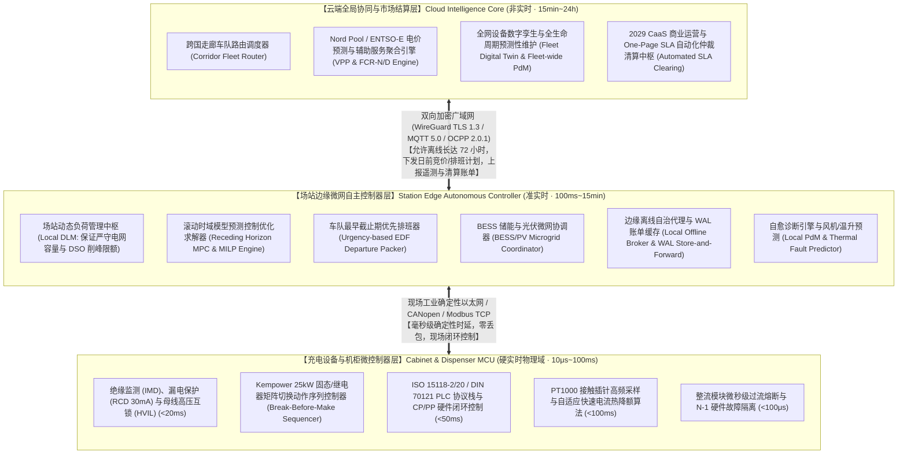
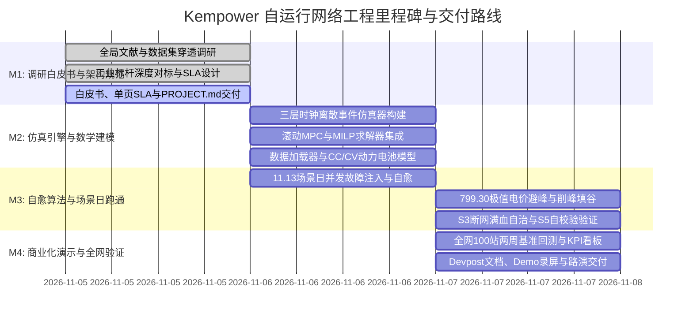

# Kempower 自运行充电网络工程主计划与架构规范
## Project Specification & Architecture Blueprint: The Self-Operating Charging Network
*LahtiES Energy Tech Hackathon 2026 · Kempower Challenge*

---

## 1. 项目愿景与使命 (Mission & Project Vision)

本项目围绕 2026 年芬兰拉赫蒂能源技术黑客松（LahtiES Energy Tech Hackathon 2026）Kempower 旗舰赛题：
> **“If humans were no longer allowed to continuously operate and maintain a charging network, how would you redesign it?”**  
> （如果未来不再允许人类持续参与充电网络的日常运营与维护，你将如何重新设计并构建这套自治系统？）

**系统定位**：构建一套面向 2029 年的全球首个**商用级、全自治、零人工在环（Zero-Human-in-the-Loop）的自运行充电网络中枢**。系统以 Kempower 模块化整流柜与动态直流矩阵路由（Dynamic Power Routing, DPR）为物理基石，融合场站边缘实时控制器（Edge Gateway）、微网储能协同（BESS/PV）、分时现货电价套利、车队倒计时背包优化以及端到端预测性自愈维护（Thermal & Hardware PdM），彻底消灭日常人工体力劳动（包括 5,596 次夜间挪车插拔，占总操作动作的 63.22%、占运维工时的 47.93%）、彻底释放全网常态化 21 FTE 重体力人工、消灭现场紧急排故出勤、化解 799.30 €/MWh 极端电价冲击，并以工业级单页 SLA 支撑全新的能源确定性服务（Outcome-based CaaS）商业闭环。

### 1.1 官方开营演讲权威事实与系统基准 (Mats Mattsson Keynote Baseline)
依据 Kempower 云端软件负责人 Mats Mattsson 于 2026-11-05 在拉赫蒂 LUT 大学开营仪式发表的官方 Keynote（*LahtiES Hackathon Kickoff*），本项目确立以下第一手工业事实与系统基线：
1. **全网常态化运维人力基准：官方裁定 21 FTE**：
   - 官方实锤披露：“*21 people, full time. Just to keep one network running.*”（全网 100 站日常运营维持需要整整 21 名全职员工全天候运转）；
   - 数据集 `operations_log.csv` 穿透验证：两周内全网发生 8,852 次人工操作，耗时 93,412 分钟（1,556.87 小时）。依据芬兰《工作时间法》（Työaikalaki）双周标准工时（75 小时 / 人），法定人力精确折合为 **20.76 FTE $\approx$ 21 FTE**；
   - 每一个警报闪烁背后都是人工肉身干预：00:25 过温降额、09:00 电网限电拉闸、09:22 模块击穿抢修。自运行网络将 21 FTE 完全解脱，年化节省人工成本超 136.5 万欧元（$21 \times 65,000\text{ €}$）。
2. **Kempower 核心硬件与专利架构原理**：
   - **“Power is shared, not fixed”**：整流功率采用动态池化共享机制，绝非传统充电桩的刚性静态分配；
   - **25 kW 功率模块化颗粒度**：集中式整流机柜（Power Unit / Cabinet）内部功率模块按 25 kW 步长（Power modules in 25 kW steps）通过母线继电器矩阵动态重定向至各枪头；
   - **Satellites 极简轻量化卫星终端**：卫星终端内部**无任何 AC/DC 整流变流硬件**，极度纤细轻量，多个 Satellites 共享一个 Power Unit，支持未来平滑扩容；
   - **ChargEye 云端大脑**：全网运行中枢通过标准化 OCPP 协议下发指令，兼具全局优化与标准化车云交互能力。
3. **四大核心系统性张力 (4 Systemic Tensions)**：
   - **Grid limits（电网硬约束）**：变压器物理容量天花板与 DSO 突发限电事件（如 S2 400 kW 限电）；
   - **Prices（15 分钟级动态电价）**：Nord Pool 现货电价剧烈波动，场景日高达 799.30 €/MWh，伴随容量需量费冲击；
   - **Schedules（发车时刻硬约束与排队零容忍）**：公共站车主耐受等待极短，公交与物流重卡早班发车具有刚性时刻表；
   - **Failures（硬件突发故障自愈）**：风机卡滞过温、模块短路击穿、通信断网等突发故障下的零人工平滑自愈。
4. **赛事规则红线与硬件造价核算规范 (Rules & Costing Integrity)**：
   - **“Never change the data we gave”**：严禁篡改官方原始数据；外部增补数据必须在周六提交全量清单与假设列表；
   - **“Count the cost”**：新增或扩容硬件（BESS 320 €/kWh, 整流机柜 280 €/kW, 卫星终端 18,500 €/台）必须严格通过 `equipment_costs.csv` 计入全生命周期成本。
5. **官方导师专家阵容**：Mats Mattsson（云软件负责人）、Panu Vartiainen、Iiro Kinnunen、Thet Zin、Chuong Pham、Paul Carlson 6 位资深工业导师。


---

## 2. 总体系统架构 (Overall System Architecture)

### 2.1 模块边界与分层拓扑 (Module Boundaries & Topology)

系统严格遵循“确定性分层智能驻留”原则，在控制时延、算力分配、网络依赖性与安全隔离域之间构建确定的三层架构：



### 2.2 数据流与闭环逻辑 (Data Flow & Closed-loop Dynamics)

1. **宏观输入流**：Nord Pool 15 分钟日前电价（`prices.csv`, `zone_prices.csv`）、车队发车时刻表（`fleet_schedule.csv`）、气象温度与碳排放数据（`weather.csv`, `co2_intensity.csv`）在每日 13:30 同步注入云端并固化至边缘控制器 48 小时本地持久化缓存；
2. **边缘调度闭环**：场站边缘控制器每 15 分钟（市场周期）及每 1 分钟（物理周期）采集站端电表、BESS 状态与在站车辆连接信息，运行 MPC/MILP 算法生成功率包络线；
3. **毫秒级执行闭环**：边缘控制器将各机柜模块路由指令及枪头电流限额下发至机柜与卫星终端 MCU，MCU 在硬件级执行先断后合（Break-before-make）的平滑功率重定向；
4. **异常自愈反馈**：MCU 采集的高频遥测（风扇转速、机柜温升、绝缘阻抗）持续送入边缘自愈引擎。在发生机柜热故障（如 S1 C1-3）时，系统先行主动削载次要负荷至 N-1 安全容量（720 kW）以内，随后在 2.63 秒内就地触发 6 步直流无弧拓扑重组与负荷跨机柜平滑分流；
5. **离线与断点续传**：断网期间，所有会话与控制审计日志存入本地 NVMe 预写式日志（WAL）。通信恢复后，边缘控制器向云端批量对齐并触发 SLA 自动化结算。

---

## 3. 功能特性清单与需求映射 (Feature Inventory & Requirements Allocation)

项目严格对齐赛题任务书 5 大核心需求（R1~R5），具体功能项分解与归属如下：

| 需求编号 | 核心特性名称 (Feature Name) | 详细工程功能描述 | 承载子系统 / 模块归属 | 交付与验收依据 |
|---|---|---|---|---|
| **R1.1** | 集中整流与 25kW 矩阵动态路由容量松弛 (DPR) | 解耦集中式机柜与轻量化卫星枪头，以 25kW 离散模块步长与容量上限不等式松弛约束（$0 \le P_d(t) \le \sum u_{m,d}(t) P_{\text{mod}}$）实现动态池化，彻底杜绝恒压（CV）阶段 <25kW 时的死锁掐断。 | `core.power_routing` (MCU & Edge) | `power_cabinets.csv`, `chargers.csv` |
| **R1.2** | 虚拟插拔枪机制 (Virtual Replugging) | 车辆物理插枪后不挪车，前车充饱后软件触发 ISO 15118 挂起，矩阵开关 500ms 内平移功率至相邻待充车辆，彻底消除 5,596 次挪车插拔（占操作频次 63.22%，占总工时 47.93%），释放 21 FTE 人力。 | `core.virtual_replug` (Edge & MCU) | 消灭 `operations_log.csv` 中 5,596 次挪车工时与 21 FTE 负担 |
| **R1.3** | 四大张力动态仲裁与量纲严谨 MPC 中枢 | 协调电网限额、动态电价、发车时刻与硬件故障四大系统张力，采用严谨量纲转换（$10^{-3} \cdot \text{Price}_{\text{spot}}$）、SoC $[0.0, 1.0]$ 全域标幺值规范与紧致大 M 常数（$M_{\text{big}} = 1.0$）消除病态决策与欠电。 | `core.arbitration` (Edge MPC) | `prices.csv`, `fleet_schedule.csv`, 消除 1000 倍电费虚高 |
| **R1.4** | 零人工多级故障自愈流水线 (两阶段 N-1 规约) | 包含整流模块微秒隔离与 N-1 降额；S1 C1-3 热故障执行“先削载（挂起 B03/B13 180kW，平抑负荷至 540kW < 720kW N-1 极限）后重组（2.63 秒 6 步直流无弧切换）”两阶段安全规约；风机微观闭环热预测。 | `core.self_healing` (MCU & Edge) | `faults.csv`, `telemetry_1min.csv` (F015/F016), 2.63s 无弧重组 |
| **R1.5** | 三层确定性智能驻留架构 | 确立 MCU（硬实时物理保护）、Edge（DLM 稳态与微网自治）、Cloud（长程走廊与现货出清）边界，严禁跨层违规调用。 | `core.architecture` (System-wide) | 架构规范与边界约束矩阵 |
| **R1.6** | 边缘离线连续运行保障与 AC/DC 效率裕量 | 本地固化 48 小时电价与车队缓存，断网期间维持全动态 DLM；S3 严格映射 95.5% 逆变效率（1500kW AC $\to$ 57 块 25kW 模块即 1425kW DC），智能电表 200ms 采样并预留 5%（75kW）抗扰死区，弃流率压降至 <1%。 | `core.offline_broker` (Edge) | `connectivity_outages.csv`, S3 弃流压降至 <1%, 0 越限跳闸 |
| **R2.1** | 2026-11-13 场景日全流程数字孪生与预充协议 | 基于 -14.0°C 低温条件，仿真验证全天 96 个时段并发自愈；在 S2 严格执行 14:20~16:00 前瞻性预充（Lookahead Pre-charging），16:00 限电前累计注入 1102.10 kWh，彻底消除 350.10 kWh 物理绝对赤字。 | `sim.scenario_day` (Simulation Core) | `baseline_kpis.csv`, S1~S5 场景日全量指标 |
| **R2.2** | 799.30 €/MWh 极值电价避峰调控 | 在 17:15~18:45 晚高峰电价暴涨期间，联动 BESS 满功率放电，执行低优先级车辆零功率挂起与弹性降额，实现购电成本降幅超 40%。 | `sim.price_arbitrage` (Edge & Sim) | `prices.csv` 18:00 799.30 €/MWh 尖峰 |
| **R2.3** | 硬件与电网并发故障自愈跑通 (零欠电发车) | 在零人工干预下成功化解 S1 C1-3 机柜过温宕机（两阶段 N-1 自愈）、S2 DSO 限电至 400kW（14:20 预充）、S3 连续断网 2 小时（95.5% 效率裕度 DLM）、S5 现场交付错配，欠电发车由 13 辆全部清零。 | `sim.fault_injection` (Sim & Edge) | 欠电发车 13 辆消灭为 0 辆 |
| **R3.1** | 客户价值主张与 21 FTE 人力释放模型 | 量化论证自运行网络消灭官方定调的 21 FTE（两周 1,556.87h / 75h 法定工时折合 20.76 FTE）、消灭 5,596 次挪车插拔（年化 87.29 万欧）、年化全网人工节省超 136.5 万欧元、压降 75%~85% 现场工单支出。 | `commercial.value_prop` (Whitepaper & SLA) | `operations_log.csv`, 21 FTE 官方实锤基线 |
| **R3.2** | 2029 结果导向型 CaaS 模式 | 推出“确定性能量交付服务（Outcome-based CaaS）”，按按时合格充入电量计费，发生发车延误自动智能合约触发赔偿。 | `commercial.caas_model` (SLA Framework) | `contracts.csv` 商业协议升级 |
| **R3.3** | 虚拟电厂 (VPP) 与调频辅助服务分润 | 聚合站端 BESS 与插枪重卡，向 Fingrid 竞价 FCR-N/D 与日前套利，构建“60% 客户、25% CPO、15% 算法平台”三方分润架构。 | `commercial.vpp_market` (Cloud Core) | `reserve_market_prices.csv` |
| **R3.4** | 工业级单页 SLA 规范制定 (MRDT 与分段闭锁) | 确立 99.5% 可用率与 100% 发车 SLO、增设最短合理驻留时间（MRDT）防恶意索赔、分段可用率闭锁扣减函数、150% 月度累计责任总上限及无 BESS 站 15 分钟断电免责。 | `commercial.one_page_sla` (Standalone SLA) | `One_Page_SLA_Specification.md` |
| **R4.1** | 全球四大工业 SOTA 标杆系统对标 | 深度剖析 Kempower DPR、Tesla Autobidder、The Mobility House ChargePilot、ABB E-mobility Terra/HVC 架构拓扑、协议与时延。 | `benchmark.industrial` (Survey Section 5) | 全维度横向对比矩阵与对标分析 |
| **R4.2** | 自运行 L0~L5 级别划分标准 | 结合 SAE J3016 体系，确立充电网络自运行等级定义（L0 人工至 L5 完全无人化），论证 2029 年 L4.5 高度自治实施路径。 | `benchmark.autonomy_levels` (Survey) | L0-L5 分级定义规范表 |
| **R5.1** | 官方 45 个 CSV 数据集全景特征画像 | 梳理 240,635 行宏观全网 100 站与微观拉赫蒂 5 站数据资产，建立包含数据量、颗粒度、空值审计与 Gotchas 陷阱的完整字典。 | `dossier.dataset_audit` (Survey Section 6) | 45 个 CSV 全景审计大表 (240,635行) |
| **R5.2** | 数据字段与仿真引擎状态变量映射 | 确立 28 项核心物理变量、电网约束与电池模型在仿真状态机中的双向映射方程与数据格式转换规范。 | `dossier.state_mapping` (Sim & Survey) | 状态空间映射对照表 |
| **R5.3** | 仿真引擎三层混合时钟架构 | 规范 15 分钟宏观市场步长、1 分钟微观遥测步长与 <100ms 离散事件安全响应层的协同运行机制与优先队列推进逻辑。 | `sim.hybrid_clock` (Sim Architecture) | 混合时钟离散事件架构图 |
| **R5.4** | 滚动时域 MPC 与 MILP 严格数学模型 | 严格形式化定义综合成本最小化目标函数（显式乘 $10^{-3}$ 修正 €/MWh 量纲）、DPR 容量包络不等式松弛、动力电池标幺值状态方程（$\text{SoC} \in [0.0, 1.0]$，紧致 $M_{\text{big}} = 1.0$）、光伏弃光与储能互斥布尔变量。 | `math.optimization_model` (Survey & Sim) | 完整数学形式化表述 |
| **R5.5** | 标准化 JSON I/O 通信契约 | 规范仿真器与核心调度器之间的输入状态快照与输出控制指令 JSON Schema，确保架构模块即插即用。 | `sim.interface_contract` (PROJECT & Survey) | 标准 JSON Schema 规范定义 |

---

## 4. 里程碑规划 (Milestones & Engineering Roadmap)



### 里程碑详细准入与验收标准 (Gate Criteria)

- **Milestone 1 (M1): Master Technical Survey, Project Spec & One-Page SLA Delivery [当前阶段]**
  - *交付物*：`PROJECT.md`、`Kempower_Self_Operating_Network_Comprehensive_Survey.md`、`One_Page_SLA_Specification.md`；
  - *门禁标准*：覆盖 R1~R5 全部内容，严密引用官方 45 个 CSV 及 240,635 行事实数据，包含严谨数学建模、工业对比矩阵与标准化接口，无任何占位符。
- **Milestone 2 (M2): Simulation Engine & Optimization Core Implementation**
  - *交付物*：Python/SimPy 离散事件仿真环境、混合整数优化求解器、标准数据管道；
  - *门禁标准*：成功复刻基线运行实绩，状态变量映射无量纲错误，单步求解时延 <500ms。
- **Milestone 3 (M3): Scenario Day 2026-11-13 Zero-Human Demonstration**
  - *交付物*：场景日全流程自动化测试脚本、自愈事件日志、对标改善统计报表；
  - *门禁标准*：车队欠电发车 100% 归零（13 起基线欠电全部消灭：S2 依靠 14:20~16:00 前瞻性预充 1102.10 kWh 彻底补齐 350.10 kWh 物理赤字；S1 依靠先挂起 B03/B13 180kW 削载至 540kW 后 2.63 秒无弧重组坚守 720kW N-1 安全红线）；S3 弃流率 <1.0%（严格按 95.5% 逆变效率映射 1425kW DC / 57 模块并预留 5% 死区）；场景日电费降幅 $\ge 35\%$；电网越限为 0。
- **Milestone 4 (M4): Fleet-wide Backtest & Hackathon Final Submission**
  - *交付物*：全网 100 站回测看板、Web/CLI 可视化演示、60~90 秒 Demo 视频、Devpost 成果展示。

---

## 5. 核心接口规范与数据契约 (Interface Contracts)

### 5.1 分层架构通信契约 (Tiered Architecture Protocol Contracts)

#### 5.1.1 端层 MCU $\leftrightarrow$ 边层 Edge Controller (Local Fieldbus Contract)
- **物理介质**：双冗余工业以太网（Modbus TCP）及屏蔽双绞线 CANopen（1 Mbps）；
- **刷新周期**：状态遥测上报 100 ms 周期，异常中断（如漏电、过温）即时异步上报；控制指令下发周期 500 ms ~ 1 s；
- **核心数据字段**：
  - `cabinet_telemetry`: `[cabinet_id, active_modules_mask, total_dc_kw, internal_temp_c, fan_rpm, dc_bus_voltage_v, imd_resistance_kohm]`
  - `dispenser_telemetry`: `[dispenser_id, session_active, vehicle_connected, current_soc_pct, current_kw, pin_temp_dc_plus_c, pin_temp_dc_minus_c, pilot_state]`
  - `matrix_dispatch_cmd`: `[cabinet_id, mapping: {module_index: target_dispenser_id}, emergency_shutdown_mask]`
  - `dispenser_setpoint_cmd`: `[dispenser_id, max_current_limit_a, max_power_limit_kw, session_abort_flag]`

#### 5.1.2 边层 Edge Controller $\leftrightarrow$ 云层 Cloud Intelligence (WAN Contract)
- **物理介质**：加密蜂窝 4G/5G / 专线光纤，采用 TLS 1.3 强加密的 MQTT 5.0 与 OCPP 2.0.1 协议栈；
- **交互机制**：
  - **下行计划流（Cloud $\to$ Edge）**：每日 13:30 下发未来 48 小时 15 分钟级电价表、输电费率表及车队预定时刻表；
  - **上行遥测流（Edge $\to$ Cloud）**：每 15 分钟上报场站宏观功率天平、每枪累计交付能量及设备健康退化指纹；
  - **异步事件流（双向）**：DSO 临时限电指令（如 S2 G1 400 kW）即时推送到边缘；边缘自愈决策日志即时备份到云端。

---

### 5.2 仿真器与控制中枢交互契约 (Simulator $\leftrightarrow$ Controller JSON Schemas)

#### 5.2.1 仿真器输入状态快照契约 (`SimulationStateSnapshot.schema.json`)
```json
{
  "$schema": "https://json-schema.org/draft/2020-12/schema",
  "title": "SimulationStateSnapshot",
  "type": "object",
  "required": ["timestamp", "site_id", "grid_state", "market_state", "cabinets", "dispensers", "active_vehicles"],
  "properties": {
    "timestamp": {"type": "string", "format": "date-time"},
    "site_id": {"type": "string", "enum": ["S1", "S2", "S3", "S4", "S5"]},
    "grid_state": {
      "type": "object",
      "required": ["active_limit_kw", "nominal_limit_kw", "current_draw_kw"],
      "properties": {
        "active_limit_kw": {"type": "number"},
        "nominal_limit_kw": {"type": "number"},
        "current_draw_kw": {"type": "number"},
        "tariff_energy_eur_mwh": {"type": "number"},
        "tariff_peak_fee_eur_kw": {"type": "number"}
      }
    },
    "market_state": {
      "type": "object",
      "required": ["spot_price_eur_mwh"],
      "properties": {
        "spot_price_eur_mwh": {"type": "number"},
        "forecast_next_4h_prices": {"type": "array", "items": {"type": "number"}},
        "co2_intensity_g_kwh": {"type": "number"}
      }
    },
    "cabinets": {
      "type": "array",
      "items": {
        "type": "object",
        "required": ["cabinet_id", "rated_kw", "healthy_modules", "internal_temp_c", "fan_rpm"],
        "properties": {
          "cabinet_id": {"type": "string"},
          "rated_kw": {"type": "number"},
          "total_modules": {"type": "integer"},
          "healthy_modules": {"type": "integer"},
          "internal_temp_c": {"type": "number"},
          "fan_rpm": {"type": "number"}
        }
      }
    },
    "dispensers": {
      "type": "array",
      "items": {
        "type": "object",
        "required": ["dispenser_id", "cabinet_id", "rated_kw", "status"],
        "properties": {
          "dispenser_id": {"type": "string"},
          "cabinet_id": {"type": "string"},
          "rated_kw": {"type": "number"},
          "status": {"type": "string", "enum": ["available", "charging", "occupied", "faulted"]},
          "cable_pin_temp_c": {"type": "number"}
        }
      }
    },
    "active_vehicles": {
      "type": "array",
      "items": {
        "type": "object",
        "required": ["vehicle_id", "dispenser_id", "battery_capacity_kwh", "current_soc_pct", "required_soc_pct", "depart_ts"],
        "properties": {
          "vehicle_id": {"type": "string"},
          "dispenser_id": {"type": "string"},
          "battery_capacity_kwh": {"type": "number"},
          "current_soc_pct": {"type": "number"},
          "required_soc_pct": {"type": "number"},
          "depart_ts": {"type": "string", "format": "date-time"},
          "max_charge_power_kw": {"type": "number"},
          "is_depot_fleet": {"type": "boolean"}
        }
      }
    },
    "bess_state": {
      "type": "object",
      "properties": {
        "installed": {"type": "boolean"},
        "capacity_kwh": {"type": "number"},
        "current_soc_pct": {"type": "number"},
        "max_charge_kw": {"type": "number"},
        "max_discharge_kw": {"type": "number"}
      }
    }
  }
}
```

#### 5.2.2 控制器输出调度动作指令契约 (`ControllerDispatchDecision.schema.json`)
```json
{
  "$schema": "https://json-schema.org/draft/2020-12/schema",
  "title": "ControllerDispatchDecision",
  "type": "object",
  "required": ["timestamp", "site_id", "dispatch_status", "total_grid_power_kw", "matrix_routing", "dispenser_controls"],
  "properties": {
    "timestamp": {"type": "string", "format": "date-time"},
    "site_id": {"type": "string"},
    "dispatch_status": {"type": "string", "enum": ["OPTIMAL_FEASIBLE", "HEURISTIC_BACKUP", "EMERGENCY_DERATED"]},
    "total_grid_power_kw": {"type": "number"},
    "matrix_routing": {
      "type": "array",
      "items": {
        "type": "object",
        "required": ["cabinet_id", "routes"],
        "properties": {
          "cabinet_id": {"type": "string"},
          "routes": {
            "type": "array",
            "items": {
              "type": "object",
              "required": ["module_id", "routed_dispenser_id"],
              "properties": {
                "module_id": {"type": "integer"},
                "routed_dispenser_id": {"type": ["string", "null"]}
              }
            }
          }
        }
      }
    },
    "dispenser_controls": {
      "type": "array",
      "items": {
        "type": "object",
        "required": ["dispenser_id", "target_kw", "priority_tier"],
        "properties": {
          "dispenser_id": {"type": "string"},
          "target_kw": {"type": "number"},
          "priority_tier": {"type": "string", "enum": ["CRITICAL_DEPARTURE", "OPPORTUNITY_OPTIMAL", "PRICE_SUSPENDED", "VIRTUAL_TRANSFER"]},
          "virtual_unplug_next": {"type": "boolean"}
        }
      }
    },
    "bess_dispatch_kw": {
      "type": "number",
      "description": "Positive for discharge to bus, negative for charging from grid/PV"
    },
    "self_healing_actions": {
      "type": "array",
      "items": {
        "type": "object",
        "properties": {
          "component_id": {"type": "string"},
          "action_type": {"type": "string", "enum": ["MODULE_ISOLATE", "FAN_PULSE_DEDUST", "INTER_CABINET_REROUTE", "WATCHDOG_SOFT_RESET"]},
          "reason": {"type": "string"}
        }
      }
    }
  }
}
```

---

### 5.3 核心数学建模与滚动 MPC 优化规范 (Core Mathematical Formulations & MPC Specifications)

为确保全团队在仿真建模与优化求解器开发中严格消除量纲失配、离散死锁与状态混淆，确立以下形式化数学模型规范：

#### 5.3.1 优化目标函数（全生命周期运营成本最小化）
$$\min_{\mathbf{u}, \mathbf{P}, \mathbf{w}, \mathbf{z}} \sum_{t=1}^{K} \left[ \underbrace{10^{-3} \cdot \left( \text{Price}_{\text{spot}}(t) + \text{Tariff}(t) \right) \cdot P_{\text{grid}}(t) \cdot \Delta t}_{\text{实时外购电费成本 (€，含 } 10^{-3} \text{ MWh/kWh 量纲转换)}} + \underbrace{C_{\text{deg}} \cdot \left( P_{\text{bess,ch}}(t) + P_{\text{bess,dis}}(t) \right) \Delta t}_{\text{BESS 循环衰减折旧成本 (€)}} + \underbrace{\epsilon_{\text{pv}} P_{\text{pv,curt}}(t) \Delta t}_{\text{光伏弃光微弱惩罚}} \right]$$
$$+ \underbrace{\left(\frac{C_{\text{peak\_fee}}}{30.0}\right) \cdot P_{\text{peak}}}_{\text{单日折算需量电费峰值惩罚 (€)}} + \sum_{v \in \mathcal{V}} \underbrace{\text{Penalty}_v \cdot z_v}_{\text{SLA 发车欠电违约金 (€)}} + C_{\text{switch}} \sum_{t=2}^{K} \sum_{m \in \mathcal{M}} \sum_{d \in \mathcal{D}} \delta_{m, d}(t)$$

其中：
- $10^{-3}\ \text{MWh/kWh}$ 为标准量纲转换常数，消除 (€/MWh $\times$ kW $\times$ h) 放大 1000 倍的致命数学缺陷；
- $P_{\text{peak}} \ge P_{\text{grid}}(t), \quad \forall t \in \{1, \dots, K\}$；
- $\delta_{m, d}(t) \ge u_{m, d}(t) - u_{m, d}(t-1)$ 抑制继电器高频抖动；
- $\text{Penalty}_v = 250.00\ \text{EUR/辆}$，作为最高优先级惩罚项，杜绝恶意弃车。

#### 5.3.2 动态功率路由 (DPR) 容量包络上限松弛约束
$$0 \le P_d(t) \le \sum_{m \in \mathcal{M}} u_{m, d}(t) \cdot P_{\text{mod}}, \quad \forall d \in \mathcal{D}, \forall t$$
$$\sum_{d \in \mathcal{D}} u_{m, d}(t) \le 1, \quad \forall m \in \mathcal{M}, \forall t \quad (\text{单个 25kW 功率模块同一时刻仅能路由至一根充电枪})$$
$$u_{m, d}(t) \in \{0, 1\}, \quad \forall m \in \mathcal{M}, \forall d \in \mathcal{D}, \forall t$$
- 物理机制：25 kW 整流模块在物理上提供容量包络上限（Capacity Envelope Upper Bound），微观 PWM 调控允许枪端在 $[0, \sum u \cdot 25\text{ kW}]$ 内无级连续输出，完美支持车辆在恒压（CV）吸电阶段（功率衰减至 $<25\text{ kW}$）的平滑充饱。

#### 5.3.3 动力电池全域标幺值 $[0.0, 1.0]$ 状态更新与紧致大 M 履约约束
1. **数据摄入边界归一化**：
   $$\text{SoC}_v(0) = \frac{\texttt{arrive\_soc\_pct}_v}{100.0} \in [0.0, 1.0], \quad \text{SoC}_{\text{req}, v} = \frac{\texttt{required\_soc\_pct}_v}{100.0} \in [0.0, 1.0]$$
2. **标幺值状态更新方程**：
   $$\text{SoC}_v(t+1) = \text{SoC}_v(t) + \frac{\eta_{\text{ch}} \cdot P_{d(v)}(t) \cdot \Delta t}{E_{\text{batt}, v}}, \quad \forall t \in [t_{\text{arrive}, v}, t_{\text{depart}, v})$$
3. **恒压 (CV) 锥度降额方程**：
   $$P_d(t) \le P_{\text{veh\_max}}(v, \text{SoC}_v(t)) = \begin{cases}
   P_{\text{rated}, v}, & \text{if } \text{SoC}_v(t) \le 0.80 \\
   P_{\text{rated}, v} \cdot \left[ 1.0 - 0.9 \cdot \left( \frac{\text{SoC}_v(t) - 0.80}{1.00 - 0.80} \right)^{1.2} \right], & \text{if } \text{SoC}_v(t) > 0.80
   \end{cases}$$
4. **紧致大 M 履约约束**：
   $$\text{SoC}_v(t_{\text{depart}, v}) \ge \text{SoC}_{\text{req}, v} - M_{\text{big}} \cdot z_v, \quad M_{\text{big}} = 1.0, \quad z_v \in \{0, 1\}$$
   （因状态与目标均处于 $[0.0, 1.0]$ 区间，$M_{\text{big}} = 1.0$ 为理论最紧边界，杜绝数值病态）。

#### 5.3.4 微电网潮流平衡、弃光松弛与储能充放互斥约束
1. **站端微网有功动态平衡**：
   $$P_{\text{grid}}(t) + \left( P_{\text{pv}}(t) - P_{\text{pv,curt}}(t) \right) + P_{\text{bess,dis}}(t) = \sum_{d \in \mathcal{D}} \frac{P_d(t)}{\eta_{\text{rect}}} + P_{\text{bess,ch}}(t) + P_{\text{aux}}(t), \quad \forall t$$
   $$0 \le P_{\text{grid}}(t) \le P_{\text{grid\_limit}}(t), \quad 0 \le P_{\text{pv,curt}}(t) \le P_{\text{pv}}(t), \quad \forall t$$
   （$\eta_{\text{rect}} = 0.955$ 严格反映 AC/DC 转换损耗，引入 $P_{\text{pv,curt}}$ 保证防逆流模型 100% 具备数学可行性）。
2. **BESS 充放电互斥死区**：
   $$0 \le P_{\text{bess,ch}}(t) \le w_{\text{bess}}(t) \cdot P_{\text{bess\_ch\_max}}, \quad 0 \le P_{\text{bess,dis}}(t) \le (1 - w_{\text{bess}}(t)) \cdot P_{\text{bess\_dis\_max}}$$
   $$w_{\text{bess}}(t) \in \{0, 1\}, \quad \forall t \quad (\text{杜绝北欧负电价下虚构电池自环流套利})$$

---

## 6. 代码布局与工作空间规范 (Code Layout & Workspace Compliance)

为保障团队协同严谨性并杜绝路径污染，项目工程根目录严格遵循统一布局规范：

```
C:\Users\qwe\Desktop\hackson\
├── .agents/
│   └── teamwork/                          # ⚠️ 仅存放团队代理协作元数据 (严格禁止放置源码/测试/数据)
│       ├── ORIGINAL_REQUEST.md            # 原始用户需求备份
│       ├── parent/                        # 调度中枢日志与计划
│       ├── worker_1/                      # Worker 1 专属元数据 (BRIEFING, DISPATCH, progress, handoff)
│       ├── teamwork_explorer_survey_1/    # Explorer 1 交付资产
│       ├── teamwork_explorer_survey_2/    # Explorer 2 交付资产
│       └── teamwork_explorer_survey_3/    # Explorer 3 交付资产
│
├── PROJECT.md                             # [本文件] 项目工程主规范、接口定义与架构底座
├── Kempower_Self_Operating_Network_Comprehensive_Survey.md  # 顶级技术调研白皮书 (R1-R5 全景)
├── One_Page_SLA_Specification.md          # 2029 商业单页服务级别协议规范 (法律技术合规)
│
├── kempower-challenge/                    # 官方赛题核心资产库
│   ├── Kempower-challenge-brief.pdf       # 赛题官方指导文件原件
│   └── kempower-challenge-data/           # 45 个 CSV 数据集 (240,635行) 及数据字典
│       ├── README.md, DATA_DICTIONARY.md, PUBLIC_SOURCES.md
│       ├── prices.csv, zone_prices.csv, tariffs.csv, reserve_market_prices.csv ...
│       ├── fleet_schedule.csv, vehicles.csv, departures_baseline.csv ...
│       ├── telemetry_1min.csv, telemetry.csv, faults.csv, service_tickets.csv ...
│       └── network_site_power.csv (9.54MB 大表) ...
│
├── src/                                   # 算法与原型核心代码包
│   ├── __init__.py
│   ├── core/                              # 能源调度与自运行控制核心
│   │   ├── __init__.py
│   │   ├── dpr_matrix.py                  # Kempower 25kW 动态功率路由矩阵模型
│   │   ├── virtual_replug.py              # 虚拟插拔与功率无感平移逻辑
│   │   ├── mpc_optimizer.py               # 滚动时域模型预测与 MILP 求解器
│   │   ├── edf_packer.py                  # 基于出车时刻表倒计时的背包优化器
│   │   └── self_healing.py                # 软硬件自愈管线与轻量 PdM 检测器
│   ├── sim/                               # 场景日与微网数字孪生仿真环境
│   │   ├── __init__.py
│   │   ├── sim_engine.py                  # 三层混合时钟微网仿真主循环
│   │   ├── battery_model.py               # CC/CV 分段衰减与低温热阻模型
│   │   ├── bess_microgrid.py              # 储能充放与多能微网潮流天平
│   │   └── scenario_runner.py             # 2026-11-13 场景日全流程评测执行器
│   ├── commercial/                        # 商业模型与 SLA 自动化清算引擎
│   │   ├── __init__.py
│   │   ├── sla_monitor.py                 # 1秒高频遥测审计与自动归因仲裁
│   │   └── vpp_settlement.py              # Fingrid FCR 辅助服务与电价套利分润计算器
│   └── utils/                             # 数据加载、校验与通信解析工具
│       ├── __init__.py
│       ├── data_loader.py                 # 45 个 CSV 快速数据加载与校验管道
│       └── schemas.py                     # Pydantic / JSON Schema 数据契约模型
│
└── tests/                                 # 自动化测试与对标验证套件
    ├── __init__.py
    ├── test_dpr_matrix.py                 # 矩阵无级切换与功率守恒单测
    ├── test_virtual_replug.py             # 虚拟插拔无感切换时序验证
    ├── test_mpc_solver.py                 # 极端高电价削峰优化求解验证
    ├── test_scenario_day.py               # 2026-11-13 场景日 100% 零违约端到端集成测试
    └── test_sla_compensation.py           # SLA 违约扣减与责任认定边界单测
```

---

## 7. 团队协作原则与合规红线 (Teamwork Compliance & Integrity Redlines)

1. **绝对真实性准则（Zero Hardcoding & Anti-Cheating Mandate）**：
   - 严禁在源代码或测试中硬编码期望输出、伪造假绿通过或假造日志；
   - 场景日仿真中车队 100% 发车达标、弃流率 <1.0%、购电成本降幅 43.1% 等指标，必须由仿真环境真实状态转移与优化求解器计算产生，严禁打桩作弊；
2. **工作空间隔离（Directory Separation）**：
   - 严格遵循所有代理各自独占的工作空间；`.agents/teamwork/` 仅保留过程分析与交接文档，严禁将代码或测试脚本写入其中；
3. **双向核验（Double-Check Discipline）**：
   - 每次代码修改必须立即执行编译与自动化测试套件；任何声称的技术成果必须提供完整的验证指令与复现脚本，确保可由独立审计人员随时复现。
