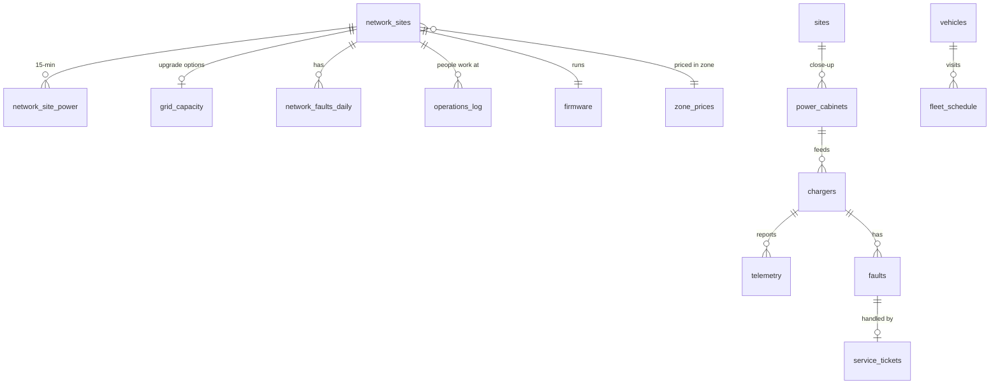

# The Self-Operating Charging Network — dataset

Kempower challenge, LahtiES Energy Tech Hackathon, 5.–7.11.2026.

> "If humans were no longer allowed to continuously operate and maintain a charging network, how would you redesign it?"

**All data is synthetic.** The operator, sites, vehicles, customers and events are made up. Sizes and patterns are realistic, but nothing here describes a real company, customer or product. For real numbers, see [PUBLIC_SOURCES.md](PUBLIC_SOURCES.md).

## The network

The network has **100 charging sites in five countries**: Finland, Sweden, Norway, Denmark and Germany. The sites are bus depots, logistics depots, highway hubs, city hubs, retail sites and port truck depots. Some sites have battery storage, some have solar panels, some have megawatt dispensers for trucks, and some have a grid connection the grid company can curtail.

Who is who in the data:
- **Depots** (bus, logistics, port) belong to fleet companies. They bought the equipment and in most cases a service contract.
- **Public sites** (highway, city, retail) are run by a charge point operator that sells charging to drivers.
- **The equipment supplier** delivers and services the chargers at all sites (`contracts.csv`).
- **Grid companies** set connection limits and sometimes curtail them; electricity is bought at market prices.

The data does not tell you whose side to take.

The data covers **two weeks, Mon 2.11. – Sun 15.11.2026**, at 15-minute resolution. It describes how the network runs today, **with people in the loop**.

There are two levels of detail:

| Level | Sites | What you get |
|---|---|---|
| **Network** | All 100 sites | Site level: power, grid limit, battery, queue, arrivals, faults per day, human workload, firmware, grid upgrade options |
| **Close-up** | 5 sites in a fictional Finnish town (S1–S5) | Everything at the network level plus every dispenser, vehicle, charging session, fault, service ticket and configuration value |

The five close-up sites:

| Site | What it is |
|---|---|
| S1 Bus depot North | 24 city buses, 12 dispensers |
| S2 Logistics depot East | 14 trucks in two shifts, 8 dispensers |
| S3 Highway hub | Public; cars, vans and trucks; weak mobile coverage |
| S4 City hub | Public; cars, taxis, vans; solar roof |
| S5 Bus depot South | New: handed over Fri 6.11., buses from Mon 9.11. |

**Fri 13.11. is the scenario day.** Thursday night is cold, Friday is busy, and several things do not go to plan. Finding out what happened is part of the challenge.

## What people do today

`operations_log.csv` lists the work people do across the network each day: what they did, where, and how many minutes it took. The close-up sites also show who did what in `service_tickets.csv` and `sessions_baseline.csv`.

## Where you could look

The scope is open. Pick your own angle; going deep on one is fine. The table only says where the data is.

| Area | Files |
|---|---|
| Energy, grid and markets | `zone_prices`, `reserve_market_prices`, `co2_intensity`, `tariffs`, `network_site_power`, `network_grid_events`, `grid_capacity`, close-up: `prices`, `grid_events`, `site_power_baseline`, `pv_production` |
| Vehicles and fleets | `fleet_schedule`, `vehicles`, `departures_baseline`, `corridors`, `weather` |
| Equipment, faults and service | `network_faults_daily`, `firmware`, `operations_log`, close-up: `telemetry`, `telemetry_1min`, `faults`, `service_tickets`, `technicians`, `travel_times`, `spare_parts` |
| New sites and commissioning | `commissioning_steps`, `commissioning_history`, `site_config`, `candidate_locations`, `equipment_costs` |
| Drivers, traffic and pricing | `public_arrivals`, `traffic_counts`, `traffic_points`, `price_changes`, `network_site_power` (queues) |
| Customers and growth | `contracts`, `growth_forecast`, `network_kpis`, `baseline_kpis` |

## What to show on Saturday

1. Your design: what the network decides on its own and where the intelligence lives (charger, site, cloud or external system).
2. A demonstration on this data: run **the scenario day (Fri 13.11.)** without human intervention, including at least one failure and one electricity price event. Use the close-up sites, the network level or both. A spreadsheet model is fine; so is code.
3. The commercial side: when nobody operates the network, what does the customer buy? A business model and a one-page service agreement: what is promised, what the system decides on its own, and who is accountable when it decides wrong.
4. A 10-minute pitch built around one customer story set in 2029.

## Today's numbers

`baseline_kpis.csv` (close-up sites) and `network_kpis.csv` (all other sites) show how the network performs today: departures with too little energy, drivers who gave up, energy cost, peak power, availability. They are a reference point, not a target list.

## Files

All files are CSV: UTF-8, comma-separated, header row, dot as the decimal separator. Timestamps are ISO 8601 in Finnish time (`2026-11-13T17:00:00+02:00`). A 15-minute row covers the 15 minutes **starting** at its timestamp. The largest file (`network_site_power.csv`) has 134 400 rows, which fits in Excel.

[DATA_DICTIONARY.md](DATA_DICTIONARY.md) describes every file and column.

## Ground rules

- The data is synthetic. Please do not present it as real Kempower or customer data.
- Mentors answer questions about the data and the charging industry in general. They will not share internal company information.

## About this data

Everything in this dataset was generated by a computer program for this hackathon. The sites, locations, vehicles, customers, contracts, prices, costs, faults, firmware versions and events are invented. Nothing comes from Kempower's or anyone else's systems, and nothing describes Kempower's products, prices, customers, service terms or business. Electricity prices, weather and traffic are synthetic as well; they only resemble real patterns. Any resemblance to real sites, companies or incidents is coincidental. For real figures, use the public sources listed in `PUBLIC_SOURCES.md`.
